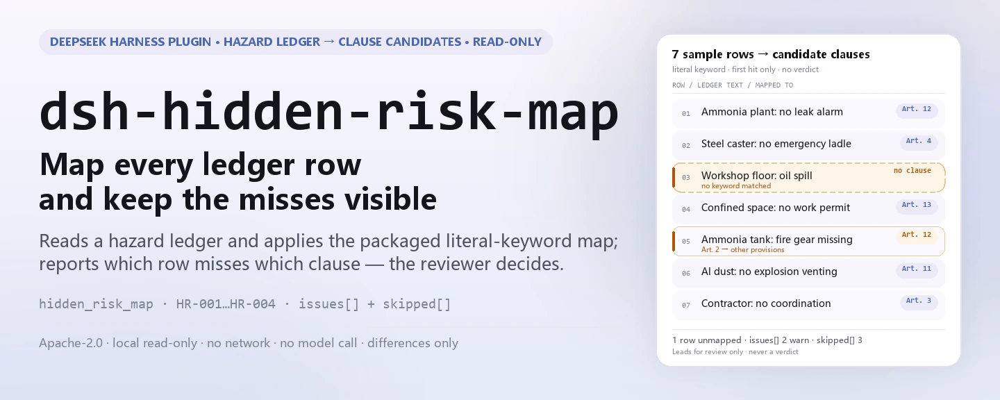

<div align="center">

<picture>
  <source media="(prefers-color-scheme: dark)" srcset="docs/assets/dsh-hidden-risk-map-hero-en-dark.webp">
  
</picture>

# dsh-hidden-risk-map

**Map every row of a safety hazard ledger onto candidate clauses of the major-accident-hazard determination standard — see which row is missing which clause, and why; the verdict stays with the reviewer.**

A data checker for DeepSeek Harness: it reads one safety hazard ledger (one row per recorded hazard, with the columns the ledger actually carries), runs the packaged versioned rule pack (HR-001..HR-004) over literal keyword matching, and reports only the gaps it can point to row by row — no compliance verdict, no liability finding.

[Install](#three-step-setup) · [Configuration](#configuration) · [FAQ](#faq) · [简体中文](README.md) · [English](README.en.md) · [Español](README.es.md) · [Português](README.pt.md) · [हिन्दी](README.hi.md)

[](LICENSE)
[](#compatibility)
[](https://www.npmjs.com/package/dsh-hidden-risk-map)
[](https://github.com/PerryLink/dsh-hidden-risk-map/actions/workflows/ci.yml)
[](#compatibility)

[](https://github.com/PerryLink/dsh-hidden-risk-map/stargazers)
[](https://www.npmjs.com/package/dsh-hidden-risk-map)
[](https://dshfind.com/plugins/PerryLink/dsh-hidden-risk-map?ref=badge)
[](https://securityscorecards.dev/viewer/?uri=github.com/PerryLink/dsh-hidden-risk-map)
[](https://dsh.market/)
[](https://gitee.com/perrylink/dsh-hidden-risk-map)

```sh
dsh plugin --profile <name> add dsh-hidden-risk-map
```

</div>

<sub>Community plugin, not affiliated with DeepSeek. Canonical repository: <https://github.com/PerryLink/dsh-hidden-risk-map> (Gitee is a mirror).</sub>

## What it is

`dsh-hidden-risk-map` reads one safety hazard ledger — one row per recorded hazard, with the columns that ledger actually carries — and maps each row onto candidate clauses of the major-accident-hazard determination standard by literal keyword matching over the text of fields such as the hazard-description column, reporting that ledger's own gaps rather than any judgement: the rows that matched no clause at all, the matched rows whose clause belongs to another industry or touches hazardous chemicals, fire, gas or special equipment that article 2 hands to other provisions, the matched rows missing the remediation-closure fields the institution configured, and the clauses hit by more rows than the configured ceiling. Every finding names the article it came from; the output is leads for review, the ledger's keyword table is an editorial aid rather than standard text, and a check that could not run states its reason in `skipped` instead of passing in silence.

- **Who it is for**: safety administrators and hazard-inspection roles; no command line required — hand it the material in chat.
- **What you give it**: the source material the check works on (a table, register or document); the original is never modified. Excel can be converted to JSON/YAML first, in chat if the platform supports it.
- **What it delivers**: a list of leads — which row, which article, why; checks that could not run are listed in `skipped` with the reason.
- **What it does not do**: no compliance verdict, no liability finding, no replacement for the reviewer; it does not decide whether an item is a major accident hazard — that needs a site visit and professional judgement.

<picture>
  <source media="(prefers-color-scheme: dark)" srcset="docs/assets/dsh-hidden-risk-map-flow-v5-dark.svg">
  
</picture>

## Three-step setup

1. **Install** (pick one channel):

   ```sh
   # git channel (latest main; equivalent to git+https://github.com/PerryLink/dsh-hidden-risk-map.git)
   dsh plugin --profile <name> add github:PerryLink/dsh-hidden-risk-map
   # npm channel (published releases)
   dsh plugin --profile <name> add dsh-hidden-risk-map
   # tarball channel: pnpm pack in this repo, then
   dsh plugin --profile <name> add ./dsh-hidden-risk-map-<version>.tgz
   ```

2. **Minimal config** (defaults are usable; a bundle row without `config` takes them all, and the rule-pack path points at the packaged `rules/hidden-risk-map.yaml`):

   ```yaml
   - insert:
       - id: dsh-hidden-risk-map
         name: dsh-hidden-risk-map
   ```

3. **Verify it mounts** (the sample run needs `pnpm run build` first, to produce `lib/`):

   ```sh
   dsh --profile <name> --dump-config | grep 'dsh-hidden-risk-map'
   node samples/quickstart/run.mjs --json
   # => {"tool":"hidden_risk_map","issueCount":1,"summary":{"error":0,"warn":1,"info":0},"skippedCount":3}
   ```

**Uninstall**: `dsh plugin --profile <name> remove dsh-hidden-risk-map` (or remove the row from the profile patch).

<details>
<summary>Use it from WorkBuddy / Coze</summary>

Search for "Safety Compliance Suite" in WorkBuddy / Coze (this check is one part of it; availability as listed) to call the same checking capability without a command line.

</details>

## Core capabilities

`dsh-hidden-risk-map` registers the `hidden_risk_map` tool: it reads a safety hazard ledger, applies a versioned rule pack, and returns a report whose every finding names the article it came from and whose every check that could not run names its reason.

- **Four rules in one pack.** The rule pack is data, not code (`rules/hidden-risk-map.yaml`); replacing it switches the whole rule set without touching a line of TypeScript.
- **Read-only on the material.** JSON or YAML in, the original never modified; pure ESM, no network request, no model call.
- **Unmapped rows are listed one by one.** `HR-001`'s headline number is "N rows are unmapped", not "0 hazards"; a row that matches no clause is listed explicitly instead of silently vanishing.
- **Article 2 hands hazards to other regimes.** Hazardous chemicals, fire, gas and special equipment are governed by other provisions; a row touching them is reported as "check the corresponding regulation instead", not mapped.
- **No fabricated citations.** Every rule carries `document` / `number` / `clause` / `excerpt` / `kind` / `source`; `excerpt` must be a verbatim quotation, and a rule whose text could not be obtained says so in `excerpt` and is marked `derived-from-principle`.
- **Severity follows the evidence.** `derived-from-principle` is capped at `warn`; institution-configured checks (`institutional-configuration`) are capped at `info`; a test asserts this.
- **An empty list is not a pass.** Every check that could not run goes into `skipped` with its reason; a rule whose required list is unset reports itself in `skipped` rather than passing silently.
- **No adjudicating wording.** The report lists differences only — never compliance, liability or correctness; a wording guard enforces this and every report carries the disclaimer.

| Rule | Check | Severity | Basis kind |
|---|---|---|---|
| `HR-001` | Every row maps to a clause, or is listed as unmapped | warn | principle |
| `HR-002` | The matched clause belongs to this deployment's industry, or defers to another regime | warn | direct |
| `HR-003` | Matched rows carry the configured remediation-closure fields (off by default) | warn | principle |
| `HR-004` | A clause hit by many rows is flagged for review (off by default) | info | principle |

### Examples

These are the plugin's real entry points; install once, then call one. The detailed walkthrough below is the plugin's **real output** on its own `HR-001` fixture, not an illustration; the table that follows covers the shorter cases.

**Detailed example** — tool `hidden_risk_map`, input:

```json
{"entries":[{"row":1,"隐患描述":"车间地面有一处油污未及时清理"}]}
```

Output:

```json
{
  "id": "dsh-hidden-risk-map.HR-001.e26f24c6",
  "ruleId": "HR-001",
  "severity": "warn",
  "locator": {
    "column": "隐患描述",
    "row": 1
  },
  "found": "台账条目「车间地面有一处油污未及时清理」未能匹配到判定标准的任何条款关键词",
  "expected": "台账条目应能对应到判定标准的具体条款，或确认不属于该标准的适用范围",
  "fix": "人工核对：可能属于其他行业条款、属于危化品/消防/燃气/特种设备等另有规定的情形，或表述与条款用词差异较大（可在 keywords 中补充本企业习惯用词）"
}
```

*Observed from `tests/fixtures/HR-001/HR-001-unsafe.json (cases.json expects HR-001 count 1); run via lib/index.mjs rules/hidden-risk-map.yaml`*

| You ask | What it answers |
|---|---|
| The ledger was run and no clause was flagged — does that mean no major accident hazard? | No. The tool's headline count is the rows it could not map, not a zero-hazard verdict. `HR-001` lists every row whose text matched no clause keyword: a different industry's clause, a hazard type governed by other provisions, or wording the keyword table does not carry yet. It reports only that no clause could be located, and it does not decide whether that row is or is not a major accident hazard. |
| An export carries a serial number and a date, but no hazard-description column. | The reader refuses the material instead of guessing; it never promotes the longest field to be the hazard text. With none of the nine known description columns present (listed below), it names the columns it did see (or reports that there were none) and states that no usable hazard-description text exists, so the check does not run and nothing — not even `HR-001`'s unmapped list — is read as a pass. |
| A row says a liquid-ammonia refrigeration room has no ammonia-leak monitoring alarm — why is it not mapped? | `HR-001` matches keywords literally, because whether a sentence is about ammonia leakage is the reviewer's call and not a fuzzy text judgement. A row about liquid ammonia is mapped only when your keyword table carries that wording; the shipped pack carries it under article 12 (industry: liquid-ammonia refrigeration). The keyword lists are an editorial aid written for this plugin, not standard text, so add your site's own vocabulary to `keywords` when the wording differs. |
| A row mentions fire safety or special equipment, and the standard is quoted at me as its basis. | That is `HR-002` working, and it does not classify the row. Article 2 hands hazardous chemicals, fire, gas and special equipment to other provisions, so the rule quotes that sentence and reports the row as "check the corresponding regulation" instead of mapping it. Only when this deployment's `industry` is configured does it also flag a matched clause that belongs to another industry; if `industry` is empty, it says in `skipped` that the industry check did not run rather than passing quietly. |
| The ledger rows carry none of the remediation-closure columns the institution requires. | That is `HR-003` only after those names are configured: `requiredFields` empty means the check does not run and the rule reports itself in `skipped`. Once configured, a matched row missing one of those columns is reported. The rule checks that the columns exist — it does not judge whether the remediation is adequate or whether the item has been closed out. |
| Many rows of the ledger hit article 3, including a few that look like the same defect written twice. | `HR-004` groups the matches by article and reports when one article is hit by more rows than `maxHitsPerClause` allows, listing the row numbers. It is an `info`-level lead for human review: deciding whether that is a duplicate entry or a systematic defect stays with the reviewer. An unset `maxHitsPerClause` (0) means the rule does not run, and it says so in `skipped`. |

Known description columns, in reading order:

```text
隐患描述 · 隐患内容 · 问题描述 · 检查内容 · 描述 · text · description · content · hazard
```

## Standards it follows

| Document | Number | Cited by rules |
|---|---|---|
| Determination Standard for Major Accident Hazards of Industrial and Trade Enterprises (canonical Chinese title recorded in `rules/evidence/`) | Ministry of Emergency Management Order No. 10 | HR-001, HR-002, HR-003, HR-004 |

**Boundary:** this plugin maps each row of a **safety hazard ledger** onto candidate clauses of the major-accident-hazard determination standard, and reports which rows could not be mapped at all. It is not `dsh-emergency-plan` (which checks a plan's element completeness) and not a site inspection tool. It reads a ledger and produces **leads for review** — never a determination that something is or is not a major accident hazard, which needs a site visit and professional judgement.

> ### ⚠️ The most useful thing this plugin does is admit what it could not map
>
> The failure mode of a keyword-based mapper is silent: a row that matches nothing simply vanishes, and a reader concludes "no major hazards found". So `HR-001` inverts that: **every row that matched no clause is listed explicitly**, with the reason it might have been missed — a different industry's clause, a hazard type governed by other rules, or simply wording the keyword table does not carry yet. The plugin's headline number is therefore "N rows are unmapped", not "0 hazards".
>
> **The standard was replaced, and its article numbers moved with it.** The determination standard in force is **Ministry of Emergency Management Order No. 10, the Determination Standard for Major Accident Hazards of Industrial and Trade Enterprises** (adopted 2023-03-20, published 2023-04-14, **in force 2023-05-15**). Its article 15 expressly repeals the 2017 edition of the determination standard (Order No. 129 of 2017). This pack cites only Order No. 10's article numbers, and a test asserts that the superseded 2017 number never appears.
>
> **Two things this plugin deliberately does not do.** It does not decide that a row *is* a major hazard; and it does not classify hazards that article 2 hands to other regimes — hazardous chemicals, fire, gas and special equipment are governed by *other* provisions, so a row touching them is reported as "check the corresponding regulation instead", not mapped.

## Configuration

All tunables are Schemastery `Config` fields in `src/config.ts` (changeable from cordis.yml); the per-rule thresholds live in the rule pack under `rules/`. An id-targeted override replaces the whole row — restate every key you need.

| Key | Type | Default | Description |
|---|---|---|---|
| `rulesFile` | string | `rules/hidden-risk-map.yaml` | Rule-pack path, relative to the package root |
| `disabledRules` | string[] | `[]` | Rule ids to stop running; each appears in `skipped` |
| `onlyRules` | string[] | `[]` | Run only these rule ids; empty runs every rule |
| `skipNotes` | string | `""` | Note appended to every `skipped` reason |
| `timeoutMs` | number | `120000` | Cooperative tool timeout budget |

Rule-level parameters worth knowing:

- `HR-001` `clauses` — the article table: `article`, `industry`, `excerpt` and the `keywords` that select it. **The keywords are an editorial aid, not standard text.** They point a ledger sentence at a candidate article; add your site's own vocabulary to `keywords` as you use it. `tagField` (default: the shipped pack's hazard-category column name) selects the column the hazard category is read from.
- `HR-002` `industry` — your enterprise's industry. Empty means the industry check cannot run and says so. `industryField` (default: the shipped pack's industry column name) selects the industry column; `otherRegimes` lists the hazard types article 2 hands to other provisions.
- `HR-003` `requiredFields` — the remediation-closure columns your procedure requires. Empty means the rule does not run. For a Chinese ledger, the shipped wording for the three common closure columns is shown after this list.
- `HR-004` `maxHitsPerClause` — flag a clause hit by more than this many rows; `0` disables it.

Default remediation-closure columns for a Chinese ledger:

```yaml
requiredFields: [整改措施, 整改责任人, 整改完成时间]
```

Example override in your profile patch:

```yaml
- insert:
    - id: dsh-hidden-risk-map
      name: dsh-hidden-risk-map
      config:
        disabledRules: [HR-004]
        timeoutMs: 180000
```

## Material format

The tool accepts JSON or YAML. Each entry is either the hazard text or a mapping of the ledger's own columns:

```yaml
entries:
  - { row: 1, 隐患描述: 炼钢连铸流程未设置事故钢水罐, 整改措施: 增设事故钢水罐, 整改责任人: 张工 }
  - { row: 2, 隐患描述: 液氨制冷机房未设置氨气泄漏监测报警装置 }
```

The text is read from the first of the nine known description columns that the row carries; the exact column names are listed above. **If none of those columns is present the reader refuses rather than guessing** — an earlier version promoted the longest field to "the hazard text", which silently turned a serial number into a finding. Fields are optional at the reading layer and validated by the check engine, so a partial export produces "missing field" findings instead of a crash.

## Rule sources

Rule data lives in `rules/hidden-risk-map.yaml`, separated from code: every rule carries a document, a document number, a clause in the source's own numbering, a verbatim excerpt and the URL the excerpt was read from. The loader enforces that an excerpt is a real quotation of at least eight characters, and that a check resting only on a general principle or a local policy can never be declared `error`; a rule pack that overstates its basis fails at load rather than producing a confident-looking report.

The clauses quoted come from **Ministry of Emergency Management Order No. 10** (canonical Chinese title recorded in `rules/evidence/`). The article table covers the general enterprise articles (article 3) and the industry articles (articles 4–14). The keyword lists were written for this plugin and are labelled as such in the pack, because the standard has no keyword list — a test asserts that the pack says so.

Two findings shaped this pack:

1. **The standard was replaced** (the 2017 edition was repealed by article 15 of the 2023 order), so only current article numbers are cited.
2. **Article 2 hands four hazard types to other regulations.** Hazardous chemicals, fire, gas and special equipment are judged under *other* provisions, so `HR-002` reports those rows as "check the corresponding regulation" rather than mapping them here.

The boundaries confirmed during verification and the conclusions deliberately **not** asserted are recorded in `rules/evidence/`.

## FAQ

<details>
<summary>The ledger was run and no clause was flagged — does that mean no major accident hazard?</summary>

No. The tool's headline count is the rows it could not map, not a zero-hazard verdict. `HR-001` lists every row whose text matched no clause keyword: a different industry's clause, a hazard type governed by other provisions, or wording the keyword table does not carry yet. It reports only that no clause could be located, and it does not decide whether that row is or is not a major accident hazard.

</details>

<details>
<summary>An export carries a serial number and a date, but no hazard-description column — what happens?</summary>

The reader refuses the material instead of guessing; it never promotes the longest field to be the hazard text. With none of the nine known description columns present, it names the columns it did see (or reports that there were none) and states that no usable hazard-description text exists, so the check does not run and nothing — not even `HR-001`'s unmapped list — is read as a pass.

</details>

<details>
<summary>A row says a liquid-ammonia refrigeration room has no ammonia-leak monitoring alarm — why is it not mapped?</summary>

`HR-001` matches keywords literally, because whether a sentence is about ammonia leakage is the reviewer's call and not a fuzzy text judgement. A row about liquid ammonia is mapped only when the keyword table carries that wording; the shipped pack carries it under article 12 (industry: liquid-ammonia refrigeration). The keyword lists are an editorial aid written for this plugin, not standard text, so add your site's own vocabulary to `keywords` when the wording differs.

</details>

<details>
<summary>A row mentions fire safety or special equipment, yet the standard is quoted as its basis — what is that?</summary>

That is `HR-002` working, and it does not classify the row. Article 2 hands hazardous chemicals, fire, gas and special equipment to other provisions, so the rule quotes that sentence and reports the row as "check the corresponding regulation" instead of mapping it. Only when this deployment's `industry` is configured does it also flag a matched clause that belongs to another industry; if `industry` is empty, it says in `skipped` that the industry check did not run rather than passing quietly.

</details>

<details>
<summary>The ledger has none of the remediation-closure columns — what does `HR-003` do?</summary>

`HR-003` runs only after those names are configured: `requiredFields` empty means the check does not run and the rule reports itself in `skipped`. Once configured, a matched row missing one of those columns is reported. The rule checks that the columns exist — it does not judge whether the remediation is adequate or whether the item has been closed out. It also ships off for a second reason: the pack verified no verbatim national clause for remediation-closure fields, so the rule stays off rather than inventing a basis.

</details>

<details>
<summary>Many rows hit article 3, and a few look like the same defect written twice.</summary>

`HR-004` groups the matches by article and reports when one article is hit by more rows than `maxHitsPerClause` allows, listing the row numbers. It is an `info`-level lead for human review: deciding whether that is a duplicate entry or a systematic defect stays with the reviewer. An unset `maxHitsPerClause` (0) means the rule does not run, and it says so in `skipped`.

</details>

<details>
<summary>How big is the performance overhead for a ledger with hundreds or thousands of rows?</summary>

The check is pure local keyword matching and field comparison — no network requests, no model calls; `timeoutMs` (120 seconds by default) is a cooperative timeout budget. Both the `native` and `ptc` tool modes work; for a whole ledger, `ptc` is recommended because the schema cost is paid once.

</details>

## Troubleshooting

- **Most rows are reported as unmapped.** That is the plugin working: either your ledger's wording is outside the keyword table (add the terms) or those rows genuinely fall under another regime (check `HR-002`'s output).
- **The industry check never runs.** `industry` is empty. Set it, or leave the check off knowingly.
- **`HR-003` never runs.** `requiredFields` is empty, and its note records that no verbatim national clause for remediation-closure fields was verified — so the rule ships off rather than inventing one.
- **The reader refuses a ledger it used to accept.** It found none of the known description columns. The error names the columns it saw; rename one to a known name, or use the `entries` list form.
- **A finding says the clause text was not obtained.** The rule pack follows a citation gate: it never invents clause text. When the exact text is unavailable, the finding stays at `warn`/`info` and says so in its `excerpt`. Treat that as a verification gap, not as proof that the document is compliant.
- **Everything is `warn` or `info`.** By design, this checker does not make a legal or safety determination; it reports differences and gaps, and a human owner decides what to do with them.
- **The plugin installs but the tool never appears.** Check that `main` resolves to `lib/index.mjs` and that `pnpm run build` produced it; a wrong `main` makes the loader skip the entry silently.
- **`dsh plugin add` refuses the package as incompatible.** The peer range covers `0.1.x` and `0.2.x`; if your runtime sits outside it, grant an explicit exemption: `dsh plugin --profile <name> allow-version dsh-hidden-risk-map@<version> --dsh-version <runtime> --accept-risk`
- **`check` reports `manifest-peers` as failed.** The static checker compares against a hard-coded peer range that predates the 0.2 line. The runtime enforces peer compatibility at install time, so the declared range is the correct one; this is a known upstream issue in `dsh-plugin-dev`.
- **Reporting a bug.** Open an issue at <https://github.com/PerryLink/dsh-hidden-risk-map/issues> with the checker version and DSH host version, the command or tool call you used, and a minimal, redacted input plus the actual vs expected result. Never paste credentials, tokens, personal data or sealed evidence text into an issue.

## Compatibility

| Surface | Status |
|---|---|
| Harness | Peer range `>=0.1.2-rc.1 <0.2.0 \|\| >=0.2.0-0 <0.3.0` — verified to accept both `0.2.0-rc.2` and `0.2.1-rc.2`. `engines.dsh` is declared as `>=0.2.1-0 <0.3.0` and is enforced by the host since 0.2.1 |
| Node | `^22.19.0 \|\| >=24.0.0` |
| Platforms | All (plain ESM; no native code, no network, no model call) |
| Tool mode | Works in `native` and `ptc`; for a whole ledger use `ptc` |

## Ecosystem & quality

- [Gitee mirror](https://gitee.com/perrylink/dsh-hidden-risk-map) (sync mirror; GitHub is canonical)
- [dshfind plugin page](https://dshfind.com/plugins/PerryLink/dsh-hidden-risk-map) (installs and ranking)
- [OpenSSF Scorecard report](https://securityscorecards.dev/viewer/?uri=github.com/PerryLink/dsh-hidden-risk-map) (driven by [.github/workflows/scorecard.yml](.github/workflows/scorecard.yml))
- [DSH Market](https://dsh.market/) (listed)
- **1024 store channel**: `npm i -g dsh1024` once, then `dsh1024 plugin --profile <name> add dsh-hidden-risk-map` (counts toward the [deepseek1024.com](https://deepseek1024.com) install ranking)
- [Ecosystem knowledge base](https://perrylink.github.io/dsh-plugin-guide/) — plugin development guide · plugin-selection data · maintenance criteria

## Development

```sh
pnpm install                                        # node ^22.19 || >=24
pnpm run typecheck                                  # tsc --noEmit
pnpm test                                           # vitest: paired fixtures per rule
pnpm run build                                      # tsdown -> lib/index.mjs + lib/index.d.mts
pnpm run verify:self-contained                      # dependency specs resolve from the registry
pnpm run check:lockfile                             # lockfile drift check
pnpm run check:readmes                              # five-language README consistency
pnpm run check:citations                            # rule-pack citation baseline
node ../scripts/sync-shared.mjs dsh-hidden-risk-map # refresh src/shared from ../_shared
pnpm pack                                           # the published tarball
```

`src/check.ts` is the pure check core — no I/O, no clock, no model access — and `rules/hidden-risk-map.yaml` declares every rule. Main paths:

| Path | Role |
|---|---|
| `src/index.ts` | function-plugin contract; registers `hidden_risk_map` and resolves the packaged rule pack |
| `src/check.ts` | pure check core `(input, ruleset, options) => Report` |
| `src/parse.ts` | JSON / YAML material reader |
| `src/config.ts` | Schemastery schema: every tunable lives here |
| `src/shared/` | shared-kit copy (self-contained package, no external import) |
| `rules/hidden-risk-map.yaml` | the rule pack, 4 rules |
| `rules/evidence/` | verification record for every citation |
| `tests/fixtures/<RULE>/` | paired fixtures per rule |
| `samples/quickstart/` | local sample run, no install required |

Local sample run (needs `pnpm run build` first, to produce `lib/`):

```sh
node samples/quickstart/run.mjs --json
# => {"tool":"hidden_risk_map","issueCount":1,"summary":{"error":0,"warn":1,"info":0},"skippedCount":3}
```

The sample input is in `samples/quickstart/input/`, the expected output in `samples/quickstart/expected/result.json`, and the screenshot in `docs/assets/quickstart.png`. README images are generated programmatically by [`scripts/gen-readme-assets.py`](scripts/gen-readme-assets.py) (Python + Pillow) as the hero set `docs/assets/dsh-hidden-risk-map-hero-{zh,en}-{light,dark}.webp` and `docs/assets/dsh-hidden-risk-map-flow-v5-{light,dark}.svg`; re-running it is safe. The older single-skin flow and demo images are kept in `docs/assets/` for external deep links, and the READMEs reference only the new hero + flow-v5 set.

Topics: `deepseek-harness`, `dsh`, `dsh-plugin`, `cordis`, `hidden`, `risk`, `map`

## Family & thanks

This project is part of the DeepSeek Harness plugin family from [PerryLink](https://github.com/PerryLink) (all Apache-2.0). Full family index: [choose a checker by material](https://perrylink.github.io/zh/checkers/choose/) and [all plugins](https://github.com/PerryLink). If it is useful, **a star helps the next person find it** — nothing is gated behind it.

- [@PerryLink](https://github.com/PerryLink) — creator and maintainer: the ledger-to-clause rule pack (HR-001..HR-004), the `hidden_risk_map` tool, the Order No. 10 clause verification record, and the five-language docs.

<details>
<summary>Expand all plugins</summary>

| Plugin | Status |
|---|---|
| **[dsh-aqua-input-check](https://github.com/PerryLink/dsh-aqua-input-check)** |  |
| **[dsh-archive-check](https://github.com/PerryLink/dsh-archive-check)** |  |
| **[dsh-auto-review](https://github.com/PerryLink/dsh-auto-review)** |  |
| **[dsh-autotier](https://github.com/PerryLink/dsh-autotier)** | 🧊 FROZEN — see the repo README |
| **[dsh-bid-ca-precheck](https://github.com/PerryLink/dsh-bid-ca-precheck)** |  |
| **[dsh-bid-qual-check](https://github.com/PerryLink/dsh-bid-qual-check)** |  |
| **[dsh-cert-mcp](https://github.com/PerryLink/dsh-cert-mcp)** | 🧊 FROZEN — see the repo README |
| **[dsh-checkpoint-rewind](https://github.com/PerryLink/dsh-checkpoint-rewind)** |  |
| **[dsh-click](https://github.com/PerryLink/dsh-click)** |  |
| **[dsh-composer-history](https://github.com/PerryLink/dsh-composer-history)** |  |
| **[dsh-contract-stance](https://github.com/PerryLink/dsh-contract-stance)** |  |
| **[dsh-customs-doc-check](https://github.com/PerryLink/dsh-customs-doc-check)** |  |
| **[dsh-data-quality](https://github.com/PerryLink/dsh-data-quality)** | 🧊 FROZEN — see the repo README |
| **[dsh-demurrage-ledger](https://github.com/PerryLink/dsh-demurrage-ledger)** |  |
| **[dsh-doublecheck](https://github.com/PerryLink/dsh-doublecheck)** |  |
| **[dsh-drill-script-check](https://github.com/PerryLink/dsh-drill-script-check)** |  |
| **[dsh-eia-guide-check](https://github.com/PerryLink/dsh-eia-guide-check)** |  |
| **[dsh-emergency-plan](https://github.com/PerryLink/dsh-emergency-plan)** |  |
| **[dsh-essay-rubric-check](https://github.com/PerryLink/dsh-essay-rubric-check)** |  |
| **[dsh-evidence-check](https://github.com/PerryLink/dsh-evidence-check)** |  |
| **[dsh-export-ctl-check](https://github.com/PerryLink/dsh-export-ctl-check)** |  |
| **[dsh-fast](https://github.com/PerryLink/dsh-fast)** |  |
| **[dsh-fmea-table-check](https://github.com/PerryLink/dsh-fmea-table-check)** |  |
| **[dsh-forecast-penalty](https://github.com/PerryLink/dsh-forecast-penalty)** |  |
| **[dsh-fund-research](https://github.com/PerryLink/dsh-fund-research)** |  |
| **[dsh-github](https://github.com/PerryLink/dsh-github)** |  |
| **[dsh-gongwen-flow-check](https://github.com/PerryLink/dsh-gongwen-flow-check)** |  |
| **[dsh-gongwen-word-check](https://github.com/PerryLink/dsh-gongwen-word-check)** |  |
| **[dsh-guard-plan-qc](https://github.com/PerryLink/dsh-guard-plan-qc)** |  |
| **[dsh-hazchem-check](https://github.com/PerryLink/dsh-hazchem-check)** |  |
| **[dsh-hazplan-check](https://github.com/PerryLink/dsh-hazplan-check)** |  |
| **[dsh-hidden-risk-map](https://github.com/PerryLink/dsh-hidden-risk-map)** |  |
| **[dsh-hs-classify](https://github.com/PerryLink/dsh-hs-classify)** |  |
| **[dsh-icd-rule-check](https://github.com/PerryLink/dsh-icd-rule-check)** |  |
| **[dsh-industry-research](https://github.com/PerryLink/dsh-industry-research)** |  |
| **[dsh-lawcite-adapter](https://github.com/PerryLink/dsh-lawcite-adapter)** |  |
| **[dsh-laya](https://github.com/PerryLink/dsh-laya)** |  |
| **[dsh-lc-doc-check](https://github.com/PerryLink/dsh-lc-doc-check)** |  |
| **[dsh-learning-gap-check](https://github.com/PerryLink/dsh-learning-gap-check)** |  |
| **[dsh-library](https://github.com/PerryLink/dsh-library)** |  |
| **[dsh-local-ai](https://github.com/PerryLink/dsh-local-ai)** |  |
| **[dsh-lsp-actions](https://github.com/PerryLink/dsh-lsp-actions)** |  |
| **[dsh-mask](https://github.com/PerryLink/dsh-mask)** |  |
| **[dsh-mcp-panel](https://github.com/PerryLink/dsh-mcp-panel)** |  |
| **[dsh-medrec-qc](https://github.com/PerryLink/dsh-medrec-qc)** |  |
| **[dsh-memento](https://github.com/PerryLink/dsh-memento)** | 🧊 FROZEN — see the repo README |
| **[dsh-nsfc-form-check](https://github.com/PerryLink/dsh-nsfc-form-check)** |  |
| **[dsh-nurse-record-check](https://github.com/PerryLink/dsh-nurse-record-check)** |  |
| **[dsh-observe](https://github.com/PerryLink/dsh-observe)** |  |
| **[dsh-origin-rvc-check](https://github.com/PerryLink/dsh-origin-rvc-check)** |  |
| **[dsh-ota-review-check](https://github.com/PerryLink/dsh-ota-review-check)** |  |
| **[dsh-output-styles](https://github.com/PerryLink/dsh-output-styles)** |  |
| **[dsh-paper-doc-adapter](https://github.com/PerryLink/dsh-paper-doc-adapter)** |  |
| **[dsh-permission-rules](https://github.com/PerryLink/dsh-permission-rules)** |  |
| **[dsh-permit-report-check](https://github.com/PerryLink/dsh-permit-report-check)** |  |
| **[dsh-pipeline-check](https://github.com/PerryLink/dsh-pipeline-check)** |  |
| **[dsh-pleading-draft](https://github.com/PerryLink/dsh-pleading-draft)** |  |
| **[dsh-plugin-doctor](https://github.com/PerryLink/dsh-plugin-doctor)** | 🚫 RETIRED (repo archived) |
| **[dsh-plugin-guide](https://github.com/PerryLink/dsh-plugin-guide)** |  |
| **[dsh-plugin-kit](https://github.com/PerryLink/dsh-plugin-kit)** | 🚫 RETIRED (repo archived) |
| **[dsh-plugin-upgrade](https://github.com/PerryLink/dsh-plugin-upgrade)** | 🚫 RETIRED (repo archived) |
| **[dsh-policy-brief-draft](https://github.com/PerryLink/dsh-policy-brief-draft)** |  |
| **[dsh-power-loss-split](https://github.com/PerryLink/dsh-power-loss-split)** |  |
| **[dsh-power-ticket-check](https://github.com/PerryLink/dsh-power-ticket-check)** |  |
| **[dsh-ppap-check](https://github.com/PerryLink/dsh-ppap-check)** |  |
| **[dsh-protest-deadline](https://github.com/PerryLink/dsh-protest-deadline)** |  |
| **[dsh-railway-window](https://github.com/PerryLink/dsh-railway-window)** |  |
| **[dsh-repair-order-qc](https://github.com/PerryLink/dsh-repair-order-qc)** |  |
| **[dsh-research-report](https://github.com/PerryLink/dsh-research-report)** |  |
| **[dsh-review-reply-check](https://github.com/PerryLink/dsh-review-reply-check)** |  |
| **[dsh-rulefile-check](https://github.com/PerryLink/dsh-rulefile-check)** |  |
| **[dsh-safety-brief-check](https://github.com/PerryLink/dsh-safety-brief-check)** |  |
| **[dsh-score](https://github.com/PerryLink/dsh-score)** | 🧊 FROZEN — see the repo README |
| **[dsh-session-sync](https://github.com/PerryLink/dsh-session-sync)** |  |
| **[dsh-site-log-check](https://github.com/PerryLink/dsh-site-log-check)** |  |
| **[dsh-skill-pack-security](https://github.com/PerryLink/dsh-skill-pack-security)** |  |
| **[dsh-soe-decision-check](https://github.com/PerryLink/dsh-soe-decision-check)** |  |
| **[dsh-soilwater-check](https://github.com/PerryLink/dsh-soilwater-check)** |  |
| **[dsh-sop-sync-check](https://github.com/PerryLink/dsh-sop-sync-check)** |  |
| **[dsh-spc-gbt-adapter](https://github.com/PerryLink/dsh-spc-gbt-adapter)** |  |
| **[dsh-talk](https://github.com/PerryLink/dsh-talk)** |  |
| **[dsh-tender-extract](https://github.com/PerryLink/dsh-tender-extract)** |  |
| **[dsh-tender-matrix](https://github.com/PerryLink/dsh-tender-matrix)** |  |
| **[dsh-test-drive](https://github.com/PerryLink/dsh-test-drive)** |  |
| **[dsh-ticktick](https://github.com/PerryLink/dsh-ticktick)** | 🚫 RETIRED (repo archived) |
| **[dsh-translate](https://github.com/PerryLink/dsh-translate)** |  |
| **[dsh-warranty-calc](https://github.com/PerryLink/dsh-warranty-calc)** |  |
| **[dsh-budget](https://github.com/PerryLink/dsh-budget)** | 🧊 FROZEN — see the repo README |
| **[dsh-claude-move](https://github.com/PerryLink/dsh-claude-move)** | 🧊 FROZEN — see the repo README |
| **[dsh-defend](https://github.com/PerryLink/dsh-defend)** | 🧊 FROZEN — see the repo README |
| **[dsh-draw](https://github.com/PerryLink/dsh-draw)** | 🧊 FROZEN — see the repo README |
| **[dsh-reach](https://github.com/PerryLink/dsh-reach)** | 🧊 FROZEN — see the repo README |
| **[dsh-background-agents](https://github.com/PerryLink/dsh-background-agents)** | 🚫 RETIRED (repo archived) |
| **[dsh-session-pin](https://github.com/PerryLink/dsh-session-pin)** | 🚫 RETIRED (repo archived) |
| **[dsh-team-rooms](https://github.com/PerryLink/dsh-team-rooms)** | 🚫 RETIRED (repo archived) |

</details>

## License

[LICENSE](LICENSE) (Apache License 2.0) © 2026 dsh-hidden-risk-map contributors

<p align="center"><sub>Apache-2.0 · Community plugin, not affiliated with DeepSeek.</sub></p>
