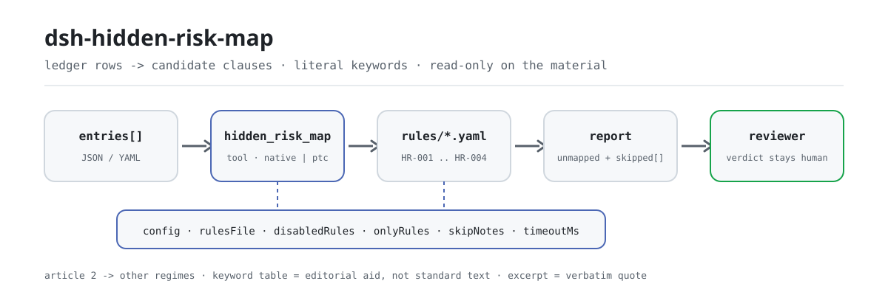

<div align="center">

<picture>
  <source media="(prefers-color-scheme: dark)" srcset="docs/assets/dsh-hidden-risk-map-flow-dark.svg">
  
</picture>

# dsh-hidden-risk-map

**Lleva cada fila de un registro de riesgos a los artículos candidatos de la norma de determinación de riesgos mayores: obtiene «qué fila, qué artículo falta y por qué», y el veredicto queda en manos del revisor.**

Comprobador de datos para DeepSeek Harness: lee un registro de riesgos (una fila por riesgo registrado, con las columnas que ese registro realmente trae), aplica el paquete de reglas versionado (HR-001..HR-004) mediante coincidencia literal de palabras clave y solo informa de las carencias que puede señalar fila por fila: sin veredicto de cumplimiento ni atribución de responsabilidad.

[Instalación](#instalación-en-tres-pasos) · [Configuración](#configuración) · [FAQ](#faq) · [简体中文](README.md) · [English](README.en.md) · [Español](README.es.md) · [Português](README.pt.md) · [हिन्दी](README.hi.md)

[](LICENSE)
[](#compatibilidad)
[](https://www.npmjs.com/package/dsh-hidden-risk-map)
[](https://github.com/PerryLink/dsh-hidden-risk-map/actions/workflows/ci.yml)
[](#compatibilidad)

[](https://github.com/PerryLink/dsh-hidden-risk-map/stargazers)
[](https://www.npmjs.com/package/dsh-hidden-risk-map)
[](https://dshfind.com/plugins/PerryLink/dsh-hidden-risk-map?ref=badge)
[](https://securityscorecards.dev/viewer/?uri=github.com/PerryLink/dsh-hidden-risk-map)
[](https://dsh.market/)
[](https://gitee.com/perrylink/dsh-hidden-risk-map)

```sh
dsh plugin --profile <name> add dsh-hidden-risk-map
```

</div>

<sub>Complemento comunitario, no afiliado a DeepSeek. Repositorio canónico: <https://github.com/PerryLink/dsh-hidden-risk-map> (Gitee es un espejo).</sub>

## Qué es

`dsh-hidden-risk-map` lee un registro de riesgos —una fila por riesgo registrado, con las columnas que ese registro realmente trae— y lleva cada fila a los artículos candidatos de la norma de determinación de riesgos mayores mediante coincidencia literal de palabras clave sobre el texto de campos como la columna de descripción del riesgo, e informa de las carencias del propio registro, no de un juicio: las filas que no coincidieron con ningún artículo, las filas cuya coincidencia pertenece a otra industria o toca productos químicos peligrosos, incendio, gas o equipo especial que el artículo 2 remite a otras disposiciones, las filas coincidentes a las que faltan los campos de cierre de la corrección configurados por la institución, y los artículos golpeados por más filas que el tope configurado. Cada hallazgo nombra el artículo del que procede; el resultado son pistas para revisión, la tabla de palabras clave es una ayuda editorial y no texto de la norma, y la comprobación que no pudo ejecutarse expone su motivo en `skipped` en lugar de pasar en silencio.

- **Para quién**: administradores de seguridad y puestos de inspección de riesgos; no hace falta saber usar la línea de comandos, basta con entregarle el material en el chat.
- **Qué le aporta**: el material original sobre el que trabaja la comprobación (una tabla, un registro o un documento); el original nunca se modifica. Excel puede convertirse antes a JSON/YAML, también en el chat si la plataforma lo permite.
- **Qué entrega**: una lista de pistas —qué fila, qué artículo, por qué—; las comprobaciones que no pudieron ejecutarse se listan en `skipped` con su motivo.
- **Qué no hace**: no dicta cumplimiento, no atribuye responsabilidad y no sustituye al revisor; tampoco decide si un asunto constituye un riesgo mayor: eso exige inspección en sitio y juicio profesional.

## Instalación en tres pasos

1. **Instalar** (elija un canal):

   ```sh
   # canal git (última main; equivale a git+https://github.com/PerryLink/dsh-hidden-risk-map.git)
   dsh plugin --profile <name> add github:PerryLink/dsh-hidden-risk-map
   # canal npm (versiones publicadas)
   dsh plugin --profile <name> add dsh-hidden-risk-map
   # canal tarball: tras pnpm pack en este repositorio
   dsh plugin --profile <name> add ./dsh-hidden-risk-map-<version>.tgz
   ```

2. **Configuración mínima** (los valores por defecto ya sirven; una fila de bundle sin `config` los toma todos y la ruta del paquete de reglas apunta al `rules/hidden-risk-map.yaml` incluido):

   ```yaml
   - insert:
       - id: dsh-hidden-risk-map
         name: dsh-hidden-risk-map
   ```

3. **Verificar que se monta** (la prueba local requiere `pnpm run build` para producir `lib/`):

   ```sh
   dsh --profile <name> --dump-config | grep 'dsh-hidden-risk-map'
   node samples/quickstart/run.mjs --json
   # => {"tool":"hidden_risk_map","issueCount":1,"summary":{"error":0,"warn":1,"info":0},"skippedCount":3}
   ```

**Desinstalar**: `dsh plugin --profile <name> remove dsh-hidden-risk-map` (o elimine la fila del profile patch).

<details>
<summary>Usarlo desde WorkBuddy / Coze</summary>

Busque «Safety Compliance Suite» en WorkBuddy / Coze (esta comprobación es una de sus partes; disponibilidad según catálogo) para usar la misma capacidad sin línea de comandos.

</details>

## Capacidades clave

`dsh-hidden-risk-map` registra la herramienta `hidden_risk_map`: lee un registro de riesgos, aplica un paquete de reglas versionado y devuelve un informe en el que cada hallazgo nombra el artículo del que procede y cada comprobación que no pudo ejecutarse indica su motivo.

- **Cuatro reglas en un paquete** — el paquete es datos, no código (`rules/hidden-risk-map.yaml`); sustituirlo cambia todo el conjunto de reglas sin tocar una línea de TypeScript.
- **Solo lectura sobre el material** — acepta JSON o YAML y el original nunca se modifica; ESM puro, sin peticiones de red ni llamadas al modelo.
- **Las filas no asignadas se listan una a una** — la cifra principal de `HR-001` es «N filas sin asignar», no «0 riesgos»; una fila que no coincide con ningún artículo se lista explícitamente en lugar de desaparecer.
- **El artículo 2 remite a otras disposiciones** — los productos químicos peligrosos, el incendio, el gas y el equipo especial se rigen por otras disposiciones; las filas que los tocan se informan como «consulte la disposición correspondiente», sin asignarlas.
- **Sin citas inventadas** — cada regla lleva `document` / `number` / `clause` / `excerpt` / `kind` / `source`; `excerpt` debe ser una cita literal, y la regla cuyo texto no se obtuvo lo dice en `excerpt` y se marca `derived-from-principle`.
- **La gravedad sigue a la evidencia** — `derived-from-principle` se limita a `warn`; las comprobaciones configuradas por la institución (`institutional-configuration`) se limitan a `info`; hay una prueba que lo verifica.
- **Una lista vacía no es un aprobado** — toda comprobación que no pudo ejecutarse va a `skipped` con su motivo; una regla cuya lista obligatoria no está configurada se declara en `skipped` en lugar de pasar en silencio.
- **Sin lenguaje que adjudique** — el informe solo enumera diferencias: nunca cumplimiento, responsabilidad ni corrección; un guardián de redacción lo impone y todo informe lleva el descargo de responsabilidad.

| Regla | Qué comprueba | Gravedad | Tipo de base |
|---|---|---|---|
| `HR-001` | Cada fila se asigna a un artículo o se lista como no asignada | warn | principio |
| `HR-002` | El artículo coincidente pertenece a la industria de este despliegue o remite a otra disposición | warn | directa |
| `HR-003` | Las filas coincidentes traen los campos de cierre de la corrección configurados (desactivada por defecto) | warn | principio |
| `HR-004` | Un artículo golpeado por demasiadas filas se marca para revisión (desactivada por defecto) | info | principio |

### Ejemplos

Estos son los puntos de entrada reales del complemento; instálelo una vez y llame a uno. El caso detallado de abajo es la **salida real** del complemento sobre su propio fixture `HR-001`, no una ilustración; la tabla siguiente cubre los casos breves.

**Ejemplo detallado** — herramienta `hidden_risk_map`, entrada:

```json
{"entries":[{"row":1,"隐患描述":"车间地面有一处油污未及时清理"}]}
```

Salida:

```json
{
  "id": "dsh-hidden-risk-map.HR-001.e26f24c6",
  "ruleId": "HR-001",
  "severity": "warn",
  "locator": {
    "column": "隐患描述",
    "row": 1
  },
  "found": "台账条目「车间地面有一处油污未及时清理」未能匹配到判定标准的任何条款关键词",
  "expected": "台账条目应能对应到判定标准的具体条款，或确认不属于该标准的适用范围",
  "fix": "人工核对：可能属于其他行业条款、属于危化品/消防/燃气/特种设备等另有规定的情形，或表述与条款用词差异较大（可在 keywords 中补充本企业习惯用词）"
}
```

*Observado en `tests/fixtures/HR-001/HR-001-unsafe.json (cases.json expects HR-001 count 1); run via lib/index.mjs rules/hidden-risk-map.yaml`*

| Usted pregunta | Qué responde |
|---|---|
| Se ejecutó el registro y no se marcó ningún artículo, ¿significa que no hay riesgos mayores? | No. La cifra principal de la herramienta es el número de filas que no pudo mapear, no un veredicto de cero riesgos. `HR-001` enumera cada fila cuyo texto no coincidió con ninguna palabra clave: un artículo de otra industria, un tipo de riesgo regido por otras disposiciones, o una redacción que la tabla de palabras clave aún no recoge. Solo informa de que no se pudo localizar ningún artículo, y no decide si esa fila constituye o no un riesgo mayor. |
| La exportación trae un número de serie y una fecha, pero ninguna columna de descripción del riesgo. | El lector rechaza el material en vez de adivinar; nunca promueve el campo más largo a texto del riesgo. Si no está ninguna de las nueve columnas de descripción conocidas (listadas abajo), nombra las columnas que sí vio (o indica que no había ninguna) y declara que no hay texto de descripción utilizable, así que la comprobación no se ejecuta y nada —ni siquiera la lista de no mapeados de `HR-001`— se lee como aprobado. |
| La fila dice que la sala de refrigeración con amoníaco líquido no tiene alarma de fuga de amoníaco — ¿por qué no queda mapeada? | `HR-001` compara palabras clave de forma literal, porque decidir si una frase trata de una fuga de amoníaco corresponde al revisor y no a un juicio difuso del texto. Una fila sobre amoníaco líquido solo se mapea cuando su tabla de palabras clave recoge esa redacción; el paquete incluido la recoge bajo el artículo 12 (industry: refrigeración con amoníaco líquido). Las listas de palabras clave son una ayuda editorial escrita para este complemento, no texto de la norma: añada a `keywords` el vocabulario propio de su planta cuando la redacción difiera. |
| Una fila menciona protección contra incendios o equipo especial, y se me cita la norma como su fundamento. | Eso es `HR-002` funcionando, y no clasifica la fila. El artículo 2 remite los productos químicos peligrosos, el incendio, el gas y el equipo especial a otras disposiciones, así que la regla cita esa frase e informa de la fila como «consulte la disposición correspondiente» en lugar de mapearla. Solo cuando el `industry` de esta instalación está configurado señala además un artículo coincidente que pertenece a otra industria; si `industry` está vacío, dice en `skipped` que no se comprobó la pertenencia sectorial en lugar de pasar en silencio. |
| Las filas del registro no traen ninguna de las columnas de cierre de la corrección que exige la institución. | Eso atañe a `HR-003` solo después de configurar esos nombres: `requiredFields` vacío significa que la comprobación no se ejecuta y la regla se declara en `skipped`. Una vez configurada, se informa de toda fila coincidente a la que falte una de esas columnas. La regla comprueba que las columnas existan: no juzga si la corrección es adecuada ni si el asunto se ha cerrado. |
| Muchas filas del registro golpean el artículo 3, y varias parecen el mismo defecto escrito dos veces. | `HR-004` agrupa las coincidencias por artículo e informa cuando un artículo recibe más filas de las que permite `maxHitsPerClause`, con la lista de números de fila. Es una pista de nivel `info` para revisión humana: decidir si eso es un registro duplicado o un defecto sistemático sigue siendo del revisor. Un `maxHitsPerClause` sin configurar (0) significa que la regla no se ejecuta, y lo dice en `skipped`. |

Columnas de descripción conocidas, en orden de lectura:

```text
隐患描述 · 隐患内容 · 问题描述 · 检查内容 · 描述 · text · description · content · hazard
```

## Normas que sigue

| Documento | Número | Reglas que lo citan |
|---|---|---|
| Norma de determinación de riesgos mayores de empresas industriales y comerciales (título chino canónico registrado en `rules/evidence/`) | Orden n.º 10 del Ministerio de Gestión de Emergencias | HR-001, HR-002, HR-003, HR-004 |

**Límite:** este complemento mapea cada fila de un **registro de riesgos** a los artículos candidatos de la norma de determinación de riesgos mayores e informa de las filas que no pudo mapear en absoluto. No es `dsh-emergency-plan` (que comprueba la completitud de los elementos de un plan) ni una herramienta de inspección en sitio. Lee un registro y produce **pistas para revisión** — nunca una determinación de que algo sea o no un riesgo mayor, lo que exige inspección en sitio y juicio profesional.

> ### ⚠️ Lo más útil que hace este complemento es admitir qué no pudo mapear
>
> El modo de fallo de un mapeador por palabras clave es silencioso: una fila que no coincide con nada simplemente desaparece, y el lector concluye «no se encontraron riesgos mayores». Por eso `HR-001` lo invierte: **cada fila que no coincidió con ningún artículo se lista explícitamente**, con el motivo por el que pudo pasarse por alto — el artículo de otra industria, un tipo de riesgo regido por otras normas o una redacción que la tabla de palabras clave aún no recoge. La cifra principal del complemento es, por tanto, «N filas sin mapear», no «0 riesgos».
>
> **La norma fue sustituida y sus números de artículo se movieron con ella.** La norma vigente es la **Orden n.º 10 del Ministerio de Gestión de Emergencias, Norma de determinación de riesgos mayores de empresas industriales y comerciales** (aprobada el 2023-03-20, publicada el 2023-04-14, **en vigor el 2023-05-15**). Su artículo 15 deroga expresamente la edición de 2017 de la norma de determinación (Orden n.º 129 de 2017). Este paquete cita solo los números de artículo de la Orden n.º 10, y una prueba verifica que el número de 2017 sustituido nunca aparezca.
>
> **Dos cosas que este complemento deliberadamente no hace.** No decide que una fila *sea* un riesgo mayor; y no clasifica los riesgos que el artículo 2 remite a otros regímenes — los productos químicos peligrosos, el incendio, el gas y el equipo especial se rigen por *otras* disposiciones, así que una fila que los toca se informa como «consulte la disposición correspondiente» y no se mapea.

## Configuración

Todos los parámetros ajustables son campos `Config` de Schemastery en `src/config.ts` (modificables desde cordis.yml); los umbrales por regla están en el paquete de reglas bajo `rules/`. Una sustitución dirigida por id reemplaza toda la fila: repita todas las claves que necesite.

| Clave | Tipo | Predeterminado | Descripción |
|---|---|---|---|
| `rulesFile` | string | `rules/hidden-risk-map.yaml` | Ruta del paquete de reglas, relativa a la raíz del paquete |
| `disabledRules` | string[] | `[]` | Ids de reglas que se dejan de ejecutar; cada una aparece en `skipped` |
| `onlyRules` | string[] | `[]` | Ejecutar solo estas reglas; vacío ejecuta todas |
| `skipNotes` | string | `""` | Nota añadida a cada motivo de `skipped` |
| `timeoutMs` | number | `120000` | Presupuesto de tiempo de espera cooperativo de la herramienta |

Parámetros por regla que conviene conocer:

- `HR-001` `clauses` — la tabla de artículos: `article`, `industry`, `excerpt` y los `keywords` que lo seleccionan. **Las palabras clave son una ayuda editorial, no texto de la norma.** Señalan una frase del registro hacia un artículo candidato; añada el vocabulario propio de su planta a `keywords` según lo use. `tagField` (por defecto, el nombre de columna de categoría de riesgo del paquete incluido) elige la columna de la que se lee la categoría del riesgo.
- `HR-002` `industry` — la industria de su empresa. Vacío significa que la comprobación sectorial no puede ejecutarse y lo dice. `industryField` (por defecto, el nombre de columna de industria del paquete incluido) elige la columna de industria; `otherRegimes` enumera los tipos de riesgo que el artículo 2 remite a otras disposiciones.
- `HR-003` `requiredFields` — las columnas de cierre de la corrección que exige su procedimiento. Vacío significa que la regla no se ejecuta. La redacción china incluida para las tres columnas de cierre habituales es:

  ```yaml
  requiredFields: [整改措施, 整改责任人, 整改完成时间]
  ```

- `HR-004` `maxHitsPerClause` — marcar un artículo golpeado por más de este número de filas; `0` lo desactiva.

Ejemplo de sustitución en su profile patch:

```yaml
- insert:
    - id: dsh-hidden-risk-map
      name: dsh-hidden-risk-map
      config:
        disabledRules: [HR-004]
        timeoutMs: 180000
```

## Formato del material

La herramienta acepta JSON o YAML. Cada entrada es el texto del riesgo o una asignación de las columnas propias del registro:

```yaml
entries:
  - { row: 1, 隐患描述: 炼钢连铸流程未设置事故钢水罐, 整改措施: 增设事故钢水罐, 整改责任人: 张工 }
  - { row: 2, 隐患描述: 液氨制冷机房未设置氨气泄漏监测报警装置 }
```

El texto se lee de la primera de las nueve columnas de descripción conocidas (`隐患描述`, `隐患内容`, `问题描述`, `检查内容`, `描述`, `text`, `description`, `content`, `hazard`) que traiga la fila. **Si no está ninguna de esas columnas, el lector rechaza el material en vez de adivinar** — una versión anterior promovía el campo más largo a «texto del riesgo», lo que convertía silenciosamente un número de serie en un hallazgo. Los campos son opcionales en la capa de lectura y los valida el motor, de modo que una exportación parcial produce hallazgos sobre lo que falta en lugar de un fallo.

## Fuentes de las reglas

Los datos de las reglas están en `rules/hidden-risk-map.yaml`, separados del código: cada regla lleva documento, número, cláusula en la numeración propia de la fuente, extracto literal y URL de origen. El cargador impone que el extracto sea una cita real de al menos ocho caracteres y que una comprobación basada sólo en un principio general o en una política local nunca se declare `error`; un paquete de reglas que exagere su base falla al cargarse en lugar de producir un informe que parezca sólido.

Las cláusulas citadas proceden de la **Orden n.º 10 del Ministerio de Gestión de Emergencias** (título chino canónico registrado en `rules/evidence/`). La tabla de artículos cubre los artículos generales (artículo 3) y los artículos por industria (artículos 4–14). Las listas de palabras clave se escribieron para este complemento y así se indica en el paquete, porque la norma no tiene lista de palabras clave — hay una prueba que verifica que el paquete lo dice.

Dos hallazgos dieron forma a este paquete:

1. **La norma fue sustituida** (la edición de 2017 fue derogada por el artículo 15 de la orden de 2023), así que solo se citan los números de artículo vigentes.
2. **El artículo 2 remite cuatro tipos de riesgo a otras normas.** Los productos químicos peligrosos, el incendio, el gas y el equipo especial se juzgan bajo *otras* disposiciones, por lo que `HR-002` informa de esas filas como «consulte la disposición correspondiente» en lugar de mapearlas aquí.

Los límites confirmados durante la verificación y las conclusiones deliberadamente **no** afirmadas están en `rules/evidence/`.

## FAQ

<details>
<summary>Se ejecutó el registro y no se marcó ningún artículo, ¿significa que no hay riesgos mayores?</summary>

No. La cifra principal de la herramienta es el número de filas que no pudo mapear, no un veredicto de cero riesgos. `HR-001` enumera cada fila cuyo texto no coincidió con ninguna palabra clave: un artículo de otra industria, un tipo de riesgo regido por otras disposiciones, o una redacción que la tabla de palabras clave aún no recoge. Solo informa de que no se pudo localizar ningún artículo, y no decide si esa fila constituye o no un riesgo mayor.

</details>

<details>
<summary>La exportación trae número de serie y fecha, pero ninguna columna de descripción del riesgo — ¿qué pasa?</summary>

El lector rechaza el material en vez de adivinar; nunca promueve el campo más largo a texto del riesgo. Si no está ninguna de las nueve columnas de descripción conocidas, nombra las columnas que sí vio (o indica que no había ninguna) y declara que no hay texto de descripción utilizable, así que la comprobación no se ejecuta y nada —ni siquiera la lista de no mapeados de `HR-001`— se lee como aprobado.

</details>

<details>
<summary>Una fila dice que la sala de refrigeración con amoníaco líquido no tiene alarma de fuga — ¿por qué no queda mapeada?</summary>

`HR-001` compara palabras clave de forma literal, porque decidir si una frase trata de una fuga de amoníaco corresponde al revisor y no a un juicio difuso del texto. Una fila sobre amoníaco líquido solo se mapea cuando la tabla de palabras clave recoge esa redacción; el paquete incluido la recoge bajo el artículo 12 (industry: refrigeración con amoníaco líquido). Las listas de palabras clave son una ayuda editorial, no texto de la norma: añada el vocabulario propio de su planta a `keywords` cuando la redacción difiera.

</details>

<details>
<summary>Una fila menciona protección contra incendios o equipo especial y se cita la norma como su fundamento — ¿qué es eso?</summary>

Eso es `HR-002` funcionando, y no clasifica la fila. El artículo 2 remite los productos químicos peligrosos, el incendio, el gas y el equipo especial a otras disposiciones, así que la regla cita esa frase e informa de la fila como «consulte la disposición correspondiente» en lugar de mapearla. Solo cuando el `industry` de esta instalación está configurado señala además un artículo coincidente que pertenece a otra industria; si `industry` está vacío, dice en `skipped` que no se comprobó la pertenencia sectorial en lugar de pasar en silencio.

</details>

<details>
<summary>El registro no trae ninguna de las columnas de cierre de la corrección — ¿qué hace `HR-003`?</summary>

`HR-003` se ejecuta solo después de configurar esos nombres: `requiredFields` vacío significa que la comprobación no se ejecuta y la regla se declara en `skipped`. Una vez configurada, se informa de toda fila coincidente a la que falte una de esas columnas. La regla comprueba que las columnas existan: no juzga si la corrección es adecuada ni si el asunto se ha cerrado. También viene desactivada por una segunda razón: el paquete no verificó ninguna cláusula nacional literal sobre campos de cierre de la corrección, así que la regla queda desactivada en lugar de inventar una base.

</details>

<details>
<summary>Muchas filas golpean el artículo 3 y varias parecen el mismo defecto escrito dos veces.</summary>

`HR-004` agrupa las coincidencias por artículo e informa cuando un artículo recibe más filas de las que permite `maxHitsPerClause`, con la lista de números de fila. Es una pista de nivel `info` para revisión humana: decidir si eso es un registro duplicado o un defecto sistemático sigue siendo del revisor. Un `maxHitsPerClause` sin configurar (0) significa que la regla no se ejecuta, y lo dice en `skipped`.

</details>

<details>
<summary>¿Cuánto cuesta procesar un registro de cientos o miles de filas?</summary>

La comprobación es coincidencia local de palabras clave y comparación de campos: sin peticiones de red ni llamadas al modelo; `timeoutMs` (120 segundos por defecto) es un presupuesto de tiempo de espera cooperativo. Los modos `native` y `ptc` funcionan; para un registro completo se recomienda `ptc`, porque el coste del esquema se paga una sola vez.

</details>

## Solución de problemas

- **La mayoría de las filas se informan como no mapeadas.** Es el complemento funcionando: o la redacción del registro queda fuera de la tabla de palabras clave (añada los términos) o esas filas caen realmente bajo otro régimen (revise la salida de `HR-002`).
- **La comprobación sectorial nunca se ejecuta.** `industry` está vacío. Configúrelo o deje la comprobación desactivada a sabiendas.
- **`HR-003` nunca se ejecuta.** `requiredFields` está vacío, y su nota registra que no se verificó ninguna cláusula nacional literal para los campos de cierre de la corrección, así que la regla viene desactivada en lugar de inventar una.
- **El lector rechaza un registro que antes aceptaba.** No encontró ninguna de las columnas de descripción conocidas. El error nombra las columnas que vio; renombre una a un nombre conocido o use la forma de lista `entries`.
- **Un hallazgo dice que el texto de la cláusula no se obtuvo.** El paquete de reglas sigue una puerta de citas: nunca inventa el texto de una cláusula. Cuando el texto exacto no está disponible, el hallazgo se queda en `warn`/`info` y lo dice en su `excerpt`. Trátelo como una carencia de verificación, no como prueba de que el documento cumple.
- **Todo es `warn` o `info`.** Por diseño, este comprobador no emite una determinación legal o de seguridad; informa de diferencias y carencias, y un responsable humano decide qué hacer con ellas.
- **El complemento se instala pero la herramienta no aparece.** Compruebe que `main` resuelve a `lib/index.mjs` y que `pnpm run build` lo generó; un `main` incorrecto hace que el cargador omita la entrada en silencio.
- **`dsh plugin add` rechaza el paquete por incompatibilidad.** El rango de peers cubre `0.1.x` y `0.2.x`; fuera de él, conceda una exención explícita: `dsh plugin --profile <name> allow-version dsh-hidden-risk-map@<version> --dsh-version <runtime> --accept-risk`
- **`check` informa `manifest-peers` como fallo.** El comprobador estático compara con un rango de peers fijo anterior a la línea 0.2; el runtime aplica la compatibilidad al instalar, así que el rango declarado es el correcto. Es un problema conocido de `dsh-plugin-dev`.
- **Informar de un fallo.** Abra un issue en <https://github.com/PerryLink/dsh-hidden-risk-map/issues> con la versión del comprobador y del host DSH, el comando o llamada usada, y una entrada mínima y redactada junto al resultado real y el esperado. Nunca pegue credenciales, tokens, datos personales ni texto de evidencia sellada.

## Compatibilidad

| Superficie | Estado |
|---|---|
| Harness | Rango de peers `>=0.1.2-rc.1 <0.2.0 \|\| >=0.2.0-0 <0.3.0` — verificado para aceptar tanto `0.2.0-rc.2` como `0.2.1-rc.2`. `engines.dsh` se declara como `>=0.2.1-0 <0.3.0` y el host lo aplica desde 0.2.1 |
| Node | `^22.19.0 \|\| >=24.0.0` |
| Plataformas | Todas (ESM puro; sin código nativo, sin red, sin llamada al modelo) |
| Modo de herramienta | Funciona en `native` y `ptc`; para un registro completo use `ptc` |

## Ecosistema y calidad

- [Espejo Gitee](https://gitee.com/perrylink/dsh-hidden-risk-map) (espejo sincronizado; GitHub es canónico)
- [Página dshfind](https://dshfind.com/plugins/PerryLink/dsh-hidden-risk-map) (instalaciones y clasificación)
- [Informe OpenSSF Scorecard](https://securityscorecards.dev/viewer/?uri=github.com/PerryLink/dsh-hidden-risk-map) (impulsado por [.github/workflows/scorecard.yml](.github/workflows/scorecard.yml))
- [DSH Market](https://dsh.market/) (publicado)
- **Canal de la tienda 1024**: `npm i -g dsh1024` una vez, luego `dsh1024 plugin --profile <name> add dsh-hidden-risk-map` (cuenta para la clasificación de instalaciones de [deepseek1024.com](https://deepseek1024.com))
- [Base de conocimiento del ecosistema](https://perrylink.github.io/dsh-plugin-guide/): guía de desarrollo de plugins · datos de selección · criterios de mantenimiento

## Desarrollo

```sh
pnpm install                                        # node ^22.19 || >=24
pnpm run typecheck                                  # tsc --noEmit
pnpm test                                           # vitest: fixtures emparejados por regla
pnpm run build                                      # tsdown -> lib/index.mjs + lib/index.d.mts
pnpm run verify:self-contained                      # las dependencias resuelven desde el registry
pnpm run check:lockfile                             # comprobación de deriva del lockfile
pnpm run check:readmes                              # consistencia de los README en cinco idiomas
pnpm run check:citations                            # línea base de citas del paquete de reglas
node ../scripts/sync-shared.mjs dsh-hidden-risk-map # refresca src/shared desde ../_shared
pnpm pack                                           # el tarball publicado
```

`src/check.ts` es el núcleo de comprobación puro —sin E/S, sin reloj, sin acceso al modelo— y `rules/hidden-risk-map.yaml` declara cada regla. Rutas principales:

| Ruta | Función |
|---|---|
| `src/index.ts` | contrato function-plugin; registra `hidden_risk_map` y resuelve el paquete de reglas incluido |
| `src/check.ts` | núcleo de comprobación puro `(input, ruleset, options) => Report` |
| `src/parse.ts` | lector de material JSON / YAML |
| `src/config.ts` | esquema Schemastery: todos los parámetros viven aquí |
| `src/shared/` | copia del kit compartido (paquete autocontenido, sin importación externa) |
| `rules/hidden-risk-map.yaml` | el paquete de reglas, 4 reglas |
| `rules/evidence/` | registro de verificación de cada cita |
| `tests/fixtures/<RULE>/` | fixtures emparejados por regla |
| `samples/quickstart/` | prueba local, sin instalación |

Prueba local (requiere `pnpm run build` antes, para producir `lib/`):

```sh
node samples/quickstart/run.mjs --json
# => {"tool":"hidden_risk_map","issueCount":1,"summary":{"error":0,"warn":1,"info":0},"skippedCount":3}
```

La entrada de la prueba está en `samples/quickstart/input/`, la salida esperada en `samples/quickstart/expected/result.json` y la captura en `docs/assets/quickstart.png`. Las imágenes del README se generan mediante [`scripts/gen-readme-assets.py`](scripts/gen-readme-assets.py) (Python + Pillow) como `docs/assets/dsh-hidden-risk-map-flow-{light,dark}.svg`; volver a ejecutarlo es seguro. Las imágenes antiguas de una sola variante se conservan en `docs/assets/` para enlaces externos, y los README solo citan el par nuevo.

Temas: `deepseek-harness`, `dsh`, `dsh-plugin`, `cordis`, `hidden`, `risk`, `map`

## Familia y agradecimientos

Este proyecto forma parte de la familia de complementos de DeepSeek Harness mantenida por [PerryLink](https://github.com/PerryLink) (todos Apache-2.0). Índice completo de la familia: [elegir un comprobador por material](https://perrylink.github.io/zh/checkers/choose/) y [todos los plugins](https://github.com/PerryLink). Si le resulta útil, **una estrella ayuda a que la siguiente persona lo encuentre**: no desbloquea ninguna función.

- [@PerryLink](https://github.com/PerryLink) — creador y mantenedor: el paquete de reglas registro→artículo (HR-001..HR-004), la herramienta `hidden_risk_map`, el registro de verificación de cláusulas de la Orden n.º 10 y la documentación en cinco idiomas.

<details>
<summary>Desplegar todos los plugins</summary>

| Plugin | Estado |
|---|---|
| **[dsh-aqua-input-check](https://github.com/PerryLink/dsh-aqua-input-check)** |  |
| **[dsh-archive-check](https://github.com/PerryLink/dsh-archive-check)** |  |
| **[dsh-auto-review](https://github.com/PerryLink/dsh-auto-review)** |  |
| **[dsh-autotier](https://github.com/PerryLink/dsh-autotier)** | 🧊 CONGELADO — ver el README del repo |
| **[dsh-bid-ca-precheck](https://github.com/PerryLink/dsh-bid-ca-precheck)** |  |
| **[dsh-bid-qual-check](https://github.com/PerryLink/dsh-bid-qual-check)** |  |
| **[dsh-cert-mcp](https://github.com/PerryLink/dsh-cert-mcp)** | 🧊 CONGELADO — ver el README del repo |
| **[dsh-checkpoint-rewind](https://github.com/PerryLink/dsh-checkpoint-rewind)** |  |
| **[dsh-click](https://github.com/PerryLink/dsh-click)** |  |
| **[dsh-composer-history](https://github.com/PerryLink/dsh-composer-history)** |  |
| **[dsh-contract-stance](https://github.com/PerryLink/dsh-contract-stance)** |  |
| **[dsh-customs-doc-check](https://github.com/PerryLink/dsh-customs-doc-check)** |  |
| **[dsh-data-quality](https://github.com/PerryLink/dsh-data-quality)** | 🧊 CONGELADO — ver el README del repo |
| **[dsh-demurrage-ledger](https://github.com/PerryLink/dsh-demurrage-ledger)** |  |
| **[dsh-doublecheck](https://github.com/PerryLink/dsh-doublecheck)** |  |
| **[dsh-drill-script-check](https://github.com/PerryLink/dsh-drill-script-check)** |  |
| **[dsh-eia-guide-check](https://github.com/PerryLink/dsh-eia-guide-check)** |  |
| **[dsh-emergency-plan](https://github.com/PerryLink/dsh-emergency-plan)** |  |
| **[dsh-essay-rubric-check](https://github.com/PerryLink/dsh-essay-rubric-check)** |  |
| **[dsh-evidence-check](https://github.com/PerryLink/dsh-evidence-check)** |  |
| **[dsh-export-ctl-check](https://github.com/PerryLink/dsh-export-ctl-check)** |  |
| **[dsh-fast](https://github.com/PerryLink/dsh-fast)** |  |
| **[dsh-fmea-table-check](https://github.com/PerryLink/dsh-fmea-table-check)** |  |
| **[dsh-forecast-penalty](https://github.com/PerryLink/dsh-forecast-penalty)** |  |
| **[dsh-fund-research](https://github.com/PerryLink/dsh-fund-research)** |  |
| **[dsh-github](https://github.com/PerryLink/dsh-github)** |  |
| **[dsh-gongwen-flow-check](https://github.com/PerryLink/dsh-gongwen-flow-check)** |  |
| **[dsh-gongwen-word-check](https://github.com/PerryLink/dsh-gongwen-word-check)** |  |
| **[dsh-guard-plan-qc](https://github.com/PerryLink/dsh-guard-plan-qc)** |  |
| **[dsh-hazchem-check](https://github.com/PerryLink/dsh-hazchem-check)** |  |
| **[dsh-hazplan-check](https://github.com/PerryLink/dsh-hazplan-check)** |  |
| **[dsh-hidden-risk-map](https://github.com/PerryLink/dsh-hidden-risk-map)** |  |
| **[dsh-hs-classify](https://github.com/PerryLink/dsh-hs-classify)** |  |
| **[dsh-icd-rule-check](https://github.com/PerryLink/dsh-icd-rule-check)** |  |
| **[dsh-industry-research](https://github.com/PerryLink/dsh-industry-research)** |  |
| **[dsh-lawcite-adapter](https://github.com/PerryLink/dsh-lawcite-adapter)** |  |
| **[dsh-laya](https://github.com/PerryLink/dsh-laya)** |  |
| **[dsh-lc-doc-check](https://github.com/PerryLink/dsh-lc-doc-check)** |  |
| **[dsh-learning-gap-check](https://github.com/PerryLink/dsh-learning-gap-check)** |  |
| **[dsh-library](https://github.com/PerryLink/dsh-library)** |  |
| **[dsh-local-ai](https://github.com/PerryLink/dsh-local-ai)** |  |
| **[dsh-lsp-actions](https://github.com/PerryLink/dsh-lsp-actions)** |  |
| **[dsh-mask](https://github.com/PerryLink/dsh-mask)** |  |
| **[dsh-mcp-panel](https://github.com/PerryLink/dsh-mcp-panel)** |  |
| **[dsh-medrec-qc](https://github.com/PerryLink/dsh-medrec-qc)** |  |
| **[dsh-memento](https://github.com/PerryLink/dsh-memento)** | 🧊 CONGELADO — ver el README del repo |
| **[dsh-nsfc-form-check](https://github.com/PerryLink/dsh-nsfc-form-check)** |  |
| **[dsh-nurse-record-check](https://github.com/PerryLink/dsh-nurse-record-check)** |  |
| **[dsh-observe](https://github.com/PerryLink/dsh-observe)** |  |
| **[dsh-origin-rvc-check](https://github.com/PerryLink/dsh-origin-rvc-check)** |  |
| **[dsh-ota-review-check](https://github.com/PerryLink/dsh-ota-review-check)** |  |
| **[dsh-output-styles](https://github.com/PerryLink/dsh-output-styles)** |  |
| **[dsh-paper-doc-adapter](https://github.com/PerryLink/dsh-paper-doc-adapter)** |  |
| **[dsh-permission-rules](https://github.com/PerryLink/dsh-permission-rules)** |  |
| **[dsh-permit-report-check](https://github.com/PerryLink/dsh-permit-report-check)** |  |
| **[dsh-pipeline-check](https://github.com/PerryLink/dsh-pipeline-check)** |  |
| **[dsh-pleading-draft](https://github.com/PerryLink/dsh-pleading-draft)** |  |
| **[dsh-plugin-doctor](https://github.com/PerryLink/dsh-plugin-doctor)** | 🚫 RETIRADO (repo archivado) |
| **[dsh-plugin-guide](https://github.com/PerryLink/dsh-plugin-guide)** |  |
| **[dsh-plugin-kit](https://github.com/PerryLink/dsh-plugin-kit)** | 🚫 RETIRADO (repo archivado) |
| **[dsh-plugin-upgrade](https://github.com/PerryLink/dsh-plugin-upgrade)** | 🚫 RETIRADO (repo archivado) |
| **[dsh-policy-brief-draft](https://github.com/PerryLink/dsh-policy-brief-draft)** |  |
| **[dsh-power-loss-split](https://github.com/PerryLink/dsh-power-loss-split)** |  |
| **[dsh-power-ticket-check](https://github.com/PerryLink/dsh-power-ticket-check)** |  |
| **[dsh-ppap-check](https://github.com/PerryLink/dsh-ppap-check)** |  |
| **[dsh-protest-deadline](https://github.com/PerryLink/dsh-protest-deadline)** |  |
| **[dsh-railway-window](https://github.com/PerryLink/dsh-railway-window)** |  |
| **[dsh-repair-order-qc](https://github.com/PerryLink/dsh-repair-order-qc)** |  |
| **[dsh-research-report](https://github.com/PerryLink/dsh-research-report)** |  |
| **[dsh-review-reply-check](https://github.com/PerryLink/dsh-review-reply-check)** |  |
| **[dsh-rulefile-check](https://github.com/PerryLink/dsh-rulefile-check)** |  |
| **[dsh-safety-brief-check](https://github.com/PerryLink/dsh-safety-brief-check)** |  |
| **[dsh-score](https://github.com/PerryLink/dsh-score)** | 🧊 CONGELADO — ver el README del repo |
| **[dsh-session-sync](https://github.com/PerryLink/dsh-session-sync)** |  |
| **[dsh-site-log-check](https://github.com/PerryLink/dsh-site-log-check)** |  |
| **[dsh-skill-pack-security](https://github.com/PerryLink/dsh-skill-pack-security)** |  |
| **[dsh-soe-decision-check](https://github.com/PerryLink/dsh-soe-decision-check)** |  |
| **[dsh-soilwater-check](https://github.com/PerryLink/dsh-soilwater-check)** |  |
| **[dsh-sop-sync-check](https://github.com/PerryLink/dsh-sop-sync-check)** |  |
| **[dsh-spc-gbt-adapter](https://github.com/PerryLink/dsh-spc-gbt-adapter)** |  |
| **[dsh-talk](https://github.com/PerryLink/dsh-talk)** |  |
| **[dsh-tender-extract](https://github.com/PerryLink/dsh-tender-extract)** |  |
| **[dsh-tender-matrix](https://github.com/PerryLink/dsh-tender-matrix)** |  |
| **[dsh-test-drive](https://github.com/PerryLink/dsh-test-drive)** |  |
| **[dsh-ticktick](https://github.com/PerryLink/dsh-ticktick)** | 🚫 RETIRADO (repo archivado) |
| **[dsh-translate](https://github.com/PerryLink/dsh-translate)** |  |
| **[dsh-warranty-calc](https://github.com/PerryLink/dsh-warranty-calc)** |  |
| **[dsh-budget](https://github.com/PerryLink/dsh-budget)** | 🧊 CONGELADO — ver el README del repo |
| **[dsh-claude-move](https://github.com/PerryLink/dsh-claude-move)** | 🧊 CONGELADO — ver el README del repo |
| **[dsh-defend](https://github.com/PerryLink/dsh-defend)** | 🧊 CONGELADO — ver el README del repo |
| **[dsh-draw](https://github.com/PerryLink/dsh-draw)** | 🧊 CONGELADO — ver el README del repo |
| **[dsh-reach](https://github.com/PerryLink/dsh-reach)** | 🧊 CONGELADO — ver el README del repo |
| **[dsh-background-agents](https://github.com/PerryLink/dsh-background-agents)** | 🚫 RETIRADO (repo archivado) |
| **[dsh-session-pin](https://github.com/PerryLink/dsh-session-pin)** | 🚫 RETIRADO (repo archivado) |
| **[dsh-team-rooms](https://github.com/PerryLink/dsh-team-rooms)** | 🚫 RETIRADO (repo archivado) |

</details>

## Licencia

[LICENSE](LICENSE) (Apache License 2.0) © 2026 dsh-hidden-risk-map contributors

<p align="center"><sub>Apache-2.0 · Complemento comunitario, no afiliado a DeepSeek.</sub></p>
