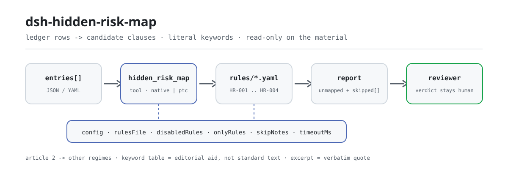

<div align="center">

<picture>
  <source media="(prefers-color-scheme: dark)" srcset="docs/assets/dsh-hidden-risk-map-flow-dark.svg">
  
</picture>

# dsh-hidden-risk-map

**सुरक्षा-जोखिम रजिस्टर की हर पंक्ति को बृहत् दुर्घटना-जोखिम निर्धारण मानक के संभावित अनुच्छेदों तक मिलाएँ — देखें कौन-सी पंक्ति में कौन-सा अनुच्छेद छूटा और क्यों; अंतिम निर्णय समीक्षक का।**

DeepSeek Harness के लिए डेटा-जाँच प्लगइन: एक सुरक्षा-जोखिम रजिस्टर पढ़ता है (हर दर्ज जोखिम की एक पंक्ति, उन स्तंभों के साथ जो रजिस्टर वास्तव में रखता है), पैकेज में आए संस्करणबद्ध नियम-पैक (HR-001..HR-004) को शब्दशः कीवर्ड मिलान से लागू करता है, और केवल वे कमियाँ बताता है जिन्हें पंक्ति-दर-पंक्ति इंगित किया जा सकता है — कोई अनुपालन निर्णय नहीं, कोई दायित्व-निर्धारण नहीं।

[इंस्टॉल](#तीन-चरणों-में-शुरुआत) · [कॉन्फ़िगरेशन](#कॉन्फ़िगरेशन) · [FAQ](#faq) · [简体中文](README.md) · [English](README.en.md) · [Español](README.es.md) · [Português](README.pt.md) · [हिन्दी](README.hi.md)

[](LICENSE)
[](#संगतता)
[](https://www.npmjs.com/package/dsh-hidden-risk-map)
[](https://github.com/PerryLink/dsh-hidden-risk-map/actions/workflows/ci.yml)
[](#संगतता)

[](https://github.com/PerryLink/dsh-hidden-risk-map/stargazers)
[](https://www.npmjs.com/package/dsh-hidden-risk-map)
[](https://dshfind.com/plugins/PerryLink/dsh-hidden-risk-map?ref=badge)
[](https://securityscorecards.dev/viewer/?uri=github.com/PerryLink/dsh-hidden-risk-map)
[](https://dsh.market/)
[](https://gitee.com/perrylink/dsh-hidden-risk-map)

```sh
dsh plugin --profile <name> add dsh-hidden-risk-map
```

</div>

<sub>समुदाय प्लगइन, DeepSeek से कोई संबद्धता नहीं। मानक रेपो: <https://github.com/PerryLink/dsh-hidden-risk-map> (Gitee इसका मिरर है)।</sub>

## यह क्या है

`dsh-hidden-risk-map` एक सुरक्षा-जोखिम रजिस्टर पढ़ता है — हर दर्ज जोखिम की एक पंक्ति, उन स्तंभों के साथ जो वह रजिस्टर वास्तव में रखता है — और जोखिम-विवरण जैसे स्तंभों के पाठ पर शब्दशः कीवर्ड मिलान द्वारा हर पंक्ति को बृहत् दुर्घटना-जोखिम निर्धारण मानक के संभावित अनुच्छेदों तक ले जाता है, और किसी निर्णय के बजाय रजिस्टर की अपनी कमियाँ दर्ज करता है: वे पंक्तियाँ जो किसी अनुच्छेद से मेल नहीं खाईं, वे मिलान-पंक्तियाँ जिनका अनुच्छेद किसी दूसरे उद्योग का है या खतरनाक रसायन, अग्नि, गैस या विशेष उपकरण से जुड़ा है जिन्हें अनुच्छेद 2 अन्य प्रावधानों को सौंपता है, वे मिलान-पंक्तियाँ जिनमें संस्था द्वारा कॉन्फ़िगर किए गए सुधार-समापन क्षेत्र नहीं हैं, और वे अनुच्छेद जिन्हें कॉन्फ़िगर की गई सीमा से अधिक पंक्तियाँ छूती हैं। हर निष्कर्ष उस अनुच्छेद का नाम लेता है जिससे वह आया; परिणाम समीक्षा के लिए सुराग हैं, कीवर्ड तालिका एक संपादकीय सहायता है मानक का पाठ नहीं, और जो जाँच चल नहीं सकी वह चुपचाप पास होने के बजाय `skipped` में अपना कारण बताती है।

- **किनके लिए**: सुरक्षा प्रशासक और जोखिम-निरीक्षण भूमिकाएँ; कमांड लाइन आनी ज़रूरी नहीं — सामग्री चैट में दे दें।
- **आप क्या देते हैं**: जाँच जिस मूल सामग्री पर काम करती है (तालिका, रजिस्टर या दस्तावेज़); मूल कभी नहीं बदला जाता। Excel को पहले JSON/YAML में बदला जा सकता है, चैट में भी यदि प्लेटफ़ॉर्म सहायता देता हो।
- **यह क्या देता है**: सुरागों की सूची — कौन-सी पंक्ति, कौन-सा अनुच्छेद, क्यों; जो जाँचें नहीं चल सकीं वे कारण के साथ `skipped` में दर्ज होती हैं।
- **यह क्या नहीं करता**: अनुपालन का निर्णय नहीं देता, दायित्व तय नहीं करता, समीक्षक का विकल्प नहीं है; यह भी तय नहीं करता कि कोई मामला बृहत् दुर्घटना-जोखिम है या नहीं — उसके लिए स्थल-निरीक्षण और पेशेवर निर्णय चाहिए।

## तीन चरणों में शुरुआत

1. **इंस्टॉल करें** (कोई एक चैनल चुनें):

   ```sh
   # git चैनल (नवीनतम main; git+https://github.com/PerryLink/dsh-hidden-risk-map.git के समान)
   dsh plugin --profile <name> add github:PerryLink/dsh-hidden-risk-map
   # npm चैनल (प्रकाशित संस्करण)
   dsh plugin --profile <name> add dsh-hidden-risk-map
   # tarball चैनल: इस रेपो में pnpm pack के बाद
   dsh plugin --profile <name> add ./dsh-hidden-risk-map-<version>.tgz
   ```

2. **न्यूनतम कॉन्फ़िगरेशन** (डिफ़ॉल्ट चलते हैं; `config` के बिना bundle पंक्ति सभी डिफ़ॉल्ट लेती है और नियम-पैक का पथ पैकेज में आए `rules/hidden-risk-map.yaml` की ओर जाता है):

   ```yaml
   - insert:
       - id: dsh-hidden-risk-map
         name: dsh-hidden-risk-map
   ```

3. **जाँचें कि माउंट हुआ** (स्थानीय नमूना चलाने के लिए पहले `pnpm run build` से `lib/` बनाएँ):

   ```sh
   dsh --profile <name> --dump-config | grep 'dsh-hidden-risk-map'
   node samples/quickstart/run.mjs --json
   # => {"tool":"hidden_risk_map","issueCount":1,"summary":{"error":0,"warn":1,"info":0},"skippedCount":3}
   ```

**अनइंस्टॉल**: `dsh plugin --profile <name> remove dsh-hidden-risk-map` (या profile patch से वह पंक्ति हटा दें)।

<details>
<summary>WorkBuddy / Coze से उपयोग करें</summary>

WorkBuddy / Coze में «Safety Compliance Suite» खोजें (यह जाँच उसका एक भाग है; उपलब्धता सूची के अनुसार) और बिना कमांड लाइन के वही जाँच क्षमता पाएँ।

</details>

## मुख्य क्षमताएँ

`dsh-hidden-risk-map` `hidden_risk_map` टूल पंजीकृत करता है: एक सुरक्षा-जोखिम रजिस्टर पढ़ता है, संस्करणबद्ध नियम-पैक लागू करता है, और ऐसी रिपोर्ट देता है जिसमें हर निष्कर्ष अपने अनुच्छेद का नाम लेता है और हर न चल पाई जाँच अपना कारण बताती है।

- **एक पैक में चार नियम** — नियम-पैक डेटा है, कोड नहीं (`rules/hidden-risk-map.yaml`); उसे बदलने से पूरा नियम-समुच्चय बदल जाता है, TypeScript की एक पंक्ति छुए बिना।
- **सामग्री पर केवल पढ़ना** — JSON या YAML स्वीकार्य है, मूल कभी नहीं बदलता; शुद्ध ESM, कोई नेटवर्क अनुरोध नहीं, कोई मॉडल कॉल नहीं।
- **बिना मैप हुई पंक्तियाँ एक-एक करके सूचीबद्ध** — `HR-001` का मुख्य आँकड़ा «N पंक्तियाँ बिना मैप» है, «0 जोखिम» नहीं; जो पंक्ति किसी अनुच्छेद से नहीं मिलती वह चुपचाप गायब होने के बजाय स्पष्ट रूप से सूचीबद्ध होती है।
- **अनुच्छेद 2 अन्य प्रावधानों को सौंपता है** — खतरनाक रसायन, अग्नि, गैस और विशेष उपकरण अन्य प्रावधानों के अधीन हैं; उन्हें छूने वाली पंक्ति «संबंधित प्रावधान देखें» के रूप में दर्ज होती है, मैप नहीं होती।
- **कोई गढ़ा हुआ उद्धरण नहीं** — हर नियम में `document` / `number` / `clause` / `excerpt` / `kind` / `source` होते हैं; `excerpt` शब्दशः उद्धरण होना चाहिए, और जिस नियम का पाठ नहीं मिला वह `excerpt` में यह बताता है और `derived-from-principle` चिह्नित होता है।
- **गंभीरता साक्ष्य के अनुसार** — `derived-from-principle` अधिकतम `warn`; संस्था-कॉन्फ़िगर जाँच (`institutional-configuration`) अधिकतम `info`; एक परीक्षण इसे जाँचता है।
- **खाली सूची पास नहीं है** — हर जाँच जो नहीं चल सकी वह कारण के साथ `skipped` में जाती है; जिस नियम की अनिवार्य सूची सेट नहीं है वह चुपचाप पास होने के बजाय `skipped` में स्वयं को दर्ज करता है।
- **कोई निर्णायक शब्दावली नहीं** — रिपोर्ट केवल अंतर गिनाती है: अनुपालन, दायित्व या शुद्धता कभी नहीं; शब्दावली गार्ड इसे लागू करता है और हर रिपोर्ट में अस्वीकरण रहता है।

| नियम | क्या जाँचता है | गंभीरता | आधार प्रकार |
|---|---|---|---|
| `HR-001` | हर पंक्ति किसी अनुच्छेद से मिलती है, या बिना मैप के रूप में सूचीबद्ध होती है | warn | सिद्धांत |
| `HR-002` | मिला अनुच्छेद इस परिनियोजन के उद्योग का है, या अन्य व्यवस्था की ओर भेजता है | warn | प्रत्यक्ष |
| `HR-003` | मिलान-पंक्तियों में कॉन्फ़िगर किए गए सुधार-समापन क्षेत्र हैं (डिफ़ॉल्ट रूप से बंद) | warn | सिद्धांत |
| `HR-004` | किसी अनुच्छेद से बहुत अधिक पंक्तियाँ टकराने पर समीक्षा के लिए चिह्न (डिफ़ॉल्ट रूप से बंद) | info | सिद्धांत |

### उदाहरण

ये प्लगइन के वास्तविक प्रवेश-बिंदु हैं; एक बार इंस्टॉल करें, फिर एक चुनें। नीचे दिया विस्तृत केस प्लगइन का अपने ही `HR-001` फ़िक्स्चर पर **वास्तविक आउटपुट** है, कोई चित्रण नहीं; उसके बाद की तालिका संक्षिप्त केसों को कवर करती है।

**विस्तृत उदाहरण** — टूल `hidden_risk_map`, इनपुट:

```json
{"entries":[{"row":1,"隐患描述":"车间地面有一处油污未及时清理"}]}
```

आउटपुट:

```json
{
  "id": "dsh-hidden-risk-map.HR-001.e26f24c6",
  "ruleId": "HR-001",
  "severity": "warn",
  "locator": {
    "column": "隐患描述",
    "row": 1
  },
  "found": "台账条目「车间地面有一处油污未及时清理」未能匹配到判定标准的任何条款关键词",
  "expected": "台账条目应能对应到判定标准的具体条款，或确认不属于该标准的适用范围",
  "fix": "人工核对：可能属于其他行业条款、属于危化品/消防/燃气/特种设备等另有规定的情形，或表述与条款用词差异较大（可在 keywords 中补充本企业习惯用词）"
}
```

*स्रोत `tests/fixtures/HR-001/HR-001-unsafe.json (cases.json expects HR-001 count 1); run via lib/index.mjs rules/hidden-risk-map.yaml`*

| आपका सवाल | इसका जवाब |
|---|---|
| रजिस्टर चलाया गया और कोई अनुच्छेद चिह्नित नहीं हुआ — क्या इसका मतलब है कि कोई बृहत् दुर्घटना-जोखिम नहीं है? | नहीं। इस उपकरण का मुख्य आँकड़ा उन पंक्तियों की गिनती है जिन्हें वह मैप नहीं कर सका, «शून्य जोखिम» का निर्णय नहीं। `HR-001` हर उस पंक्ति को सूचीबद्ध करता है जिसका पाठ किसी अनुच्छेद-कीवर्ड से मेल नहीं खाया: किसी दूसरे उद्योग का अनुच्छेद, अन्य प्रावधानों में आने वाला जोखिम-प्रकार, या ऐसी शब्दावली जो कीवर्ड तालिका में अभी नहीं है। यह केवल यह बताता है कि कोई अनुच्छेद नहीं खोजा जा सका, और यह तय नहीं करता कि वह पंक्ति बृहत् दुर्घटना-जोखिम है या नहीं। |
| निर्यात में क्रमांक और दिनांक हैं, पर जोखिम-विवरण नाम का कोई स्तंभ नहीं। | पाठक सामग्री को अस्वीकार कर देता है, अंदाज़ा नहीं लगाता; वह सबसे लंबे क्षेत्र को कभी जोखिम-पाठ नहीं मान लेता। नौ ज्ञात विवरण-स्तंभों में से कोई न हो (सूची नीचे है) तो वह देखे गए स्तंभों के नाम बताता है (या बताता है कि कोई नहीं था) और कहता है कि कोई उपयोगी जोखिम-विवरण पाठ नहीं है, इसलिए जाँच नहीं चलती और कुछ भी — `HR-001` की अमैप्ड सूची भी नहीं — पास के रूप में नहीं पढ़ा जाता। |
| एक पंक्ति कहती है कि तरल अमोनिया शीतलन कक्ष में अमोनिया रिसाव अलार्म नहीं है — यह मैप क्यों नहीं हुई? | `HR-001` कीवर्ड का शब्दशः मिलान करता है, क्योंकि «यह वाक्य अमोनिया रिसाव के बारे में है या नहीं» यह समीक्षक का निर्णय है, पाठ का धुँधला आकलन नहीं। तरल अमोनिया वाली पंक्ति तभी मैप होती है जब आपकी कीवर्ड तालिका में वह शब्दावली हो; पैकेज में आया पैक उसे अनुच्छेद 12 (industry: तरल-अमोनिया शीतलन) के अंतर्गत रखता है। कीवर्ड सूचियाँ इस प्लगइन के लिए लिखी गई संपादकीय सहायता हैं, मानक का पाठ नहीं, इसलिए शब्दावली भिन्न हो तो अपने संस्थान के शब्द `keywords` में जोड़ें। |
| एक पंक्ति में अग्नि-सुरक्षा या विशेष उपकरण का उल्लेख है, और मुझे आधार के रूप में यही मानक उद्धृत किया जा रहा है। | यह `HR-002` का काम है, और यह उस पंक्ति का वर्गीकरण नहीं करता। अनुच्छेद 2 खतरनाक रसायन, अग्नि, गैस और विशेष उपकरण को अन्य प्रावधानों को सौंपता है, इसलिए यह नियम वह वाक्य उद्धृत करता है और पंक्ति को मैप करने के बजाय «संबंधित प्रावधान देखें» के रूप में दर्ज करता है। इस परिनियोजन का `industry` कॉन्फ़िगर होने पर ही यह अलग से बताता है कि मिला अनुच्छेद किसी और उद्योग का है; `industry` खाली हो तो यह `skipped` में कहता है कि उद्योग-संबद्धता की जाँच नहीं हुई, चुपचाप पास होने के बजाय। |
| रजिस्टर की पंक्तियों में संस्था द्वारा अपेक्षित सुधार-समापन स्तंभों में से कोई नहीं है। | ये नाम कॉन्फ़िगर करने के बाद ही `HR-003` लागू होता है: `requiredFields` खाली हो तो यह जाँच नहीं चलती और नियम स्वयं को `skipped` में दर्ज करता है। कॉन्फ़िगर होने पर, जिस मिलान-पंक्ति में इनमें से कोई स्तंभ न हो, वह दर्ज होती है। नियम यह देखता है कि स्तंभ मौजूद हैं — यह नहीं आँकता कि सुधार पर्याप्त है या मामला बंद हो चुका है। |
| रजिस्टर की बहुत सी पंक्तियाँ अनुच्छेद 3 से टकराती हैं, और कुछ तो एक ही दोष दो बार लिखा हुआ लगती हैं। | `HR-004` मिलानों को अनुच्छेद के अनुसार समूहित करता है और तब दर्ज करता है जब किसी अनुच्छेद से `maxHitsPerClause` की अनुमति से अधिक पंक्तियाँ टकराएँ, साथ में पंक्ति-संख्याएँ भी। यह मानवीय समीक्षा के लिए `info` स्तर का सुराग है: यह दोहरा प्रवेश है या व्यवस्थागत दोष, यह तय करना समीक्षक का ही काम है। `maxHitsPerClause` कॉन्फ़िगर न हो (0) तो नियम नहीं चलता, और यह `skipped` में बताता है। |

ज्ञात विवरण-स्तंभ, पढ़ने के क्रम में:

```text
隐患描述 · 隐患内容 · 问题描述 · 检查内容 · 描述 · text · description · content · hazard
```

## यह किन मानकों पर आधारित है

| दस्तावेज़ | संख्यांक | इन्हें उद्धृत करने वाले नियम |
|---|---|---|
| औद्योगिक और वाणिज्यिक उद्यमों के बृहत् दुर्घटना-जोखिम निर्धारण मानक (मानक चीनी शीर्षक `rules/evidence/` में दर्ज) | आपात प्रबंधन मंत्रालय का आदेश संख्या 10 | HR-001, HR-002, HR-003, HR-004 |

**सीमा:** यह प्लगइन एक **सुरक्षा-जोखिम रजिस्टर** की हर पंक्ति को बृहत् दुर्घटना-जोखिम निर्धारण मानक के संभावित अनुच्छेदों से मिलाता है और बताता है कि कौन-सी पंक्तियाँ बिल्कुल मैप नहीं हो सकीं। यह `dsh-emergency-plan` नहीं है (वह योजना के तत्वों की पूर्णता जाँचता है) और स्थल-निरीक्षण उपकरण भी नहीं है। यह रजिस्टर पढ़कर **समीक्षा के लिए सुराग** देता है — कभी यह निर्णय नहीं कि कोई मामला बृहत् दुर्घटना-जोखिम है या नहीं; उसके लिए स्थल-निरीक्षण और पेशेवर निर्णय चाहिए।

> ### ⚠️ इस प्लगइन की सबसे उपयोगी बात यह है कि वह मान लेता है कि क्या मैप नहीं कर सका
>
> कीवर्ड-आधारित मैपर की विफलता चुपचाप होती है: जो पंक्ति कुछ भी नहीं मिलाती वह बस गायब हो जाती है, और पाठक «कोई बृहत् जोखिम नहीं मिला» निष्कर्ष निकाल लेता है। इसलिए `HR-001` इसे उलट देता है: **हर वह पंक्ति जो किसी अनुच्छेद से नहीं मिली, स्पष्ट रूप से सूचीबद्ध होती है**, उस कारण के साथ कि वह क्यों छूट सकती थी — किसी दूसरे उद्योग का अनुच्छेद, अन्य नियमों के अधीन जोखिम-प्रकार, या बस ऐसी शब्दावली जो कीवर्ड तालिका में अभी नहीं है। इसलिए प्लगइन का मुख्य आँकड़ा «N पंक्तियाँ बिना मैप» है, «0 जोखिम» नहीं।
>
> **मानक बदल दिया गया, और उसके अनुच्छेद-क्रमांक उसके साथ बदल गए।** प्रभावी मानक **आपात प्रबंधन मंत्रालय का आदेश संख्या 10 — औद्योगिक और वाणिज्यिक उद्यमों के बृहत् दुर्घटना-जोखिम निर्धारण मानक** है (2023-03-20 को स्वीकृत, 2023-04-14 को प्रकाशित, **2023-05-15 से प्रभावी**)। इसका अनुच्छेद 15 निर्धारण मानक के 2017 संस्करण (2017 का आदेश संख्या 129) को स्पष्ट रूप से निरसित करता है। यह पैक केवल आदेश संख्या 10 के अनुच्छेद-क्रमांक उद्धृत करता है, और एक परीक्षण जाँचता है कि निरसित 2017 क्रमांक कभी न आए।
>
> **दो बातें जो यह प्लगइन जानबूझकर नहीं करता।** यह तय नहीं करता कि कोई पंक्ति *ही* बृहत् जोखिम है; और यह उन जोखिमों का वर्गीकरण नहीं करता जिन्हें अनुच्छेद 2 अन्य व्यवस्थाओं को सौंपता है — खतरनाक रसायन, अग्नि, गैस और विशेष उपकरण *अन्य* प्रावधानों के अधीन हैं, इसलिए उन्हें छूने वाली पंक्ति «संबंधित प्रावधान देखें» के रूप में दर्ज होती है, मैप नहीं होती।

## कॉन्फ़िगरेशन

सभी समायोज्य पैरामीटर `src/config.ts` की Schemastery `Config` फ़ील्ड हैं (cordis.yml से बदले जा सकते हैं); प्रति-नियम सीमाएँ `rules/` के नियम-पैक में हैं। आईडी-आधारित ओवरराइड पूरी पंक्ति बदल देता है — जिन कुंजियों की ज़रूरत हो उन्हें दोहराएँ।

| कुंजी | प्रकार | डिफ़ॉल्ट | विवरण |
|---|---|---|---|
| `rulesFile` | string | `rules/hidden-risk-map.yaml` | नियम-पैक का पथ, पैकेज रूट के सापेक्ष |
| `disabledRules` | string[] | `[]` | बंद करने वाले नियम id; प्रत्येक `skipped` में दिखता है |
| `onlyRules` | string[] | `[]` | केवल ये नियम चलाएँ; खाली होने पर सभी नियम चलते हैं |
| `skipNotes` | string | `""` | हर `skipped` कारण के आगे जोड़ी जाने वाली टिप्पणी |
| `timeoutMs` | number | `120000` | उपकरण का सहकारी समय-सीमा बजट |

नियम-स्तरीय पैरामीटर जो जानना उपयोगी है:

- `HR-001` `clauses` — अनुच्छेद तालिका: `article`, `industry`, `excerpt` और उसे चुनने वाले `keywords`। **कीवर्ड संपादकीय सहायता हैं, मानक का पाठ नहीं।** वे रजिस्टर के एक वाक्य को संभावित अनुच्छेद की ओर इंगित करते हैं; उपयोग के साथ अपने संस्थान के शब्द `keywords` में जोड़ें। `tagField` (डिफ़ॉल्ट: पैकेज में आए पैक का जोखिम-श्रेणी स्तंभ नाम) वह स्तंभ चुनता है जहाँ से जोखिम-श्रेणी पढ़ी जाती है।
- `HR-002` `industry` — आपके उद्यम का उद्योग। खाली होने पर उद्योग-जाँच नहीं चल सकती और यह बताती है। `industryField` (डिफ़ॉल्ट: पैकेज में आए पैक का उद्योग स्तंभ नाम) उद्योग-स्तंभ चुनता है; `otherRegimes` उन जोखिम-प्रकारों को सूचीबद्ध करता है जिन्हें अनुच्छेद 2 अन्य प्रावधानों को सौंपता है।
- `HR-003` `requiredFields` — आपकी प्रक्रिया द्वारा अपेक्षित सुधार-समापन स्तंभ। खाली होने पर नियम नहीं चलता। तीन सामान्य समापन-स्तंभों के लिए पैकेज में आई चीनी शब्दावली यह है:

  ```yaml
  requiredFields: [整改措施, 整改责任人, 整改完成时间]
  ```

- `HR-004` `maxHitsPerClause` — किसी अनुच्छेद से इससे अधिक पंक्तियाँ टकराने पर चिह्न लगाएँ; `0` इसे बंद करता है।

आपके profile patch में ओवरराइड का उदाहरण:

```yaml
- insert:
    - id: dsh-hidden-risk-map
      name: dsh-hidden-risk-map
      config:
        disabledRules: [HR-004]
        timeoutMs: 180000
```

## सामग्री प्रारूप

टूल JSON या YAML स्वीकार करता है। हर प्रविष्टि या तो जोखिम-पाठ है या रजिस्टर के अपने स्तंभों का मैपिंग:

```yaml
entries:
  - { row: 1, 隐患描述: 炼钢连铸流程未设置事故钢水罐, 整改措施: 增设事故钢水罐, 整改责任人: 张工 }
  - { row: 2, 隐患描述: 液氨制冷机房未设置氨气泄漏监测报警装置 }
```

पाठ उन नौ ज्ञात विवरण-स्तंभों (`隐患描述`, `隐患内容`, `问题描述`, `检查内容`, `描述`, `text`, `description`, `content`, `hazard`) में से पहले से पढ़ा जाता है जो पंक्ति में मौजूद हो। **यदि इनमें से कोई स्तंभ नहीं है तो पाठक अंदाज़ा लगाने के बजाय सामग्री अस्वीकार कर देता है** — पुराना संस्करण सबसे लंबे क्षेत्र को «जोखिम-पाठ» बना देता था, जिससे क्रमांक चुपचाप निष्कर्ष बन जाता था। फ़ील्ड पढ़ने की परत में वैकल्पिक हैं और जाँच इंजन उन्हें सत्यापित करता है, इसलिए आंशिक निर्यात पर क्रैश के बजाय «अनुपस्थित» श्रेणी के निष्कर्ष मिलते हैं।

## नियमों के स्रोत

नियम-डेटा `rules/hidden-risk-map.yaml` में, कोड से अलग: प्रत्येक नियम में दस्तावेज़, संख्या, स्रोत की अपनी क्रमांकन-प्रणाली के अनुसार धारा, शब्दशः उद्धरण और स्रोत URL होता है। लोडर लागू करता है कि उद्धरण कम से कम आठ अक्षरों का वास्तविक उद्धरण हो, और जिस जाँच का आधार केवल सामान्य सिद्धांत या स्थानीय नीति हो उसे कभी `error` घोषित न किया जाए; जो नियम-पैक अपना आधार बढ़ा-चढ़ाकर बताता है वह भरोसेमंद दिखने वाली रिपोर्ट देने के बजाय लोड पर ही विफल हो जाता है।

उद्धृत धाराएँ **आपात प्रबंधन मंत्रालय के आदेश संख्या 10** से आती हैं (मानक चीनी शीर्षक `rules/evidence/` में दर्ज)। अनुच्छेद तालिका सामान्य उद्यम अनुच्छेदों (अनुच्छेद 3) और उद्योग-अनुच्छेदों (अनुच्छेद 4–14) को कवर करती है। कीवर्ड सूचियाँ इस प्लगइन के लिए लिखी गई हैं और पैक में ऐसा अंकित है, क्योंकि मानक में कोई कीवर्ड सूची नहीं है — एक परीक्षण जाँचता है कि पैक यह कहता है।

दो निष्कर्षों ने इस पैक को आकार दिया:

1. **मानक बदल दिया गया** (2017 संस्करण 2023 के आदेश के अनुच्छेद 15 द्वारा निरसित), इसलिए केवल वर्तमान अनुच्छेद-क्रमांक उद्धृत हैं।
2. **अनुच्छेद 2 चार जोखिम-प्रकार अन्य विनियमों को सौंपता है।** खतरनाक रसायन, अग्नि, गैस और विशेष उपकरण *अन्य* प्रावधानों के अंतर्गत आँके जाते हैं, इसलिए `HR-002` उन पंक्तियों को यहाँ मैप करने के बजाय «संबंधित प्रावधान देखें» के रूप में दर्ज करता है।

सत्यापन के दौरान पुष्ट सीमाएँ और जान-बूझकर **न** कहे गए निष्कर्ष `rules/evidence/` में दर्ज हैं।

## FAQ

<details>
<summary>रजिस्टर चलाया गया और कोई अनुच्छेद चिह्नित नहीं हुआ — क्या इसका मतलब है कि कोई बृहत् दुर्घटना-जोखिम नहीं है?</summary>

नहीं। उपकरण का मुख्य आँकड़ा उन पंक्तियों की गिनती है जिन्हें वह मैप नहीं कर सका, «शून्य जोखिम» का निर्णय नहीं। `HR-001` हर उस पंक्ति को सूचीबद्ध करता है जिसका पाठ किसी अनुच्छेद-कीवर्ड से मेल नहीं खाया: किसी दूसरे उद्योग का अनुच्छेद, अन्य प्रावधानों में आने वाला जोखिम-प्रकार, या ऐसी शब्दावली जो कीवर्ड तालिका में अभी नहीं है। यह केवल यह बताता है कि कोई अनुच्छेद नहीं खोजा जा सका, और यह तय नहीं करता कि वह पंक्ति बृहत् दुर्घटना-जोखिम है या नहीं।

</details>

<details>
<summary>निर्यात में क्रमांक और दिनांक हैं, पर जोखिम-विवरण स्तंभ नहीं — क्या होता है?</summary>

पाठक सामग्री को अस्वीकार कर देता है, अंदाज़ा नहीं लगाता; वह सबसे लंबे क्षेत्र को कभी जोखिम-पाठ नहीं मान लेता। नौ ज्ञात विवरण-स्तंभों में से कोई न हो तो वह देखे गए स्तंभों के नाम बताता है (या बताता है कि कोई नहीं था) और कहता है कि कोई उपयोगी जोखिम-विवरण पाठ नहीं है, इसलिए जाँच नहीं चलती और कुछ भी — `HR-001` की अमैप्ड सूची भी नहीं — पास के रूप में नहीं पढ़ा जाता।

</details>

<details>
<summary>एक पंक्ति कहती है कि तरल अमोनिया शीतलन कक्ष में अमोनिया रिसाव अलार्म नहीं है — यह मैप क्यों नहीं हुई?</summary>

`HR-001` कीवर्ड का शब्दशः मिलान करता है, क्योंकि «यह वाक्य अमोनिया रिसाव के बारे में है या नहीं» यह समीक्षक का निर्णय है, पाठ का धुँधला आकलन नहीं। तरल अमोनिया वाली पंक्ति तभी मैप होती है जब कीवर्ड तालिका में वह शब्दावली हो; पैकेज में आया पैक उसे अनुच्छेद 12 (industry: तरल-अमोनिया शीतलन) के अंतर्गत रखता है। कीवर्ड सूचियाँ संपादकीय सहायता हैं, मानक का पाठ नहीं, इसलिए शब्दावली भिन्न हो तो अपने संस्थान के शब्द `keywords` में जोड़ें।

</details>

<details>
<summary>एक पंक्ति में अग्नि-सुरक्षा या विशेष उपकरण का उल्लेख है और मानक को उसका आधार बताया जा रहा है — यह क्या है?</summary>

यह `HR-002` का काम है, और यह उस पंक्ति का वर्गीकरण नहीं करता। अनुच्छेद 2 खतरनाक रसायन, अग्नि, गैस और विशेष उपकरण को अन्य प्रावधानों को सौंपता है, इसलिए यह नियम वह वाक्य उद्धृत करता है और पंक्ति को मैप करने के बजाय «संबंधित प्रावधान देखें» के रूप में दर्ज करता है। इस परिनियोजन का `industry` कॉन्फ़िगर होने पर ही यह अलग से बताता है कि मिला अनुच्छेद किसी और उद्योग का है; `industry` खाली हो तो यह `skipped` में कहता है कि उद्योग-संबद्धता की जाँच नहीं हुई, चुपचाप पास होने के बजाय।

</details>

<details>
<summary>रजिस्टर में सुधार-समापन स्तंभों में से कोई नहीं है — `HR-003` क्या करता है?</summary>

`HR-003` ये नाम कॉन्फ़िगर करने के बाद ही चलता है: `requiredFields` खाली हो तो जाँच नहीं चलती और नियम स्वयं को `skipped` में दर्ज करता है। कॉन्फ़िगर होने पर, जिस मिलान-पंक्ति में इनमें से कोई स्तंभ न हो, वह दर्ज होती है। नियम यह देखता है कि स्तंभ मौजूद हैं — यह नहीं आँकता कि सुधार पर्याप्त है या मामला बंद हो चुका है। यह दूसरे कारण से भी बंद रहता है: पैक ने सुधार-समापन क्षेत्रों पर कोई शब्दशः राष्ट्रीय धारा सत्यापित नहीं की, इसलिए नियम आधार गढ़ने के बजाय बंद रहता है।

</details>

<details>
<summary>बहुत सी पंक्तियाँ अनुच्छेद 3 से टकराती हैं और कुछ एक ही दोष दो बार लिखा हुआ लगती हैं।</summary>

`HR-004` मिलानों को अनुच्छेद के अनुसार समूहित करता है और तब दर्ज करता है जब किसी अनुच्छेद से `maxHitsPerClause` की अनुमति से अधिक पंक्तियाँ टकराएँ, साथ में पंक्ति-संख्याएँ भी। यह मानवीय समीक्षा के लिए `info` स्तर का सुराग है: यह दोहरा प्रवेश है या व्यवस्थागत दोष, यह तय करना समीक्षक का ही काम है। `maxHitsPerClause` कॉन्फ़िगर न हो (0) तो नियम नहीं चलता, और यह `skipped` में बताता है।

</details>

<details>
<summary>सैकड़ों-हज़ारों पंक्तियों वाला रजिस्टर जाँचने में कितना खर्च होता है?</summary>

जाँच स्थानीय शब्दशः कीवर्ड मिलान और फ़ील्ड तुलना है: कोई नेटवर्क अनुरोध नहीं, कोई मॉडल कॉल नहीं; `timeoutMs` (डिफ़ॉल्ट 120 सेकंड) सहकारी समय-सीमा बजट है। `native` और `ptc` दोनों टूल मोड चलते हैं; पूरे रजिस्टर के लिए `ptc` सुझाया जाता है, क्योंकि स्कीमा लागत एक बार चुकाई जाती है।

</details>

## समस्या निवारण

- **अधिकांश पंक्तियाँ बिना मैप बताई जाती हैं।** यह प्लगइन का काम है: या तो रजिस्टर की शब्दावली कीवर्ड तालिका से बाहर है (शब्द जोड़ें) या वे पंक्तियाँ वास्तव में किसी अन्य व्यवस्था में आती हैं (`HR-002` का आउटपुट देखें)।
- **उद्योग-जाँच कभी नहीं चलती।** `industry` खाली है। इसे सेट करें, या जानबूझकर जाँच बंद रखें।
- **`HR-003` कभी नहीं चलता।** `requiredFields` खाली है, और उसका नोट दर्ज करता है कि सुधार-समापन क्षेत्रों पर कोई शब्दशः राष्ट्रीय धारा सत्यापित नहीं हुई — इसलिए नियम आधार गढ़ने के बजाय बंद रहता है।
- **पाठक ऐसा रजिस्टर अस्वीकार करता है जो पहले स्वीकार करता था।** उसे कोई ज्ञात विवरण-स्तंभ नहीं मिला। त्रुटि देखे गए स्तंभों के नाम बताती है; किसी एक का नाम ज्ञात नाम में बदलें, या `entries` सूची रूप का उपयोग करें।
- **किसी निष्कर्ष में लिखा है कि धारा का पाठ इस बार नहीं मिला।** नियम-पैक उद्धरण-द्वार का पालन करता है: वह कभी धारा का पाठ नहीं गढ़ता। सटीक पाठ उपलब्ध न हो तो निष्कर्ष `warn`/`info` पर रहता है और अपने `excerpt` में यह बताता है। इसे सत्यापन की कमी मानें, दस्तावेज़ के अनुपालन का प्रमाण नहीं।
- **सब कुछ `warn` या `info` है।** डिज़ाइन के अनुसार, यह जाँचकर्ता कानूनी या सुरक्षा निर्णय नहीं देता; वह अंतर और कमियाँ बताता है, और मानवीय ज़िम्मेदार तय करता है कि उनका क्या करना है।
- **प्लगइन इंस्टॉल हो गया पर टूल दिखता नहीं।** जाँचें कि `main` `lib/index.mjs` पर जाता है और `pnpm run build` ने उसे बनाया है; गलत `main` से लोडर प्रविष्टि चुपचाप छोड़ देता है।
- **`dsh plugin add` असंगत बताकर मना करता है।** peer range `0.1.x` और `0.2.x` दोनों को कवर करती है; बाहर होने पर स्पष्ट छूट दें: `dsh plugin --profile <name> allow-version dsh-hidden-risk-map@<version> --dsh-version <runtime> --accept-risk`
- **`check` में `manifest-peers` विफल दिखता है।** यह स्थिर जाँचकर्ता 0.2 पंक्ति से पहले के निश्चित peer रेंज से तुलना करता है; रनटाइम इंस्टॉल के समय अनुकूलता लागू करता है, इसलिए घोषित रेंज सही है। यह `dsh-plugin-dev` की ज्ञात अपस्ट्रीम समस्या है।
- **समस्या दर्ज करें।** <https://github.com/PerryLink/dsh-hidden-risk-map/issues> पर जाँचकर्ता संस्करण, DSH होस्ट संस्करण, प्रयुक्त कमांड या टूल कॉल, और न्यूनतम, संपादित (redacted) इनपुट के साथ वास्तविक बनाम अपेक्षित परिणाम दें। क्रेडेंशियल, टोकन, व्यक्तिगत डेटा या सीलबंद साक्ष्य पाठ कभी न चिपकाएँ।

## संगतता

| सतह | स्थिति |
|---|---|
| Harness | peer रेंज `>=0.1.2-rc.1 <0.2.0 \|\| >=0.2.0-0 <0.3.0` — `0.2.0-rc.2` और `0.2.1-rc.2` दोनों को स्वीकार करने के लिए सत्यापित। `engines.dsh` `>=0.2.1-0 <0.3.0` के रूप में घोषित है और 0.2.1 से होस्ट इसे लागू करता है |
| Node | `^22.19.0 \|\| >=24.0.0` |
| प्लेटफ़ॉर्म | सभी (शुद्ध ESM; कोई नेटिव कोड नहीं, कोई नेटवर्क नहीं, कोई मॉडल कॉल नहीं) |
| टूल मोड | `native` और `ptc` में काम करता है; पूरे रजिस्टर के लिए `ptc` चुनें |

## इकोसिस्टम और गुणवत्ता

- [Gitee मिरर](https://gitee.com/perrylink/dsh-hidden-risk-map) (समन्वित मिरर; GitHub मानक है)
- [dshfind प्लगइन पृष्ठ](https://dshfind.com/plugins/PerryLink/dsh-hidden-risk-map) (इंस्टॉल और रैंकिंग)
- [OpenSSF Scorecard रिपोर्ट](https://securityscorecards.dev/viewer/?uri=github.com/PerryLink/dsh-hidden-risk-map) ([.github/workflows/scorecard.yml](.github/workflows/scorecard.yml) द्वारा संचालित)
- [DSH Market](https://dsh.market/) (सूचीबद्ध)
- **1024 स्टोर चैनल**: एक बार `npm i -g dsh1024`, फिर `dsh1024 plugin --profile <name> add dsh-hidden-risk-map` ([deepseek1024.com](https://deepseek1024.com) की इंस्टॉल रैंकिंग में गिना जाता है)
- [इकोसिस्टम ज्ञानकोश](https://perrylink.github.io/dsh-plugin-guide/): प्लगइन विकास गाइड · चयन डेटा · रखरखाव मानदंड

## डेवलपमेंट

```sh
pnpm install                                        # node ^22.19 || >=24
pnpm run typecheck                                  # tsc --noEmit
pnpm test                                           # vitest: प्रति नियम युग्मित फ़िक्स्चर
pnpm run build                                      # tsdown -> lib/index.mjs + lib/index.d.mts
pnpm run verify:self-contained                      # निर्भरताएँ registry से resolve होती हैं
pnpm run check:lockfile                             # lockfile ड्रिफ्ट जाँच
pnpm run check:readmes                              # पाँच भाषाओं के README की संगति
pnpm run check:citations                            # नियम-पैक उद्धरण आधार
node ../scripts/sync-shared.mjs dsh-hidden-risk-map # ../_shared से src/shared ताज़ा करें
pnpm pack                                           # प्रकाशित tarball
```

`src/check.ts` शुद्ध जाँच-कोर है — कोई I/O नहीं, कोई घड़ी नहीं, कोई मॉडल पहुँच नहीं — और `rules/hidden-risk-map.yaml` हर नियम घोषित करता है। मुख्य पथ:

| पथ | भूमिका |
|---|---|
| `src/index.ts` | function-plugin अनुबंध; `hidden_risk_map` पंजीकृत करता है और पैकेज में आया नियम-पैक resolve करता है |
| `src/check.ts` | शुद्ध जाँच-कोर `(input, ruleset, options) => Report` |
| `src/parse.ts` | JSON / YAML सामग्री पाठक |
| `src/config.ts` | Schemastery स्कीमा: सभी समायोज्य यहाँ रहते हैं |
| `src/shared/` | साझा किट की प्रति (स्व-निहित पैकेज, बाहरी आयात नहीं) |
| `rules/hidden-risk-map.yaml` | नियम-पैक, 4 नियम |
| `rules/evidence/` | हर उद्धरण का सत्यापन रिकॉर्ड |
| `tests/fixtures/<RULE>/` | प्रति नियम युग्मित फ़िक्स्चर |
| `samples/quickstart/` | स्थानीय नमूना, इंस्टॉल के बिना |

स्थानीय नमूना (पहले `pnpm run build` से `lib/` बनाएँ):

```sh
node samples/quickstart/run.mjs --json
# => {"tool":"hidden_risk_map","issueCount":1,"summary":{"error":0,"warn":1,"info":0},"skippedCount":3}
```

नमूना इनपुट `samples/quickstart/input/` में, अपेक्षित आउटपुट `samples/quickstart/expected/result.json` में, और स्क्रीनशॉट `docs/assets/quickstart.png` में है। README चित्र [`scripts/gen-readme-assets.py`](scripts/gen-readme-assets.py) (Python + Pillow) से `docs/assets/dsh-hidden-risk-map-flow-{light,dark}.svg` के रूप में बनते हैं; दोबारा चलाना सुरक्षित है। पुराने एकल-संस्करण चित्र बाहरी लिंक के लिए `docs/assets/` में रखे गए हैं, और README केवल नए युग्म का उल्लेख करते हैं।

विषय: `deepseek-harness`, `dsh`, `dsh-plugin`, `cordis`, `hidden`, `risk`, `map`

## परिवार और आभार

यह परियोजना [PerryLink](https://github.com/PerryLink) द्वारा अनुरक्षित DeepSeek Harness प्लगइन परिवार का सदस्य है (सभी Apache-2.0)। पूरा परिवार सूचकांक: [सामग्री से जाँचकर्ता चुनें](https://perrylink.github.io/zh/checkers/choose/) और [सभी प्लगइन](https://github.com/PerryLink)। अगर यह उपयोगी हो, **एक स्टार अगले व्यक्ति को इसे खोजने में मदद करता है** — इससे कोई सुविधा अनलॉक नहीं होती।

- [@PerryLink](https://github.com/PerryLink) — निर्माता और अनुरक्षक: रजिस्टर→अनुच्छेद नियम-पैक (HR-001..HR-004), `hidden_risk_map` टूल, आदेश संख्या 10 का धारा-सत्यापन रिकॉर्ड, और पाँच भाषाओं का दस्तावेज़।

<details>
<summary>सभी प्लगइन खोलें</summary>

| प्लगइन | स्थिति |
|---|---|
| **[dsh-aqua-input-check](https://github.com/PerryLink/dsh-aqua-input-check)** |  |
| **[dsh-archive-check](https://github.com/PerryLink/dsh-archive-check)** |  |
| **[dsh-auto-review](https://github.com/PerryLink/dsh-auto-review)** |  |
| **[dsh-autotier](https://github.com/PerryLink/dsh-autotier)** | 🧊 फ़्रोज़न — रेपो README देखें |
| **[dsh-bid-ca-precheck](https://github.com/PerryLink/dsh-bid-ca-precheck)** |  |
| **[dsh-bid-qual-check](https://github.com/PerryLink/dsh-bid-qual-check)** |  |
| **[dsh-cert-mcp](https://github.com/PerryLink/dsh-cert-mcp)** | 🧊 फ़्रोज़न — रेपो README देखें |
| **[dsh-checkpoint-rewind](https://github.com/PerryLink/dsh-checkpoint-rewind)** |  |
| **[dsh-click](https://github.com/PerryLink/dsh-click)** |  |
| **[dsh-composer-history](https://github.com/PerryLink/dsh-composer-history)** |  |
| **[dsh-contract-stance](https://github.com/PerryLink/dsh-contract-stance)** |  |
| **[dsh-customs-doc-check](https://github.com/PerryLink/dsh-customs-doc-check)** |  |
| **[dsh-data-quality](https://github.com/PerryLink/dsh-data-quality)** | 🧊 फ़्रोज़न — रेपो README देखें |
| **[dsh-demurrage-ledger](https://github.com/PerryLink/dsh-demurrage-ledger)** |  |
| **[dsh-doublecheck](https://github.com/PerryLink/dsh-doublecheck)** |  |
| **[dsh-drill-script-check](https://github.com/PerryLink/dsh-drill-script-check)** |  |
| **[dsh-eia-guide-check](https://github.com/PerryLink/dsh-eia-guide-check)** |  |
| **[dsh-emergency-plan](https://github.com/PerryLink/dsh-emergency-plan)** |  |
| **[dsh-essay-rubric-check](https://github.com/PerryLink/dsh-essay-rubric-check)** |  |
| **[dsh-evidence-check](https://github.com/PerryLink/dsh-evidence-check)** |  |
| **[dsh-export-ctl-check](https://github.com/PerryLink/dsh-export-ctl-check)** |  |
| **[dsh-fast](https://github.com/PerryLink/dsh-fast)** |  |
| **[dsh-fmea-table-check](https://github.com/PerryLink/dsh-fmea-table-check)** |  |
| **[dsh-forecast-penalty](https://github.com/PerryLink/dsh-forecast-penalty)** |  |
| **[dsh-fund-research](https://github.com/PerryLink/dsh-fund-research)** |  |
| **[dsh-github](https://github.com/PerryLink/dsh-github)** |  |
| **[dsh-gongwen-flow-check](https://github.com/PerryLink/dsh-gongwen-flow-check)** |  |
| **[dsh-gongwen-word-check](https://github.com/PerryLink/dsh-gongwen-word-check)** |  |
| **[dsh-guard-plan-qc](https://github.com/PerryLink/dsh-guard-plan-qc)** |  |
| **[dsh-hazchem-check](https://github.com/PerryLink/dsh-hazchem-check)** |  |
| **[dsh-hazplan-check](https://github.com/PerryLink/dsh-hazplan-check)** |  |
| **[dsh-hidden-risk-map](https://github.com/PerryLink/dsh-hidden-risk-map)** |  |
| **[dsh-hs-classify](https://github.com/PerryLink/dsh-hs-classify)** |  |
| **[dsh-icd-rule-check](https://github.com/PerryLink/dsh-icd-rule-check)** |  |
| **[dsh-industry-research](https://github.com/PerryLink/dsh-industry-research)** |  |
| **[dsh-lawcite-adapter](https://github.com/PerryLink/dsh-lawcite-adapter)** |  |
| **[dsh-laya](https://github.com/PerryLink/dsh-laya)** |  |
| **[dsh-lc-doc-check](https://github.com/PerryLink/dsh-lc-doc-check)** |  |
| **[dsh-learning-gap-check](https://github.com/PerryLink/dsh-learning-gap-check)** |  |
| **[dsh-library](https://github.com/PerryLink/dsh-library)** |  |
| **[dsh-local-ai](https://github.com/PerryLink/dsh-local-ai)** |  |
| **[dsh-lsp-actions](https://github.com/PerryLink/dsh-lsp-actions)** |  |
| **[dsh-mask](https://github.com/PerryLink/dsh-mask)** |  |
| **[dsh-mcp-panel](https://github.com/PerryLink/dsh-mcp-panel)** |  |
| **[dsh-medrec-qc](https://github.com/PerryLink/dsh-medrec-qc)** |  |
| **[dsh-memento](https://github.com/PerryLink/dsh-memento)** | 🧊 फ़्रोज़न — रेपो README देखें |
| **[dsh-nsfc-form-check](https://github.com/PerryLink/dsh-nsfc-form-check)** |  |
| **[dsh-nurse-record-check](https://github.com/PerryLink/dsh-nurse-record-check)** |  |
| **[dsh-observe](https://github.com/PerryLink/dsh-observe)** |  |
| **[dsh-origin-rvc-check](https://github.com/PerryLink/dsh-origin-rvc-check)** |  |
| **[dsh-ota-review-check](https://github.com/PerryLink/dsh-ota-review-check)** |  |
| **[dsh-output-styles](https://github.com/PerryLink/dsh-output-styles)** |  |
| **[dsh-paper-doc-adapter](https://github.com/PerryLink/dsh-paper-doc-adapter)** |  |
| **[dsh-permission-rules](https://github.com/PerryLink/dsh-permission-rules)** |  |
| **[dsh-permit-report-check](https://github.com/PerryLink/dsh-permit-report-check)** |  |
| **[dsh-pipeline-check](https://github.com/PerryLink/dsh-pipeline-check)** |  |
| **[dsh-pleading-draft](https://github.com/PerryLink/dsh-pleading-draft)** |  |
| **[dsh-plugin-doctor](https://github.com/PerryLink/dsh-plugin-doctor)** | 🚫 रिटायर्ड (रेपो संग्रहीत) |
| **[dsh-plugin-guide](https://github.com/PerryLink/dsh-plugin-guide)** |  |
| **[dsh-plugin-kit](https://github.com/PerryLink/dsh-plugin-kit)** | 🚫 रिटायर्ड (रेपो संग्रहीत) |
| **[dsh-plugin-upgrade](https://github.com/PerryLink/dsh-plugin-upgrade)** | 🚫 रिटायर्ड (रेपो संग्रहीत) |
| **[dsh-policy-brief-draft](https://github.com/PerryLink/dsh-policy-brief-draft)** |  |
| **[dsh-power-loss-split](https://github.com/PerryLink/dsh-power-loss-split)** |  |
| **[dsh-power-ticket-check](https://github.com/PerryLink/dsh-power-ticket-check)** |  |
| **[dsh-ppap-check](https://github.com/PerryLink/dsh-ppap-check)** |  |
| **[dsh-protest-deadline](https://github.com/PerryLink/dsh-protest-deadline)** |  |
| **[dsh-railway-window](https://github.com/PerryLink/dsh-railway-window)** |  |
| **[dsh-repair-order-qc](https://github.com/PerryLink/dsh-repair-order-qc)** |  |
| **[dsh-research-report](https://github.com/PerryLink/dsh-research-report)** |  |
| **[dsh-review-reply-check](https://github.com/PerryLink/dsh-review-reply-check)** |  |
| **[dsh-rulefile-check](https://github.com/PerryLink/dsh-rulefile-check)** |  |
| **[dsh-safety-brief-check](https://github.com/PerryLink/dsh-safety-brief-check)** |  |
| **[dsh-score](https://github.com/PerryLink/dsh-score)** | 🧊 फ़्रोज़न — रेपो README देखें |
| **[dsh-session-sync](https://github.com/PerryLink/dsh-session-sync)** |  |
| **[dsh-site-log-check](https://github.com/PerryLink/dsh-site-log-check)** |  |
| **[dsh-skill-pack-security](https://github.com/PerryLink/dsh-skill-pack-security)** |  |
| **[dsh-soe-decision-check](https://github.com/PerryLink/dsh-soe-decision-check)** |  |
| **[dsh-soilwater-check](https://github.com/PerryLink/dsh-soilwater-check)** |  |
| **[dsh-sop-sync-check](https://github.com/PerryLink/dsh-sop-sync-check)** |  |
| **[dsh-spc-gbt-adapter](https://github.com/PerryLink/dsh-spc-gbt-adapter)** |  |
| **[dsh-talk](https://github.com/PerryLink/dsh-talk)** |  |
| **[dsh-tender-extract](https://github.com/PerryLink/dsh-tender-extract)** |  |
| **[dsh-tender-matrix](https://github.com/PerryLink/dsh-tender-matrix)** |  |
| **[dsh-test-drive](https://github.com/PerryLink/dsh-test-drive)** |  |
| **[dsh-ticktick](https://github.com/PerryLink/dsh-ticktick)** | 🚫 रिटायर्ड (रेपो संग्रहीत) |
| **[dsh-translate](https://github.com/PerryLink/dsh-translate)** |  |
| **[dsh-warranty-calc](https://github.com/PerryLink/dsh-warranty-calc)** |  |
| **[dsh-budget](https://github.com/PerryLink/dsh-budget)** | 🧊 फ़्रोज़न — रेपो README देखें |
| **[dsh-claude-move](https://github.com/PerryLink/dsh-claude-move)** | 🧊 फ़्रोज़न — रेपो README देखें |
| **[dsh-defend](https://github.com/PerryLink/dsh-defend)** | 🧊 फ़्रोज़न — रेपो README देखें |
| **[dsh-draw](https://github.com/PerryLink/dsh-draw)** | 🧊 फ़्रोज़न — रेपो README देखें |
| **[dsh-reach](https://github.com/PerryLink/dsh-reach)** | 🧊 फ़्रोज़न — रेपो README देखें |
| **[dsh-background-agents](https://github.com/PerryLink/dsh-background-agents)** | 🚫 रिटायर्ड (रेपो संग्रहीत) |
| **[dsh-session-pin](https://github.com/PerryLink/dsh-session-pin)** | 🚫 रिटायर्ड (रेपो संग्रहीत) |
| **[dsh-team-rooms](https://github.com/PerryLink/dsh-team-rooms)** | 🚫 रिटायर्ड (रेपो संग्रहीत) |

</details>

## लाइसेंस

[LICENSE](LICENSE) (Apache License 2.0) © 2026 dsh-hidden-risk-map contributors

<p align="center"><sub>Apache-2.0 · समुदाय प्लगइन, DeepSeek से कोई संबद्धता नहीं।</sub></p>
