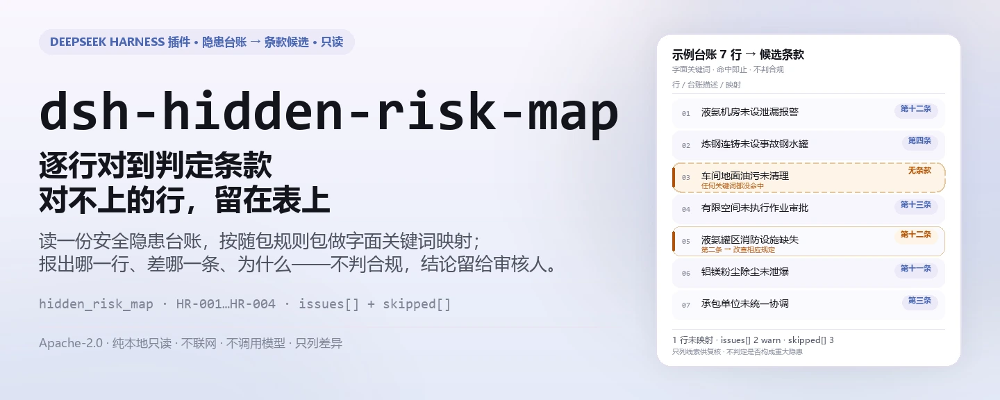
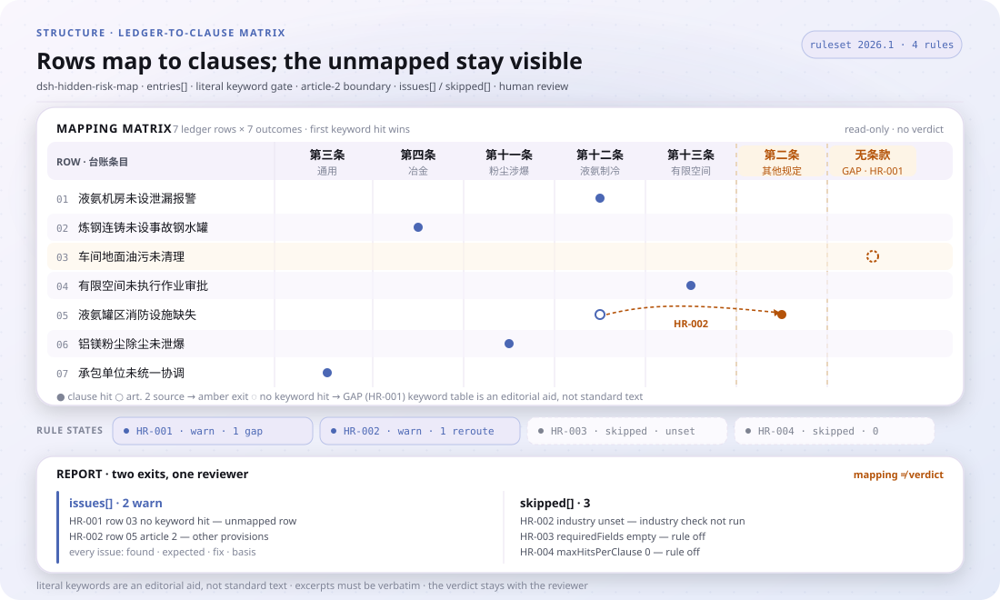

<div align="center">

<picture>
  <source media="(prefers-color-scheme: dark)" srcset="docs/assets/dsh-hidden-risk-map-hero-zh-dark.webp">
  
</picture>

# dsh-hidden-risk-map

**把安全隐患台账逐行映射到《工贸企业重大事故隐患判定标准》的候选条款——输出「哪一行、差哪一条、为什么」，定性结论留给审核人。**

面向 DeepSeek Harness 的数据型核查插件：读取一份安全隐患台账（每条已登记隐患一行，带台账实际有的列），按随包的版本化规则包（HR-001..HR-004）做字面关键词映射，只列台账自身能逐条指认的缺口，不判合规、不认定责任。

[安装](#三步上手) · [配置](#配置) · [FAQ](#faq) · [简体中文](README.md) · [English](README.en.md)

[](LICENSE)
[](#兼容性)
[](https://www.npmjs.com/package/dsh-hidden-risk-map)
[](https://github.com/PerryLink/dsh-hidden-risk-map/actions/workflows/ci.yml)
[](#兼容性)

[](https://github.com/PerryLink/dsh-hidden-risk-map/stargazers)
[](https://www.npmjs.com/package/dsh-hidden-risk-map)
[](https://dshfind.com/plugins/PerryLink/dsh-hidden-risk-map?ref=badge)
[](https://securityscorecards.dev/viewer/?uri=github.com/PerryLink/dsh-hidden-risk-map)
[](https://dsh.market/)
[](https://gitee.com/perrylink/dsh-hidden-risk-map)

```sh
dsh plugin --profile <name> add dsh-hidden-risk-map
```

</div>

<sub>社区插件，与 DeepSeek 官方无关。唯一仓库：<https://github.com/PerryLink/dsh-hidden-risk-map>（Gitee 为镜像）。</sub>

## 它是什么

`dsh-hidden-risk-map` 读取一份安全隐患台账——每条已登记隐患一行，带台账实际有的列——按字面关键词匹配 `隐患描述` 一类字段的文字，把每一行指向《工贸企业重大事故隐患判定标准》的候选条款，并报出台账自身的缺口而不是任何结论：完全没有匹配到条款的行、命中的条款属于其他行业或涉及判定标准第二条交给其他规定的危险化学品、消防、燃气、特种设备事项的行、命中条目缺少本机构配置的整改闭环字段的行、以及被超过配置上限的条目数命中的条款。每条发现都注明它来自哪一条条款；输出只供人工复核，台账的关键词表是人工归纳的检索词而不是标准原文，无法执行的检查在 `skipped` 中说明原因，而不是静默通过。

- **给谁用**：安全管理员、隐患排查岗；不用懂命令行，在对话里把材料交给它即可。
- **你交什么**：这项核对用到的原始材料（表格、清单或文书）；不改原件。Excel 可先转成 JSON/YAML，对话里也能代转。
- **它交什么**：一份「哪一行、差哪一条、为什么」的线索清单；没能执行的检查逐条列入 `skipped` 并写明原因。
- **它不做什么**：不判合规、不认定责任、不替代审核人；也不判定某事项是否构成重大事故隐患——那需要现场核查与专业判断。

<picture>
  <source media="(prefers-color-scheme: dark)" srcset="docs/assets/dsh-hidden-risk-map-flow-v5-dark.svg">
  
</picture>

## 三步上手

1. **安装**（三选一）：

   ```sh
   # git 通道（最新 main；等价于 git+https://github.com/PerryLink/dsh-hidden-risk-map.git）
   dsh plugin --profile <name> add github:PerryLink/dsh-hidden-risk-map
   # npm 通道（已发布版本）
   dsh plugin --profile <name> add dsh-hidden-risk-map
   # tarball 通道：本仓库 pnpm pack 后
   dsh plugin --profile <name> add ./dsh-hidden-risk-map-<version>.tgz
   ```

2. **最小配置**（默认即可用；bundle 行不带 `config` 时全部走默认值，规则包路径指向随包的 `rules/hidden-risk-map.yaml`）：

   ```yaml
   - insert:
       - id: dsh-hidden-risk-map
         name: dsh-hidden-risk-map
   ```

3. **验证已生效**（试跑需先 `pnpm run build` 产出 `lib/`）：

   ```sh
   dsh --profile <name> --dump-config | grep 'dsh-hidden-risk-map'
   node samples/quickstart/run.mjs --json
   # => {"tool":"hidden_risk_map","issueCount":1,"summary":{"error":0,"warn":1,"info":0},"skippedCount":3}
   ```

**卸载**：`dsh plugin --profile <name> remove dsh-hidden-risk-map`（或从 profile patch 删掉该行）。

<details>
<summary>在 WorkBuddy / 扣子中使用</summary>

在 WorkBuddy / 扣子搜「安全合规核对包」（本检查是其中一项；上架以商城为准）即可调用同一套核对能力，无需命令行。

</details>

## 核心能力

`dsh-hidden-risk-map` 注册 `hidden_risk_map` 工具：读入一份安全隐患台账，套用版本化规则包，返回一份报告——每条发现都写明它来自哪一条条款，每条没能执行的检查都写明原因。

- **四条规则一包带走** —— 规则包是数据不是代码（`rules/hidden-risk-map.yaml`），换掉规则包即换掉整套检查，不动一行 TypeScript。
- **只读材料** —— 接受 JSON 或 YAML，原件永不修改；纯 ESM，无网络请求、不调用模型。
- **未映射的行逐条列出** —— `HR-001` 的头号数字是「N 行未能映射」，不是「0 处隐患」；一行没匹配到任何条款，它会明确列出，而不是让这一行静默消失。
- **第二条交给其他规定** —— 危险化学品、消防（火灾）、燃气、特种设备由其他规定管辖；涉及这些事项的行报成「改查相应规定」，不做映射。
- **引文不造假** —— 每条规则带 `document` / `number` / `clause` / `excerpt` / `kind` / `source`；`excerpt` 必须是逐字引文，本次未取得原文的规则在 `excerpt` 里如实写明并标为 `derived-from-principle`。
- **严重级跟着证据走** —— `derived-from-principle` 最高 `warn`，本机构配置（`institutional-configuration`）最高 `info`，并有测试断言。
- **空清单 ≠ 没问题** —— 每条没能执行的检查都进 `skipped` 并写明原因；必填清单未配置的规则自我报告 `skipped`，绝不静默通过。
- **措辞不作裁决** —— 报告只列差异，不判定合规、责任或正确性；措辞守卫（wording guard）强制执行，报告永远附带免责声明。

| 规则 | 核对内容 | 严重级 | 依据类别 |
|---|---|---|---|
| `HR-001` | 台账每一行都能定位到条款，或明确列为未映射 | warn | principle |
| `HR-002` | 命中条款属于本部署的行业，或改查其他规定 | warn | direct |
| `HR-003` | 命中行带齐配置的整改闭环字段（默认关闭） | warn | principle |
| `HR-004` | 单一条款被过多行命中时提请复核（默认关闭） | info | principle |

### 示例

以下为插件真实入口；安装后调用一次即可。详细走查是本插件对自己 `HR-001` 测试夹具的**真实输出**，不是示意图；下表是常见问题的简短案例。

**详细示例** —— 工具 `hidden_risk_map`，输入：

```json
{"entries":[{"row":1,"隐患描述":"车间地面有一处油污未及时清理"}]}
```

输出：

```json
{
  "id": "dsh-hidden-risk-map.HR-001.e26f24c6",
  "ruleId": "HR-001",
  "severity": "warn",
  "locator": {
    "column": "隐患描述",
    "row": 1
  },
  "found": "台账条目「车间地面有一处油污未及时清理」未能匹配到判定标准的任何条款关键词",
  "expected": "台账条目应能对应到判定标准的具体条款，或确认不属于该标准的适用范围",
  "fix": "人工核对：可能属于其他行业条款、属于危化品/消防/燃气/特种设备等另有规定的情形，或表述与条款用词差异较大（可在 keywords 中补充本企业习惯用词）"
}
```

*Observed from `tests/fixtures/HR-001/HR-001-unsafe.json (cases.json expects HR-001 count 1); run via lib/index.mjs rules/hidden-risk-map.yaml`*

| 你会问 | 它怎么答 |
|---|---|
| 台账跑完了，一条条款都没报出来，是不是就没有重大事故隐患？ | 不是。这个工具的头号数字是「没能映射到条款的行数」，不是「零隐患」的结论。`HR-001` 会把文字匹配不到任何条款关键词的行逐条列出：可能属于其他行业条款、属于另有规定的情形，或表述与关键词表用词不同。它只指出「定位不到条款」这一事实，不判断该行是否构成重大事故隐患。 |
| 导出的台账里有编号、有日期，就是没有叫 `隐患描述` 的列。 | 读取器会拒绝这份材料，不猜。它不会把最长的字段当成隐患文本。`隐患描述`、`隐患内容`、`问题描述`、`检查内容`、`描述`、`text`、`description`、`content`、`hazard` 一个都没有时，它会列出实际看到的列名（或说明一列都没有），并说明没有可用的隐患描述文本，因此检查不执行——连 `HR-001` 的未映射清单也不会被读成「通过」。 |
| 某行写的是「液氨制冷机房未设置氨气泄漏监测报警装置」，为什么没有映射到条款？ | `HR-001` 按字面匹配关键词：「这句话是不是在说氨气泄漏」属于复核人的判断，不做模糊语义匹配。含「液氨」的行只有在你的关键词表收录了这种用词时才会命中；本规则库在第十二条（industry 使用液氨制冷）下收了它。关键词表是人工归纳的检索词、不是标准原文，用词不同时请把本企业习惯用词补进 `keywords`。 |
| 某行涉及消防或特种设备，却被引了《工贸企业重大事故隐患判定标准》作为依据。 | 这正是 `HR-002` 在起作用，它不给该行定性。判定标准第二条把危险化学品、消防（火灾）、燃气、特种设备交给其他规定，所以本条引用这句原文，把该行报成「改查相应规定」，而不是映射。只有配置了本机构的 `industry` 之后，它才会另外报出「命中条款属于其他行业」；`industry` 留空时，它在 `skipped` 里说明行业归属未核对，而不是静默通过。 |
| 台账里没有 `整改措施`、`整改责任人`、`整改完成时间` 这几列。 | 配置了这几个字段名之后才轮到 `HR-003`：`requiredFields` 留空表示本条不执行，并在 `skipped` 里自报。配置之后，命中条款却缺了其中某列的行会被报出。本条只核对字段是否存在，不判断整改是否合格、是否已销号。 |
| 台账里很多行都命中第三条，其中几条看着像同一个缺陷写了两遍。 | `HR-004` 按条款归集命中，当某一条款被超过 `maxHitsPerClause` 条台账命中时报出，并列出命中行号。它是 `info` 级的提示线索：究竟是不是重复登记、是不是系统性缺陷，仍需人工判断。`maxHitsPerClause` 未配置（0）时本条不执行，并在 `skipped` 里说明。 |

## 依据的标准

| 文件 | 文号 | 引用它的规则 |
|---|---|---|
| 《工贸企业重大事故隐患判定标准》 | 应急管理部令第10号 | HR-001, HR-002, HR-003, HR-004 |

**边界：** 本插件把一份**安全隐患台账**的每一行映射到重大事故隐患判定标准的候选条款上，并报出完全无法映射的行。它不是 `dsh-emergency-plan`（后者核对预案的要素完备性），也不是现场检查工具。它读取台账并产出**供复核的线索**——从不判定某事项属于或不属于重大事故隐患；那需要现场核查与专业判断。

> ### ⚠️ 这个插件最有用的地方，是承认它没能映射出什么
>
> 基于关键词的映射器，其失效方式是静默的：一行什么都没匹配到，就那样消失了，读者于是得出「未发现重大事故隐患」的结论。所以 `HR-001` 把这件事反过来：**每一行没有匹配到任何条款的记录都会被明确列出**，并附上它可能被漏掉的原因——属于其他行业的条款、由其他规定管辖的隐患类型，或者只是关键词表尚未收录的表述。因此，这个插件的头号数字是「N 行未能映射」，而不是「0 处隐患」。
>
> **该标准已被替换，条文编号也随之改变。** 现行有效的判定标准是 **应急管理部令第10号《工贸企业重大事故隐患判定标准》**（2023-03-20 通过，2023-04-14 公布，**2023-05-15 施行**）。其第十五条明确废止 安监总管四〔2017〕129号《工贸行业重大生产安全事故隐患判定标准（2017版）》。本规则库只引用第10号令的条文编号，并且有测试断言：被取代的 2017 年文号绝不会出现。
>
> **有两件事这个插件刻意不做。** 它不判定某一行*就是*重大事故隐患；它也不对判定标准第二条交给其他规定管辖的隐患进行分类——危险化学品、消防、燃气和特种设备由*其他*规定管辖，因此涉及这些事项的行会被报成「改查相应规定」，而不是被映射。

## 配置

全部可调参数都是 `src/config.ts` 里的 Schemastery `Config` 字段（可从 cordis.yml 覆盖）；逐条阈值在 `rules/` 下的规则库文件里。按 id 覆盖会替换整行——请重述所有需要的键。

| 键 | 类型 | 默认值 | 说明 |
|---|---|---|---|
| `rulesFile` | string | `rules/hidden-risk-map.yaml` | 规则库文件路径，相对插件包根目录 |
| `disabledRules` | string[] | `[]` | 要停用的规则 id 列表；每条都会出现在 `skipped` 中 |
| `onlyRules` | string[] | `[]` | 只执行这些规则 id；留空表示执行全部规则 |
| `skipNotes` | string | `""` | 附加到每条 `skipped` 说明后的备注 |
| `timeoutMs` | number | `120000` | 工具协作式超时预算（毫秒） |

值得了解的规则级参数：

- `HR-001` `clauses` —— 条款表：`article`、`industry`、`excerpt` 与选中该条的 `keywords`。**关键词是人工归纳的检索词，不是标准原文。** 它把台账的一句话指向候选条款；使用中请把本企业习惯用词补进 `keywords`。`tagField`（默认 `隐患类别`）指定从哪一栏读取隐患类别。
- `HR-002` `industry` —— 本企业所属行业。留空表示行业归属检查无法执行，并会说明。`industryField`（默认 `所属行业`）指定从哪一栏读行业；`otherRegimes` 列出判定标准第二条交给其他规定的隐患类型。
- `HR-003` `requiredFields` —— 本机构程序要求的整改闭环列，例如 `[整改措施, 整改责任人, 整改完成时间]`。留空表示该条不执行。
- `HR-004` `maxHitsPerClause` —— 某条款被超过这个条数的台账命中时报出；`0` 表示关闭。

profile patch 覆盖示例：

```yaml
- insert:
    - id: dsh-hidden-risk-map
      name: dsh-hidden-risk-map
      config:
        disabledRules: [HR-004]
        timeoutMs: 180000
```

## 材料格式

工具接受 JSON 或 YAML。每条目可以是隐患文本，也可以是台账自身列名的映射：

```yaml
entries:
  - { row: 1, 隐患描述: 炼钢连铸流程未设置事故钢水罐, 整改措施: 增设事故钢水罐, 整改责任人: 张工 }
  - { row: 2, 隐患描述: 液氨制冷机房未设置氨气泄漏监测报警装置 }
```

文本从该行携带的 `隐患描述`、`隐患内容`、`问题描述`、`检查内容`、`描述`、`text`、`description`、`content`、`hazard` 中第一个存在的列读取。**若这些列一个都没有，读取器拒绝材料而不是猜测**——早期版本曾把最长的字段提升为「隐患文本」，结果把编号静默当成了发现。字段在读取层是可选的，由检查引擎校验，因此部分导出的材料会产生「缺项」类差异，而不是让程序崩溃。

## 规则来源

规则数据在 `rules/hidden-risk-map.yaml`，与代码分离：每条规则都带文件名、文号、按原文自身编号体系的条款号、逐字摘录与来源地址。加载期强制摘录是真实引文且不少于八个字符，也禁止依据仅为原则性条款（`kind: derived-from-principle`，最高 `warn`）或本机构配置（`kind: institutional-configuration`，最高 `info`）的检查被标为 `error`；夸大依据的规则库会在加载期失败，而不会产出一份看起来很有底气的报告。

引用的条款出自 **应急管理部令第10号**。条款表覆盖第三条的通用企业情形与第四至十四条的行业条款。关键词表是为本插件编写的检索词，并在包内标注（标准本身没有关键词表——有测试断言规则库写明了这一点）。

两件塑造了本规则库的事：

1. **标准已被替换**（2017 版被 2023 年第10号令第十五条废止），因此只引用现行条号。
2. **第二条把四类隐患交给其他规定。** 危险化学品、消防（火灾）、燃气、特种设备由*其他*规定判定，所以 `HR-002` 把这些行报成「改查相应规定」，而不在这里映射。

核验中确认的边界与「刻意没有作出的结论」收录在 `rules/evidence/` 目录。

## FAQ

<details>
<summary>台账跑完了，一条条款都没报出来，是不是就没有重大事故隐患？</summary>

不是。工具的头号数字是「没能映射到条款的行数」，不是「零隐患」的结论。`HR-001` 会把文字匹配不到任何条款关键词的行逐条列出：可能属于其他行业条款、属于另有规定的情形，或表述与关键词表用词不同。它只指出「定位不到条款」这一事实，不判断该行是否构成重大事故隐患。

</details>

<details>
<summary>导出的台账有编号、有日期，就是没有叫 `隐患描述` 的列，会怎样？</summary>

读取器会拒绝这份材料，不猜。它不会把最长的字段当成隐患文本。`隐患描述`、`隐患内容`、`问题描述`、`检查内容`、`描述`、`text`、`description`、`content`、`hazard` 一个都没有时，它列出实际看到的列名（或说明一列都没有），并说明没有可用的隐患描述文本，因此检查不执行——连 `HR-001` 的未映射清单也不会被读成「通过」。

</details>

<details>
<summary>某行写的是「液氨制冷机房未设置氨气泄漏监测报警装置」，为什么没有映射到条款？</summary>

`HR-001` 按字面匹配关键词：「这句话是不是在说氨气泄漏」属于复核人的判断，不做模糊语义匹配。含「液氨」的行只有在关键词表收录了这种用词时才会命中；本规则库在第十二条（`industry` 使用液氨制冷）下收了它。关键词表是人工归纳的检索词、不是标准原文，用词不同时请把本企业习惯用词补进 `keywords`。

</details>

<details>
<summary>某行涉及消防或特种设备，却被引了《工贸企业重大事故隐患判定标准》作为依据，是怎么回事？</summary>

这正是 `HR-002` 在起作用，它不给该行定性。判定标准第二条把危险化学品、消防（火灾）、燃气、特种设备交给其他规定，所以本条引用这句原文，把该行报成「改查相应规定」，而不是映射。只有配置了本机构的 `industry` 之后，它才会另外报出「命中条款属于其他行业」；`industry` 留空时，它在 `skipped` 里说明行业归属未核对，而不是静默通过。

</details>

<details>
<summary>台账里没有 `整改措施`、`整改责任人`、`整改完成时间` 这几列，`HR-003` 会怎样？</summary>

配置了这几个字段名之后才轮到 `HR-003`：`requiredFields` 留空表示本条不执行，并在 `skipped` 里自报。配置之后，命中条款却缺了其中某列的行会被报出。本条只核对字段是否存在，不判断整改是否合格、是否已销号。它默认关闭还有一层原因：规则库没有核验到「整改闭环字段」的逐字国家条款，于是选择关闭这条规则，而不是编造一条依据。

</details>

<details>
<summary>台账里很多行都命中第三条，其中几条看着像同一个缺陷写了两遍。</summary>

`HR-004` 按条款归集命中，当某一条款被超过 `maxHitsPerClause` 条台账命中时报出，并列出命中行号。它是 `info` 级的提示线索：究竟是不是重复登记、是不是系统性缺陷，仍需人工判断。`maxHitsPerClause` 未配置（0）时本条不执行，并在 `skipped` 里说明。

</details>

<details>
<summary>一整份几百上千行的台账一起查，性能吃得消吗？</summary>

检查本身是纯本地的字面关键词匹配与字段核对，无网络请求、不调用模型；`timeoutMs`（默认 120 秒）是协作式超时预算。`native` 与 `ptc` 两种工具模式都能跑；批量校验整份台账时建议 `ptc`，schema 成本只付一次。

</details>

## 排障

- **大多数行被报成未映射。** 这是插件在工作：要么台账用词不在关键词表里（把词补进去），要么这些行确实属于其他规定（看 `HR-002` 的输出）。
- **行业归属检查从不执行。** `industry` 为空。配置它，或者明确地让这项检查保持关闭。
- **`HR-003` 从不执行。** `requiredFields` 为空，且其说明记录着：没有核验到整改闭环字段的逐字国家条款——所以这条规则随包关闭，而不是编造一条依据。
- **读取器拒绝了以前能接受的台账。** 它找不到任何一个已知的描述列。错误信息会列出它实际看到的列；把其中一列改成已知名称，或改用 `entries` 列表形式。
- **发现里写着「条款原文本次未取得」。** 规则包遵循引文门禁：绝不编造条款原文。原文拿不到时，发现停在 `warn` / `info` 并在 `excerpt` 里写明。请把它当作核验缺口，而不是材料合规的证明。
- **报告里全是 `warn` / `info`。** 设计如此：本插件不作出法律、安全或监管定性，只报差异和缺口，由人决定怎么处理。
- **插件装上了但工具不出现。** 确认 `main` 指向 `lib/index.mjs` 且 `pnpm run build` 已生成该文件；`main` 写错会让加载器静默跳过该条目。
- **`dsh plugin add` 报版本不兼容。** peer 范围覆盖 `0.1.x` 与 `0.2.x`；若运行时在其之外，可显式豁免：`dsh plugin --profile <name> allow-version dsh-hidden-risk-map@<version> --dsh-version <runtime> --accept-risk`
- **`check` 报 `manifest-peers` 失败。** 静态检查器比对的是一份早于 0.2 世代的硬编码 peer 范围；安装期的 peer 校验以运行时为准，声明的范围才是正确的。这是 `dsh-plugin-dev` 的已知上游问题。
- **报告问题。** 在 <https://github.com/PerryLink/dsh-hidden-risk-map/issues> 提交，附上插件版本、DSH 宿主版本、所用命令或工具调用、最小化且已脱敏的输入与实际/期望结果；不要粘贴凭据、令牌、个人数据或受封存的证据原文。

## 兼容性

| 项目 | 状态 |
|---|---|
| Harness | 对等版本范围 `>=0.1.2-rc.1 <0.2.0 \|\| >=0.2.0-0 <0.3.0` —— 已实测同时接受 `0.2.0-rc.2` 与 `0.2.1-rc.2`。已声明 `engines.dsh`：0.2.1 起由宿主单独裁决，范围为 `>=0.2.1-0 <0.3.0` |
| Node | `^22.19.0 \|\| >=24.0.0` |
| 平台 | 全平台（纯 ESM；无原生代码、无联网、不调用模型） |
| 工具模式 | `native` / `ptc` 均可；批量校验整份台账时建议 `ptc`，schema 成本只付一次 |

## 生态与质量

- [Gitee 镜像](https://gitee.com/perrylink/dsh-hidden-risk-map)（同步镜像，以 GitHub 为准）
- [dshfind 插件页](https://dshfind.com/plugins/PerryLink/dsh-hidden-risk-map)（安装量与排名）
- [OpenSSF Scorecard 报告](https://securityscorecards.dev/viewer/?uri=github.com/PerryLink/dsh-hidden-risk-map)（由 [.github/workflows/scorecard.yml](.github/workflows/scorecard.yml) 驱动）
- [DSH Market](https://dsh.market/)（已上架）
- **1024 商店渠道**：先 `npm i -g dsh1024`，再 `dsh1024 plugin --profile <name> add dsh-hidden-risk-map`（计入 [deepseek1024.com](https://deepseek1024.com) 安装排行）
- [生态实测知识库](https://perrylink.github.io/dsh-plugin-guide/)：插件开发指南 · 选型实测数据 · 维护取舍判据

## 开发

```sh
pnpm install                                        # node ^22.19 || >=24
pnpm run typecheck                                  # tsc --noEmit
pnpm test                                           # vitest：每条规则有成对夹具
pnpm run build                                      # tsdown -> lib/index.mjs + lib/index.d.mts
pnpm run verify:self-contained                      # 依赖 spec 均来自 registry
pnpm run check:lockfile                             # lockfile 漂移检查
pnpm run check:readmes                              # 五语 README 一致性
pnpm run check:citations                            # 规则包引文基线
node ../scripts/sync-shared.mjs dsh-hidden-risk-map # 从 ../_shared 刷新 src/shared
pnpm pack                                           # 发布 tarball
```

`src/check.ts` 是不碰 I/O、不读时钟、不调用模型的纯检查核心；`rules/hidden-risk-map.yaml` 声明每一条规则。主要路径：

| 路径 | 作用 |
|---|---|
| `src/index.ts` | function-plugin 契约；注册 `hidden_risk_map` 工具并解析随包规则库 |
| `src/check.ts` | 纯检查核心 `(input, ruleset, options) => Report` |
| `src/parse.ts` | JSON / YAML 材料读取器 |
| `src/config.ts` | Schemastery schema：全部可调参数都在这里 |
| `src/shared/` | 共享件副本（随包自包含，不从外部导入） |
| `rules/hidden-risk-map.yaml` | 规则包，4 条规则 |
| `rules/evidence/` | 每条引文的核验记录 |
| `tests/fixtures/<RULE>/` | 每条规则的成对夹具 |
| `samples/quickstart/` | 无需安装即可试跑的本地样例 |

本地样例试跑（需先 `pnpm run build` 产出 `lib/`）：

```sh
node samples/quickstart/run.mjs --json
# => {"tool":"hidden_risk_map","issueCount":1,"summary":{"error":0,"warn":1,"info":0},"skippedCount":3}
```

样例输入在 `samples/quickstart/input/`，期望输出在 `samples/quickstart/expected/result.json`，截图见 `docs/assets/quickstart.png`。README 配图由 [`scripts/gen-readme-assets.py`](scripts/gen-readme-assets.py) 程序化生成（Python + Pillow），出 `docs/assets/dsh-hidden-risk-map-hero-{zh,en}-{light,dark}.webp` 与 `docs/assets/dsh-hidden-risk-map-flow-v5-{light,dark}.svg`，可重复执行；旧的单版流程图与演示图保留在 `docs/assets/` 供外链使用，README 只引用新生成的 hero 与 flow-v5。

Topics：`deepseek-harness`, `dsh`, `dsh-plugin`, `cordis`, `hidden`, `risk`, `map`

## 家族与致谢

本项目是 [PerryLink](https://github.com/PerryLink) 维护的 DeepSeek Harness 插件家族成员（全部 Apache-2.0）。完整家族索引见[按材料选核查器](https://perrylink.github.io/zh/checkers/choose/)与[全部插件](https://github.com/PerryLink)。如果这个插件帮到了你，**给个 star**——它不解锁任何功能，但会让下一个人更容易找到它。

- [@PerryLink](https://github.com/PerryLink) —— 创建者与维护者：台账→条款映射规则包（HR-001..HR-004）、`hidden_risk_map` 工具、第10号令条款核验记录与五语文档。

<details>
<summary>展开全部插件</summary>

| 插件 | 状态 |
|---|---|
| **[dsh-aqua-input-check](https://github.com/PerryLink/dsh-aqua-input-check)** |  |
| **[dsh-archive-check](https://github.com/PerryLink/dsh-archive-check)** |  |
| **[dsh-auto-review](https://github.com/PerryLink/dsh-auto-review)** |  |
| **[dsh-autotier](https://github.com/PerryLink/dsh-autotier)** | 🧊 已冻结 — 见仓库 README |
| **[dsh-bid-ca-precheck](https://github.com/PerryLink/dsh-bid-ca-precheck)** |  |
| **[dsh-bid-qual-check](https://github.com/PerryLink/dsh-bid-qual-check)** |  |
| **[dsh-cert-mcp](https://github.com/PerryLink/dsh-cert-mcp)** | 🧊 已冻结 — 见仓库 README |
| **[dsh-checkpoint-rewind](https://github.com/PerryLink/dsh-checkpoint-rewind)** |  |
| **[dsh-click](https://github.com/PerryLink/dsh-click)** |  |
| **[dsh-composer-history](https://github.com/PerryLink/dsh-composer-history)** |  |
| **[dsh-contract-stance](https://github.com/PerryLink/dsh-contract-stance)** |  |
| **[dsh-customs-doc-check](https://github.com/PerryLink/dsh-customs-doc-check)** |  |
| **[dsh-data-quality](https://github.com/PerryLink/dsh-data-quality)** | 🧊 已冻结 — 见仓库 README |
| **[dsh-demurrage-ledger](https://github.com/PerryLink/dsh-demurrage-ledger)** |  |
| **[dsh-doublecheck](https://github.com/PerryLink/dsh-doublecheck)** |  |
| **[dsh-drill-script-check](https://github.com/PerryLink/dsh-drill-script-check)** |  |
| **[dsh-eia-guide-check](https://github.com/PerryLink/dsh-eia-guide-check)** |  |
| **[dsh-emergency-plan](https://github.com/PerryLink/dsh-emergency-plan)** |  |
| **[dsh-essay-rubric-check](https://github.com/PerryLink/dsh-essay-rubric-check)** |  |
| **[dsh-evidence-check](https://github.com/PerryLink/dsh-evidence-check)** |  |
| **[dsh-export-ctl-check](https://github.com/PerryLink/dsh-export-ctl-check)** |  |
| **[dsh-fast](https://github.com/PerryLink/dsh-fast)** |  |
| **[dsh-fmea-table-check](https://github.com/PerryLink/dsh-fmea-table-check)** |  |
| **[dsh-forecast-penalty](https://github.com/PerryLink/dsh-forecast-penalty)** |  |
| **[dsh-fund-research](https://github.com/PerryLink/dsh-fund-research)** |  |
| **[dsh-github](https://github.com/PerryLink/dsh-github)** |  |
| **[dsh-gongwen-flow-check](https://github.com/PerryLink/dsh-gongwen-flow-check)** |  |
| **[dsh-gongwen-word-check](https://github.com/PerryLink/dsh-gongwen-word-check)** |  |
| **[dsh-guard-plan-qc](https://github.com/PerryLink/dsh-guard-plan-qc)** |  |
| **[dsh-hazchem-check](https://github.com/PerryLink/dsh-hazchem-check)** |  |
| **[dsh-hazplan-check](https://github.com/PerryLink/dsh-hazplan-check)** |  |
| **[dsh-hidden-risk-map](https://github.com/PerryLink/dsh-hidden-risk-map)** |  |
| **[dsh-hs-classify](https://github.com/PerryLink/dsh-hs-classify)** |  |
| **[dsh-icd-rule-check](https://github.com/PerryLink/dsh-icd-rule-check)** |  |
| **[dsh-industry-research](https://github.com/PerryLink/dsh-industry-research)** |  |
| **[dsh-lawcite-adapter](https://github.com/PerryLink/dsh-lawcite-adapter)** |  |
| **[dsh-laya](https://github.com/PerryLink/dsh-laya)** |  |
| **[dsh-lc-doc-check](https://github.com/PerryLink/dsh-lc-doc-check)** |  |
| **[dsh-learning-gap-check](https://github.com/PerryLink/dsh-learning-gap-check)** |  |
| **[dsh-library](https://github.com/PerryLink/dsh-library)** |  |
| **[dsh-local-ai](https://github.com/PerryLink/dsh-local-ai)** |  |
| **[dsh-lsp-actions](https://github.com/PerryLink/dsh-lsp-actions)** |  |
| **[dsh-mask](https://github.com/PerryLink/dsh-mask)** |  |
| **[dsh-mcp-panel](https://github.com/PerryLink/dsh-mcp-panel)** |  |
| **[dsh-medrec-qc](https://github.com/PerryLink/dsh-medrec-qc)** |  |
| **[dsh-memento](https://github.com/PerryLink/dsh-memento)** | 🧊 已冻结 — 见仓库 README |
| **[dsh-nsfc-form-check](https://github.com/PerryLink/dsh-nsfc-form-check)** |  |
| **[dsh-nurse-record-check](https://github.com/PerryLink/dsh-nurse-record-check)** |  |
| **[dsh-observe](https://github.com/PerryLink/dsh-observe)** |  |
| **[dsh-origin-rvc-check](https://github.com/PerryLink/dsh-origin-rvc-check)** |  |
| **[dsh-ota-review-check](https://github.com/PerryLink/dsh-ota-review-check)** |  |
| **[dsh-output-styles](https://github.com/PerryLink/dsh-output-styles)** |  |
| **[dsh-paper-doc-adapter](https://github.com/PerryLink/dsh-paper-doc-adapter)** |  |
| **[dsh-permission-rules](https://github.com/PerryLink/dsh-permission-rules)** |  |
| **[dsh-permit-report-check](https://github.com/PerryLink/dsh-permit-report-check)** |  |
| **[dsh-pipeline-check](https://github.com/PerryLink/dsh-pipeline-check)** |  |
| **[dsh-pleading-draft](https://github.com/PerryLink/dsh-pleading-draft)** |  |
| **[dsh-plugin-doctor](https://github.com/PerryLink/dsh-plugin-doctor)** | 🚫 已退役（仓库已归档） |
| **[dsh-plugin-guide](https://github.com/PerryLink/dsh-plugin-guide)** |  |
| **[dsh-plugin-kit](https://github.com/PerryLink/dsh-plugin-kit)** | 🚫 已退役（仓库已归档） |
| **[dsh-plugin-upgrade](https://github.com/PerryLink/dsh-plugin-upgrade)** | 🚫 已退役（仓库已归档） |
| **[dsh-policy-brief-draft](https://github.com/PerryLink/dsh-policy-brief-draft)** |  |
| **[dsh-power-loss-split](https://github.com/PerryLink/dsh-power-loss-split)** |  |
| **[dsh-power-ticket-check](https://github.com/PerryLink/dsh-power-ticket-check)** |  |
| **[dsh-ppap-check](https://github.com/PerryLink/dsh-ppap-check)** |  |
| **[dsh-protest-deadline](https://github.com/PerryLink/dsh-protest-deadline)** |  |
| **[dsh-railway-window](https://github.com/PerryLink/dsh-railway-window)** |  |
| **[dsh-repair-order-qc](https://github.com/PerryLink/dsh-repair-order-qc)** |  |
| **[dsh-research-report](https://github.com/PerryLink/dsh-research-report)** |  |
| **[dsh-review-reply-check](https://github.com/PerryLink/dsh-review-reply-check)** |  |
| **[dsh-rulefile-check](https://github.com/PerryLink/dsh-rulefile-check)** |  |
| **[dsh-safety-brief-check](https://github.com/PerryLink/dsh-safety-brief-check)** |  |
| **[dsh-score](https://github.com/PerryLink/dsh-score)** | 🧊 已冻结 — 见仓库 README |
| **[dsh-session-sync](https://github.com/PerryLink/dsh-session-sync)** |  |
| **[dsh-site-log-check](https://github.com/PerryLink/dsh-site-log-check)** |  |
| **[dsh-skill-pack-security](https://github.com/PerryLink/dsh-skill-pack-security)** |  |
| **[dsh-soe-decision-check](https://github.com/PerryLink/dsh-soe-decision-check)** |  |
| **[dsh-soilwater-check](https://github.com/PerryLink/dsh-soilwater-check)** |  |
| **[dsh-sop-sync-check](https://github.com/PerryLink/dsh-sop-sync-check)** |  |
| **[dsh-spc-gbt-adapter](https://github.com/PerryLink/dsh-spc-gbt-adapter)** |  |
| **[dsh-talk](https://github.com/PerryLink/dsh-talk)** |  |
| **[dsh-tender-extract](https://github.com/PerryLink/dsh-tender-extract)** |  |
| **[dsh-tender-matrix](https://github.com/PerryLink/dsh-tender-matrix)** |  |
| **[dsh-test-drive](https://github.com/PerryLink/dsh-test-drive)** |  |
| **[dsh-ticktick](https://github.com/PerryLink/dsh-ticktick)** | 🚫 已退役（仓库已归档） |
| **[dsh-translate](https://github.com/PerryLink/dsh-translate)** |  |
| **[dsh-warranty-calc](https://github.com/PerryLink/dsh-warranty-calc)** |  |
| **[dsh-budget](https://github.com/PerryLink/dsh-budget)** | 🧊 已冻结 — 见仓库 README |
| **[dsh-claude-move](https://github.com/PerryLink/dsh-claude-move)** | 🧊 已冻结 — 见仓库 README |
| **[dsh-defend](https://github.com/PerryLink/dsh-defend)** | 🧊 已冻结 — 见仓库 README |
| **[dsh-draw](https://github.com/PerryLink/dsh-draw)** | 🧊 已冻结 — 见仓库 README |
| **[dsh-reach](https://github.com/PerryLink/dsh-reach)** | 🧊 已冻结 — 见仓库 README |
| **[dsh-background-agents](https://github.com/PerryLink/dsh-background-agents)** | 🚫 已退役（仓库已归档） |
| **[dsh-session-pin](https://github.com/PerryLink/dsh-session-pin)** | 🚫 已退役（仓库已归档） |
| **[dsh-team-rooms](https://github.com/PerryLink/dsh-team-rooms)** | 🚫 已退役（仓库已归档） |

</details>

## License

[LICENSE](LICENSE)（Apache License 2.0）© 2026 dsh-hidden-risk-map contributors

<p align="center"><sub>Apache-2.0 · 社区插件，与 DeepSeek 无关。</sub></p>
