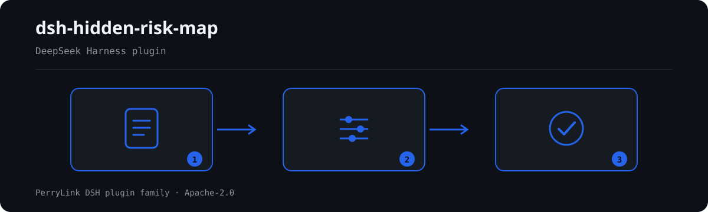

# dsh-hidden-risk-map — Hazard ledger entry mapping onto candidate clauses of the major-accident-hazard determination standard

[English](README.md) · [简体中文](README-zh.md) · [Español](README-es.md) · [Português](README-pt.md) · [हिन्दी](README-hi.md)

```sh
dsh plugin --profile <name> add dsh-hidden-risk-map
```


[](https://dsh.market/)

`dsh-hidden-risk-map` reads one safety hazard ledger — one row per recorded hazard, with the columns that ledger actually carries — and maps each row onto candidate clauses of the major-accident-hazard determination standard by literal keyword matching over the text of fields such as `隐患描述`, and reports that index's own gaps rather than any judgement: the rows that matched no clause at all, the matched rows whose clause belongs to another industry or touches hazardous chemicals, fire, gas or special equipment that article 2 hands to other provisions, the matched rows missing the remediation-closure fields the institution configured, and the clauses hit by more rows than the configured ceiling. Every finding names the article it came from; the output is leads for review, the ledger's keyword table is an editorial aid rather than standard text, and a check that could not run states its reason in `skipped` instead of passing in silence.

## Install

```sh
dsh plugin --profile <name> add dsh-hidden-risk-map
dsh --profile <name> --dump-config | grep 'dsh-hidden-risk-map'
```

## What it looks like



*Workflow overview: call → plugin → result. The examples below use the real command surface.*


## What it answers

### Examples

The table below is the example set: the first row is the detailed walkthrough, the remaining rows are short cases.

| You ask | What it answers |
|---|---|
| The ledger was run and no clause was flagged — does that mean no major accident hazard? | No. The tool's headline count is the rows it could not map, not a zero-hazard verdict. `HR-001` lists every row whose text matched no clause keyword: a different industry's clause, a hazard type governed by other provisions, or wording the keyword table does not carry yet. It reports only that no clause could be located, and it does not decide whether that row is or is not a major accident hazard. |
| An export carries a serial number and a date, but no column named `隐患描述`. | The reader refuses the material instead of guessing; it never promotes the longest field to be the hazard text. With none of `隐患描述`, `隐患内容`, `问题描述`, `检查内容`, `描述`, `text`, `description`, `content` or `hazard` present it names the columns it did see (or reports that there were none) and states that no usable hazard-description text exists, so the check does not run and nothing - not even `HR-001`'s unmapped list - is read as a pass. |
| The row is written 液氨制冷机房未设置氨气泄漏监测报警装置 — why is it not mapped? | `HR-001` matches keywords literally, because whether a sentence is about ammonia leakage is the reviewer's call and not a fuzzy text judgement. A row about 液氨 is mapped only when your keyword table carries that wording; the lemma carries it under 第十二条 (industry 使用液氨制冷). The keyword lists are an editorial aid written for this plugin, not standard text, so add your site's own vocabulary to `keywords` when the wording differs. |
| A row mentions 消防 or 特种设备, and the standard is quoted at me as its basis. | That is `HR-002` working, and it does not classify the row. Article 2 hands hazardous chemicals, fire, gas and special equipment to other provisions, so the rule quotes that sentence and reports the row as "check the corresponding regulation" instead of mapping it. Only when this deployment's `industry` is configured does it also flag a matched clause that belongs to another industry; if `industry` is empty, it says in `skipped` that the industry check did not run rather than passing quietly. |
| The ledger rows carry no 整改措施, 整改责任人 or 整改完成时间 columns. | That is `HR-003` only after those names are configured: `requiredFields` empty means the check does not run and the rule reports itself in `skipped`. Once configured, a matched row missing one of those columns is reported. The rule checks that the columns exist — it does not judge whether the remediation is adequate or whether the item has been closed out. |
| Many rows of the ledger hit 第三条, including a few that look like the same defect written twice. | `HR-004` groups the matches by article and reports when one article is hit by more rows than `maxHitsPerClause` allows, listing the row numbers. It is an `info`-level lead for human review: deciding whether that is a duplicate entry or a systematic defect stays with the reviewer. An unset `maxHitsPerClause` (0) means the rule does not run, and it says so in `skipped`. |

## Standards it follows

| Document | Number | Cited by rules |
|---|---|---|
| 《工贸企业重大事故隐患判定标准》 | 应急管理部令第10号 | HR-001, HR-002, HR-003, HR-004 |

**Boundary:** this plugin maps each row of a **safety hazard ledger** onto candidate clauses of the
major-accident-hazard determination standard, and reports which rows could not be mapped at all. It is
not `dsh-emergency-plan` (which checks a plan's element completeness) and not a site inspection tool.
It reads a ledger and produces **leads for review** — never a determination that something is or is not
a major accident hazard, which needs a site visit and professional judgement.

> ### ⚠️ The most useful thing this plugin does is admit what it could not map
>
> The failure mode of a keyword-based mapper is silent: a row that matches nothing simply vanishes, and
> a reader concludes "no major hazards found". So `HR-001` inverts that: **every row that matched no
> clause is listed explicitly**, with the reason it might have been missed — a different industry's
> clause, a hazard type governed by other rules, or simply wording the keyword table does not carry yet.
> The plugin's headline number is therefore "N rows are unmapped", not "0 hazards".
>
> **The standard was replaced, and its article numbers moved with it.** The determination standard in
> force is **应急管理部令第10号《工贸企业重大事故隐患判定标准》** (adopted 2023-03-20, published
> 2023-04-14, **in force 2023-05-15**). Its article 15 expressly repeals
> 安监总管四〔2017〕129号《工贸行业重大生产安全事故隐患判定标准（2017版）》. This pack cites only
> the 第10号令 article numbers, and a test asserts that the superseded 2017 number never appears.
>
> **Two things this plugin deliberately does not do.** It does not decide that a row *is* a major
> hazard; and it does not classify hazards that article 2 hands to other regimes — hazardous
> chemicals, fire, gas and special equipment are governed by *other* provisions, so a row touching them
> is reported as "check the corresponding regulation instead", not mapped.

## Compatibility

| Surface | Status |
|---|---|
| Harness | Peer range `>=0.1.2-rc.1 <0.2.0 \|\| >=0.2.0-0 <0.3.0` — verified to accept both `0.2.0-rc.2` and `0.2.1-rc.2`. `engines.dsh` is declared as `>=0.2.1-0 <0.3.0` and is enforced by the host since 0.2.1 |
| Node | `^22.19.0 || >=24.0.0` |
| Platforms | All (plain ESM; no native code, no network, no model call) |
| Tool mode | Works in `native` and `ptc`; for a whole ledger use `ptc` |

## What it does

Registers the `hidden_risk_map` tool. It reads a hazard ledger — one row per recorded hazard, with the
columns the ledger actually carries — applies a versioned rule pack, and returns a report whose every
finding names the article it came from.

| Rule | Check | Severity | Basis kind |
|---|---|---|---|
| `HR-001` | every row maps to a clause, or is listed as unmapped | warn | principle |
| `HR-002` | a matched clause belongs to this deployment's industry, or defers to another regime | warn | direct |
| `HR-003` | a matched row carries the configured remediation fields (off by default) | warn | principle |
| `HR-004` | one clause hit by many rows is flagged for review (off by default) | info | principle |

## Configuration

| Key | Type | Default | Description |
|---|---|---|---|
| `rulesFile` | string | `rules/hidden-risk-map.yaml` | Rule-pack path, relative to the package root |
| `disabledRules` | string[] | `[]` | Rule ids to stop running; each appears in `skipped` |
| `onlyRules` | string[] | `[]` | Run only these rule ids; empty runs every rule |
| `skipNotes` | string | `""` | Note appended to every `skipped` reason |
| `timeoutMs` | number | `120000` | Cooperative tool timeout budget |

Rule-level parameters worth knowing:

- `HR-001` `clauses` — the article table: `article`, `industry`, `excerpt` and the `keywords` that
  select it. **The keywords are an editorial aid, not standard text.** They exist to point a ledger
  sentence at a candidate article; add your site's own vocabulary as you use it.
- `HR-002` `industry` — your enterprise's industry. Empty means the industry check cannot run and says
  so. `otherRegimes` lists the hazard types article 2 hands to other provisions.
- `HR-003` `requiredFields` — the remediation-closure columns your procedure requires, e.g.
  `[整改措施, 整改责任人, 整改完成时间]`. Empty means the rule does not run.
- `HR-004` `maxHitsPerClause` — flag a clause hit by more than this many rows. `0` disables it.

## Material format

The tool accepts JSON or YAML. Each entry is either the hazard text or a mapping of the ledger's own
columns:

```yaml
entries:
  - { row: 1, 隐患描述: 炼钢连铸流程未设置事故钢水罐, 整改措施: 增设事故钢水罐, 整改责任人: 张工 }
  - { row: 2, 隐患描述: 液氨制冷机房未设置氨气泄漏监测报警装置 }
```

The text is read from the first of `隐患描述`, `隐患内容`, `问题描述`, `检查内容`, `描述`, `text`,
`description`, `content`, `hazard` that the row carries. **If none of those columns is present the
reader refuses rather than guessing** — an earlier version promoted the longest field to "the hazard
text", which silently turned a serial number into a finding.

## Rule sources

Rule data lives in `rules/hidden-risk-map.yaml`. Every rule carries a document, a document number, a
clause in the source's own numbering, a verbatim excerpt and the URL the excerpt was read from. The
loader enforces that an excerpt is a real quotation of at least eight characters, and that a check
resting only on a general principle or a local policy can never be declared `error`.

The clauses quoted come from **应急管理部令第10号**. The article table covers the three general
enterprise situations (article 3) and the industry articles (articles 4–14). The keyword lists were
written for this plugin and are labelled as such in the pack, because the standard has no keyword list
— a test asserts that the pack says so.

Two findings shaped this pack:

1. **The standard was replaced** (2017 version repealed by article 15 of the 2023 order), so only
   current article numbers are cited.
2. **Article 2 hands four hazard types to other regulations.** Hazardous chemicals, fire, gas and
   special equipment are judged under *other* provisions, so `HR-002` reports those rows as
   "check the corresponding regulation" rather than mapping them here.

## Troubleshooting

- **Most rows are reported as unmapped.** That is the plugin working: either your ledger's wording is
  outside the keyword table (add the terms) or those rows genuinely fall under another regime (check
  `HR-002`'s output).
- **The industry check never runs.** `industry` is empty. Set it, or leave the check off knowingly.
- **`HR-003` never runs.** `requiredFields` is empty, and its note records that no verbatim national
  clause for remediation-closure fields was verified — so the rule ships off rather than inventing one.
- **The reader refuses a ledger it used to accept.** It found none of the known description columns.
  The error names the columns it saw; rename one to a known name, or use the `entries` list form.
- **The plugin installs but the tool never appears.** Check that `main` resolves to `lib/index.mjs` and
  that `pnpm run build` produced it; a wrong `main` makes the loader skip the entry silently.
- **`dsh plugin add` refuses the package as incompatible.** The peer range covers `0.1.x` and `0.2.x`;
  if your runtime sits outside it, grant an explicit exemption:
  `dsh plugin --profile <name> allow-version dsh-hidden-risk-map@0.1.0 --dsh-version <runtime> --accept-risk`
- **`check` reports `manifest-peers` as failed.** The static checker compares against a hard-coded peer
  range that predates the 0.2 line. The runtime enforces peer compatibility at install time, so the
  declared range is the correct one; this is a known upstream issue in `dsh-plugin-dev`.

## Development

```sh
pnpm install
pnpm run typecheck   # tsc --noEmit
pnpm test            # vitest, paired fixtures per rule
pnpm run build       # tsdown -> lib/index.mjs + lib/index.d.mts
node ../scripts/sync-shared.mjs dsh-hidden-risk-map   # refresh src/shared from ../_shared
```

## PerryLink DSH Plugin Family

This project is part of the DeepSeek Harness plugin family from [PerryLink](https://github.com/PerryLink). The roster stays collapsed below so every README keeps a short first screen; expand it to see every row and its status.

<details>
<summary>Expand all plugins</summary>

| Plugin | Status |
|---|---|
| **[dsh-aqua-input-check](https://github.com/PerryLink/dsh-aqua-input-check)** |  |
| **[dsh-archive-check](https://github.com/PerryLink/dsh-archive-check)** |  |
| **[dsh-auto-review](https://github.com/PerryLink/dsh-auto-review)** |  |
| **[dsh-autotier](https://github.com/PerryLink/dsh-autotier)** |  |
| **[dsh-bid-ca-precheck](https://github.com/PerryLink/dsh-bid-ca-precheck)** |  |
| **[dsh-bid-qual-check](https://github.com/PerryLink/dsh-bid-qual-check)** |  |
| **[dsh-cert-mcp](https://github.com/PerryLink/dsh-cert-mcp)** |  |
| **[dsh-checkpoint-rewind](https://github.com/PerryLink/dsh-checkpoint-rewind)** |  |
| **[dsh-click](https://github.com/PerryLink/dsh-click)** |  |
| **[dsh-composer-history](https://github.com/PerryLink/dsh-composer-history)** |  |
| **[dsh-contract-stance](https://github.com/PerryLink/dsh-contract-stance)** |  |
| **[dsh-customs-doc-check](https://github.com/PerryLink/dsh-customs-doc-check)** |  |
| **[dsh-data-quality](https://github.com/PerryLink/dsh-data-quality)** |  |
| **[dsh-demurrage-ledger](https://github.com/PerryLink/dsh-demurrage-ledger)** |  |
| **[dsh-doublecheck](https://github.com/PerryLink/dsh-doublecheck)** |  |
| **[dsh-drill-script-check](https://github.com/PerryLink/dsh-drill-script-check)** |  |
| **[dsh-eia-guide-check](https://github.com/PerryLink/dsh-eia-guide-check)** |  |
| **[dsh-emergency-plan](https://github.com/PerryLink/dsh-emergency-plan)** |  |
| **[dsh-essay-rubric-check](https://github.com/PerryLink/dsh-essay-rubric-check)** |  |
| **[dsh-evidence-check](https://github.com/PerryLink/dsh-evidence-check)** |  |
| **[dsh-export-ctl-check](https://github.com/PerryLink/dsh-export-ctl-check)** |  |
| **[dsh-fast](https://github.com/PerryLink/dsh-fast)** |  |
| **[dsh-fmea-table-check](https://github.com/PerryLink/dsh-fmea-table-check)** |  |
| **[dsh-forecast-penalty](https://github.com/PerryLink/dsh-forecast-penalty)** |  |
| **[dsh-fund-research](https://github.com/PerryLink/dsh-fund-research)** |  |
| **[dsh-github](https://github.com/PerryLink/dsh-github)** |  |
| **[dsh-gongwen-flow-check](https://github.com/PerryLink/dsh-gongwen-flow-check)** |  |
| **[dsh-gongwen-word-check](https://github.com/PerryLink/dsh-gongwen-word-check)** |  |
| **[dsh-guard-plan-qc](https://github.com/PerryLink/dsh-guard-plan-qc)** |  |
| **[dsh-hazchem-check](https://github.com/PerryLink/dsh-hazchem-check)** |  |
| **[dsh-hazplan-check](https://github.com/PerryLink/dsh-hazplan-check)** |  |
| **[dsh-hidden-risk-map](https://github.com/PerryLink/dsh-hidden-risk-map)** |  |
| **[dsh-hs-classify](https://github.com/PerryLink/dsh-hs-classify)** |  |
| **[dsh-icd-rule-check](https://github.com/PerryLink/dsh-icd-rule-check)** |  |
| **[dsh-industry-research](https://github.com/PerryLink/dsh-industry-research)** |  |
| **[dsh-lawcite-adapter](https://github.com/PerryLink/dsh-lawcite-adapter)** |  |
| **[dsh-laya](https://github.com/PerryLink/dsh-laya)** |  |
| **[dsh-lc-doc-check](https://github.com/PerryLink/dsh-lc-doc-check)** |  |
| **[dsh-learning-gap-check](https://github.com/PerryLink/dsh-learning-gap-check)** |  |
| **[dsh-library](https://github.com/PerryLink/dsh-library)** |  |
| **[dsh-local-ai](https://github.com/PerryLink/dsh-local-ai)** |  |
| **[dsh-lsp-actions](https://github.com/PerryLink/dsh-lsp-actions)** |  |
| **[dsh-mask](https://github.com/PerryLink/dsh-mask)** |  |
| **[dsh-mcp-panel](https://github.com/PerryLink/dsh-mcp-panel)** |  |
| **[dsh-medrec-qc](https://github.com/PerryLink/dsh-medrec-qc)** |  |
| **[dsh-memento](https://github.com/PerryLink/dsh-memento)** |  |
| **[dsh-nsfc-form-check](https://github.com/PerryLink/dsh-nsfc-form-check)** |  |
| **[dsh-nurse-record-check](https://github.com/PerryLink/dsh-nurse-record-check)** |  |
| **[dsh-observe](https://github.com/PerryLink/dsh-observe)** |  |
| **[dsh-origin-rvc-check](https://github.com/PerryLink/dsh-origin-rvc-check)** |  |
| **[dsh-ota-review-check](https://github.com/PerryLink/dsh-ota-review-check)** |  |
| **[dsh-output-styles](https://github.com/PerryLink/dsh-output-styles)** |  |
| **[dsh-paper-doc-adapter](https://github.com/PerryLink/dsh-paper-doc-adapter)** |  |
| **[dsh-permission-rules](https://github.com/PerryLink/dsh-permission-rules)** |  |
| **[dsh-permit-report-check](https://github.com/PerryLink/dsh-permit-report-check)** |  |
| **[dsh-pipeline-check](https://github.com/PerryLink/dsh-pipeline-check)** |  |
| **[dsh-pleading-draft](https://github.com/PerryLink/dsh-pleading-draft)** |  |
| **[dsh-plugin-doctor](https://github.com/PerryLink/dsh-plugin-doctor)** |  |
| **[dsh-plugin-guide](https://github.com/PerryLink/dsh-plugin-guide)** |  |
| **[dsh-plugin-kit](https://github.com/PerryLink/dsh-plugin-kit)** |  |
| **[dsh-plugin-upgrade](https://github.com/PerryLink/dsh-plugin-upgrade)** |  |
| **[dsh-policy-brief-draft](https://github.com/PerryLink/dsh-policy-brief-draft)** |  |
| **[dsh-power-loss-split](https://github.com/PerryLink/dsh-power-loss-split)** |  |
| **[dsh-power-ticket-check](https://github.com/PerryLink/dsh-power-ticket-check)** |  |
| **[dsh-ppap-check](https://github.com/PerryLink/dsh-ppap-check)** |  |
| **[dsh-protest-deadline](https://github.com/PerryLink/dsh-protest-deadline)** |  |
| **[dsh-railway-window](https://github.com/PerryLink/dsh-railway-window)** |  |
| **[dsh-repair-order-qc](https://github.com/PerryLink/dsh-repair-order-qc)** |  |
| **[dsh-research-report](https://github.com/PerryLink/dsh-research-report)** |  |
| **[dsh-review-reply-check](https://github.com/PerryLink/dsh-review-reply-check)** |  |
| **[dsh-rulefile-check](https://github.com/PerryLink/dsh-rulefile-check)** |  |
| **[dsh-safety-brief-check](https://github.com/PerryLink/dsh-safety-brief-check)** |  |
| **[dsh-score](https://github.com/PerryLink/dsh-score)** |  |
| **[dsh-session-sync](https://github.com/PerryLink/dsh-session-sync)** |  |
| **[dsh-site-log-check](https://github.com/PerryLink/dsh-site-log-check)** |  |
| **[dsh-skill-pack-security](https://github.com/PerryLink/dsh-skill-pack-security)** |  |
| **[dsh-soe-decision-check](https://github.com/PerryLink/dsh-soe-decision-check)** |  |
| **[dsh-soilwater-check](https://github.com/PerryLink/dsh-soilwater-check)** |  |
| **[dsh-sop-sync-check](https://github.com/PerryLink/dsh-sop-sync-check)** |  |
| **[dsh-spc-gbt-adapter](https://github.com/PerryLink/dsh-spc-gbt-adapter)** |  |
| **[dsh-talk](https://github.com/PerryLink/dsh-talk)** |  |
| **[dsh-tender-extract](https://github.com/PerryLink/dsh-tender-extract)** |  |
| **[dsh-tender-matrix](https://github.com/PerryLink/dsh-tender-matrix)** |  |
| **[dsh-test-drive](https://github.com/PerryLink/dsh-test-drive)** |  |
| **[dsh-ticktick](https://github.com/PerryLink/dsh-ticktick)** |  |
| **[dsh-translate](https://github.com/PerryLink/dsh-translate)** |  |
| **[dsh-warranty-calc](https://github.com/PerryLink/dsh-warranty-calc)** |  |
| **[dsh-budget](https://github.com/PerryLink/dsh-budget)** | 🧊 FROZEN — see the repo README |
| **[dsh-claude-move](https://github.com/PerryLink/dsh-claude-move)** | 🧊 FROZEN — see the repo README |
| **[dsh-defend](https://github.com/PerryLink/dsh-defend)** | 🧊 FROZEN — see the repo README |
| **[dsh-draw](https://github.com/PerryLink/dsh-draw)** | 🧊 FROZEN — see the repo README |
| **[dsh-reach](https://github.com/PerryLink/dsh-reach)** | 🧊 FROZEN — see the repo README |
| **[dsh-background-agents](https://github.com/PerryLink/dsh-background-agents)** | 🚫 RETIRED — see the repo README |
| **[dsh-session-pin](https://github.com/PerryLink/dsh-session-pin)** | 🚫 RETIRED — see the repo README |
| **[dsh-team-rooms](https://github.com/PerryLink/dsh-team-rooms)** | 🚫 RETIRED — see the repo README |

</details>

## License

[Apache License 2.0](LICENSE) © 2026 dsh-hidden-risk-map contributors.
