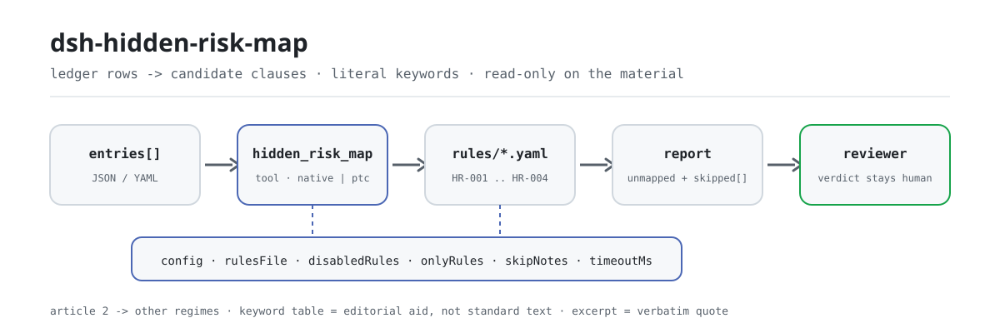

<div align="center">

<picture>
  <source media="(prefers-color-scheme: dark)" srcset="docs/assets/dsh-hidden-risk-map-flow-dark.svg">
  
</picture>

# dsh-hidden-risk-map

**Leva cada linha de um registo de riscos aos artigos candidatos da norma de determinação de riscos maiores — mostra «que linha, que artigo falta e porquê», e o veredicto fica com o revisor.**

Verificador de dados para o DeepSeek Harness: lê um registo de riscos (uma linha por risco registado, com as colunas que esse registo realmente traz), aplica o pacote de regras versionado (HR-001..HR-004) por correspondência literal de palavras-chave e só relata as lacunas que consegue apontar linha a linha — sem veredicto de conformidade nem atribuição de responsabilidade.

[Instalação](#instalação-em-três-passos) · [Configuração](#configuração) · [FAQ](#faq) · [简体中文](README.md) · [English](README.en.md) · [Español](README.es.md) · [Português](README.pt.md) · [हिन्दी](README.hi.md)

[](LICENSE)
[](#compatibilidade)
[](https://www.npmjs.com/package/dsh-hidden-risk-map)
[](https://github.com/PerryLink/dsh-hidden-risk-map/actions/workflows/ci.yml)
[](#compatibilidade)

[](https://github.com/PerryLink/dsh-hidden-risk-map/stargazers)
[](https://www.npmjs.com/package/dsh-hidden-risk-map)
[](https://dshfind.com/plugins/PerryLink/dsh-hidden-risk-map?ref=badge)
[](https://securityscorecards.dev/viewer/?uri=github.com/PerryLink/dsh-hidden-risk-map)
[](https://dsh.market/)
[](https://gitee.com/perrylink/dsh-hidden-risk-map)

```sh
dsh plugin --profile <name> add dsh-hidden-risk-map
```

</div>

<sub>Complemento comunitário, não afiliado à DeepSeek. Repositório canónico: <https://github.com/PerryLink/dsh-hidden-risk-map> (o Gitee é um espelho).</sub>

## O que é

`dsh-hidden-risk-map` lê um registo de riscos — uma linha por risco registado, com as colunas que esse registo realmente traz — e leva cada linha aos artigos candidatos da norma de determinação de riscos maiores por correspondência literal de palavras-chave sobre o texto de campos como a coluna de descrição do risco, e relata as lacunas do próprio registo, não um juízo: as linhas que não corresponderam a artigo nenhum, as linhas cuja correspondência pertence a outra indústria ou toca produtos químicos perigosos, incêndio, gás ou equipamento especial que o artigo 2 remete para outras disposições, as linhas correspondidas às quais faltam os campos de fecho da correção configurados pela instituição, e os artigos atingidos por mais linhas do que o limite configurado. Cada achado nomeia o artigo de onde veio; o resultado são pistas para revisão, a tabela de palavras-chave é um auxiliar editorial e não texto da norma, e a verificação que não pôde ser executada declara o motivo em `skipped` em vez de passar em silêncio.

- **Para quem**: administradores de segurança e funções de inspeção de riscos; não é preciso saber usar a linha de comandos, basta entregar o material no chat.
- **O que entrega**: o material original sobre o qual a verificação trabalha (uma tabela, um registo ou um documento); o original nunca é modificado. O Excel pode ser convertido primeiro em JSON/YAML, também no chat se a plataforma o permitir.
- **O que devolve**: uma lista de pistas — que linha, que artigo, porquê; as verificações que não puderam ser executadas são listadas em `skipped` com o motivo.
- **O que não faz**: não dita conformidade, não atribui responsabilidade e não substitui o revisor; também não decide se um assunto constitui um risco maior — isso exige inspeção no local e juízo profissional.

## Instalação em três passos

1. **Instalar** (escolha um canal):

   ```sh
   # canal git (última main; equivale a git+https://github.com/PerryLink/dsh-hidden-risk-map.git)
   dsh plugin --profile <name> add github:PerryLink/dsh-hidden-risk-map
   # canal npm (versões publicadas)
   dsh plugin --profile <name> add dsh-hidden-risk-map
   # canal tarball: após pnpm pack neste repositório
   dsh plugin --profile <name> add ./dsh-hidden-risk-map-<version>.tgz
   ```

2. **Configuração mínima** (os valores predefinidos já servem; uma linha de bundle sem `config` assume todos e o caminho do pacote de regras aponta para o `rules/hidden-risk-map.yaml` incluído):

   ```yaml
   - insert:
       - id: dsh-hidden-risk-map
         name: dsh-hidden-risk-map
   ```

3. **Verificar que monta** (o teste local precisa de `pnpm run build` para produzir `lib/`):

   ```sh
   dsh --profile <name> --dump-config | grep 'dsh-hidden-risk-map'
   node samples/quickstart/run.mjs --json
   # => {"tool":"hidden_risk_map","issueCount":1,"summary":{"error":0,"warn":1,"info":0},"skippedCount":3}
   ```

**Desinstalar**: `dsh plugin --profile <name> remove dsh-hidden-risk-map` (ou remova a linha do profile patch).

<details>
<summary>Usar a partir do WorkBuddy / Coze</summary>

Procure «Safety Compliance Suite» no WorkBuddy / Coze (esta verificação é uma das suas partes; disponibilidade conforme o catálogo) para usar a mesma capacidade sem linha de comandos.

</details>

## Capacidades principais

`dsh-hidden-risk-map` regista a ferramenta `hidden_risk_map`: lê um registo de riscos, aplica um pacote de regras versionado e devolve um relatório em que cada achado nomeia o artigo de onde veio e cada verificação que não pôde ser executada indica o motivo.

- **Quatro regras num pacote** — o pacote é dados, não código (`rules/hidden-risk-map.yaml`); substituí-lo troca todo o conjunto de regras sem tocar numa linha de TypeScript.
- **Apenas leitura sobre o material** — aceita JSON ou YAML e o original nunca é modificado; ESM puro, sem pedidos de rede nem chamadas ao modelo.
- **As linhas não mapeadas são listadas uma a uma** — a cifra principal do `HR-001` é «N linhas não mapeadas», não «0 riscos»; uma linha que não coincide com artigo nenhum é listada explicitamente em vez de desaparecer.
- **O artigo 2 remete para outras disposições** — produtos químicos perigosos, incêndio, gás e equipamento especial regem-se por outras disposições; as linhas que os tocam são reportadas como «consulte a disposição correspondente», sem serem mapeadas.
- **Sem citações inventadas** — cada regra leva `document` / `number` / `clause` / `excerpt` / `kind` / `source`; `excerpt` tem de ser uma citação literal, e a regra cujo texto não foi obtido diz isso em `excerpt` e é marcada `derived-from-principle`.
- **A gravidade segue a evidência** — `derived-from-principle` fica limitada a `warn`; as verificações configuradas pela instituição (`institutional-configuration`) ficam limitadas a `info`; há um teste que o verifica.
- **Uma lista vazia não é uma aprovação** — toda a verificação que não pôde ser executada vai para `skipped` com o motivo; uma regra cuja lista obrigatória não está configurada declara-se em `skipped` em vez de passar em silêncio.
- **Sem linguagem que adjudique** — o relatório apenas enumera diferenças: nunca conformidade, responsabilidade ou correção; um guardião de redação impõe isso e todo o relatório leva o aviso legal.

| Regra | O que verifica | Gravidade | Tipo de base |
|---|---|---|---|
| `HR-001` | Cada linha é mapeada a um artigo ou listada como não mapeada | warn | princípio |
| `HR-002` | O artigo correspondido pertence à indústria desta instalação ou remete a outra disposição | warn | direta |
| `HR-003` | As linhas correspondidas trazem os campos de fecho da correção configurados (desativada por predefinição) | warn | princípio |
| `HR-004` | Um artigo atingido por demasiadas linhas é marcado para revisão (desativada por predefinição) | info | princípio |

### Exemplos

Estes são os pontos de entrada reais do complemento; instale uma vez e chame um. O caso detalhado abaixo é a **saída real** do complemento sobre o seu próprio fixture `HR-001`, não uma ilustração; a tabela seguinte cobre os casos breves.

**Exemplo detalhado** — ferramenta `hidden_risk_map`, entrada:

```json
{"entries":[{"row":1,"隐患描述":"车间地面有一处油污未及时清理"}]}
```

Saída:

```json
{
  "id": "dsh-hidden-risk-map.HR-001.e26f24c6",
  "ruleId": "HR-001",
  "severity": "warn",
  "locator": {
    "column": "隐患描述",
    "row": 1
  },
  "found": "台账条目「车间地面有一处油污未及时清理」未能匹配到判定标准的任何条款关键词",
  "expected": "台账条目应能对应到判定标准的具体条款，或确认不属于该标准的适用范围",
  "fix": "人工核对：可能属于其他行业条款、属于危化品/消防/燃气/特种设备等另有规定的情形，或表述与条款用词差异较大（可在 keywords 中补充本企业习惯用词）"
}
```

*Observado em `tests/fixtures/HR-001/HR-001-unsafe.json (cases.json expects HR-001 count 1); run via lib/index.mjs rules/hidden-risk-map.yaml`*

| Você pergunta | O que ele responde |
|---|---|
| O registo foi executado e nenhum artigo foi assinalado — isso significa que não há riscos maiores? | Não. O número principal da ferramenta é a contagem de linhas que não conseguiu mapear, não um veredicto de zero riscos. `HR-001` lista cada linha cujo texto não correspondeu a nenhuma palavra-chave: um artigo de outra indústria, um tipo de risco regido por outras disposições, ou uma redação que a tabela de palavras-chave ainda não cobre. Apenas informa que não foi possível localizar artigo algum, e não decide se essa linha constitui ou não um risco maior. |
| A exportação traz um número de série e uma data, mas nenhuma coluna de descrição do risco. | O leitor recusa o material em vez de adivinhar; nunca promove o campo mais longo a texto do risco. Se não estiver nenhuma das nove colunas de descrição conhecidas (listadas abaixo), nomeia as colunas que viu (ou indica que não havia nenhuma) e declara que não existe texto de descrição utilizável, pelo que a verificação não é executada e nada — nem a lista de não mapeados do `HR-001` — é lido como aprovação. |
| A linha diz que a sala de refrigeração com amoníaco líquido não tem alarme de fuga de amoníaco — porque não é mapeada? | `HR-001` compara palavras-chave de forma literal, porque decidir se uma frase fala de fuga de amoníaco cabe ao revisor e não a um juízo difuso do texto. Uma linha sobre amoníaco líquido só é mapeada quando a tabela de palavras-chave contém essa redação; o pacote incluído inclui-a no artigo 12 (industry: refrigeração com amoníaco líquido). As listas de palavras-chave são um auxiliar editorial escrito para este complemento, não texto da norma: acrescente a `keywords` o vocabulário da sua instalação quando a redação diferir. |
| Uma linha menciona proteção contra incêndio ou equipamento especial, e citam-me a norma como seu fundamento. | Isso é o `HR-002` a funcionar, e não classifica a linha. O artigo 2 remete os produtos químicos perigosos, o incêndio, o gás e o equipamento especial para outras disposições, por isso a regra cita essa frase e reporta a linha como «consulte a disposição correspondente» em vez de a mapear. Só quando o `industry` desta instalação está configurado assinala também um artigo correspondido que pertence a outra indústria; se `industry` estiver vazio, diz em `skipped` que a pertença setorial não foi verificada em vez de passar em silêncio. |
| As linhas do registo não trazem nenhuma das colunas de fecho da correção exigidas pela instituição. | Isso só diz respeito ao `HR-003` depois de configurar esses nomes: `requiredFields` vazio significa que a verificação não é executada e a regra declara-se em `skipped`. Uma vez configurada, cada linha correspondida à qual falte uma dessas colunas é reportada. A regra verifica que as colunas existem: não julga se a correção é adequada nem se o assunto foi encerrado. |
| Muitas linhas do registo atingem o artigo 3, e várias parecem o mesmo defeito escrito duas vezes. | `HR-004` agrupa as correspondências por artigo e reporta quando um artigo recebe mais linhas do que `maxHitsPerClause` permite, com a lista dos números de linha. É uma pista de nível `info` para revisão humana: decidir se isso é um registo duplicado ou um defeito sistemático continua a ser do revisor. Um `maxHitsPerClause` não configurado (0) significa que a regra não é executada, e di-lo em `skipped`. |

Colunas de descrição conhecidas, pela ordem de leitura:

```text
隐患描述 · 隐患内容 · 问题描述 · 检查内容 · 描述 · text · description · content · hazard
```

## Normas que segue

| Documento | Número | Regras que o citam |
|---|---|---|
| Norma de determinação de riscos maiores de empresas industriais e comerciais (título chinês canónico registado em `rules/evidence/`) | Ordem n.º 10 do Ministério da Gestão de Emergências | HR-001, HR-002, HR-003, HR-004 |

**Limite:** este complemento mapeia cada linha de um **registo de riscos** aos artigos candidatos da norma de determinação de riscos maiores e informa as linhas que não conseguiu mapear de todo. Não é o `dsh-emergency-plan` (que verifica a completude dos elementos de um plano) nem uma ferramenta de inspeção no local. Lê um registo e produz **pistas para revisão** — nunca uma determinação de que algo é ou não um risco maior, o que exige inspeção no local e juízo profissional.

> ### ⚠️ O mais útil que este complemento faz é admitir o que não conseguiu mapear
>
> O modo de falha de um mapeador por palavras-chave é silencioso: uma linha que não corresponde a nada simplesmente desaparece, e o leitor conclui «não foram encontrados riscos maiores». Por isso o `HR-001` inverte isso: **cada linha que não correspondeu a artigo nenhum é listada explicitamente**, com o motivo pelo qual pode ter escapado — o artigo de outra indústria, um tipo de risco regido por outras normas ou uma redação que a tabela de palavras-chave ainda não cobre. A cifra principal do complemento é, portanto, «N linhas não mapeadas», não «0 riscos».
>
> **A norma foi substituída e os seus números de artigo mudaram com ela.** A norma em vigor é a **Ordem n.º 10 do Ministério da Gestão de Emergências, Norma de determinação de riscos maiores de empresas industriais e comerciais** (aprovada a 2023-03-20, publicada a 2023-04-14, **em vigor a 2023-05-15**). O seu artigo 15 revoga expressamente a edição de 2017 da norma de determinação (Ordem n.º 129 de 2017). Este pacote cita apenas os números de artigo da Ordem n.º 10, e um teste verifica que o número substituído de 2017 nunca aparece.
>
> **Duas coisas que este complemento deliberadamente não faz.** Não decide que uma linha *é* um risco maior; e não classifica os riscos que o artigo 2 remete a outros regimes — produtos químicos perigosos, incêndio, gás e equipamento especial regem-se por *outras* disposições, por isso uma linha que os toca é reportada como «consulte a disposição correspondente» e não é mapeada.

## Configuração

Todos os parâmetros ajustáveis são campos `Config` de Schemastery em `src/config.ts` (alteráveis a partir do cordis.yml); os limites por regra estão no pacote de regras em `rules/`. Uma substituição dirigida por id substitui a linha inteira: repita todas as chaves de que precisa.

| Chave | Tipo | Predefinição | Descrição |
|---|---|---|---|
| `rulesFile` | string | `rules/hidden-risk-map.yaml` | Caminho do pacote de regras, relativo à raiz do pacote |
| `disabledRules` | string[] | `[]` | Ids de regras a desativar; cada uma aparece em `skipped` |
| `onlyRules` | string[] | `[]` | Executar apenas estas regras; vazio executa todas |
| `skipNotes` | string | `""` | Nota acrescentada a cada motivo de `skipped` |
| `timeoutMs` | number | `120000` | Orçamento de tempo limite cooperativo da ferramenta |

Parâmetros por regra que vale a pena conhecer:

- `HR-001` `clauses` — a tabela de artigos: `article`, `industry`, `excerpt` e as `keywords` que o selecionam. **As palavras-chave são um auxiliar editorial, não texto da norma.** Apontam uma frase do registo para um artigo candidato; acrescente o vocabulário da sua instalação a `keywords` à medida que o usar. `tagField` (por predefinição, o nome da coluna de categoria de risco do pacote incluído) escolhe a coluna de onde a categoria do risco é lida.
- `HR-002` `industry` — a indústria da sua empresa. Vazio significa que a verificação setorial não pode ser executada e di-lo. `industryField` (por predefinição, o nome da coluna de indústria do pacote incluído) escolhe a coluna de indústria; `otherRegimes` enumera os tipos de risco que o artigo 2 remete a outras disposições.
- `HR-003` `requiredFields` — as colunas de fecho da correção exigidas pelo seu procedimento. Vazio significa que a regra não é executada. A redação chinesa incluída para as três colunas de fecho habituais é:

  ```yaml
  requiredFields: [整改措施, 整改责任人, 整改完成时间]
  ```

- `HR-004` `maxHitsPerClause` — marcar um artigo atingido por mais do que este número de linhas; `0` desativa-o.

Exemplo de substituição no seu profile patch:

```yaml
- insert:
    - id: dsh-hidden-risk-map
      name: dsh-hidden-risk-map
      config:
        disabledRules: [HR-004]
        timeoutMs: 180000
```

## Formato do material

A ferramenta aceita JSON ou YAML. Cada entrada é o texto do risco ou um mapeamento das colunas do próprio registo:

```yaml
entries:
  - { row: 1, 隐患描述: 炼钢连铸流程未设置事故钢水罐, 整改措施: 增设事故钢水罐, 整改责任人: 张工 }
  - { row: 2, 隐患描述: 液氨制冷机房未设置氨气泄漏监测报警装置 }
```

O texto é lido da primeira das nove colunas de descrição conhecidas (`隐患描述`, `隐患内容`, `问题描述`, `检查内容`, `描述`, `text`, `description`, `content`, `hazard`) que a linha trouxer. **Se nenhuma dessas colunas estiver presente, o leitor recusa o material em vez de adivinhar** — uma versão anterior promovia o campo mais longo a «texto do risco», o que transformava silenciosamente um número de série num achado. Os campos são opcionais na camada de leitura e validados pelo motor, pelo que uma exportação parcial produz achados sobre o que falta em vez de falhar.

## Fontes das regras

Os dados das regras ficam em `rules/hidden-risk-map.yaml`, separados do código: cada regra traz documento, número, cláusula na numeração própria da fonte, trecho literal e URL de origem. O carregador impõe que o trecho seja citação real de pelo menos oito caracteres e que uma verificação baseada apenas em princípio geral ou em política local nunca seja declarada `error`; um pacote de regras que exagere a sua base falha ao carregar em vez de produzir um relatório que pareça sólido.

As cláusulas citadas provêm da **Ordem n.º 10 do Ministério da Gestão de Emergências** (título chinês canónico registado em `rules/evidence/`). A tabela de artigos cobre os artigos gerais (artigo 3) e os artigos por indústria (artigos 4–14). As listas de palavras-chave foram escritas para este complemento e estão assinaladas como tal no pacote, porque a norma não tem lista de palavras-chave — há um teste que verifica que o pacote o diz.

Dois achados moldaram este pacote:

1. **A norma foi substituída** (a edição de 2017 foi revogada pelo artigo 15 da ordem de 2023), por isso só são citados os números de artigo em vigor.
2. **O artigo 2 remete quatro tipos de risco a outras normas.** Produtos químicos perigosos, incêndio, gás e equipamento especial são julgados ao abrigo de *outras* disposições, por isso o `HR-002` reporta essas linhas como «consulte a disposição correspondente» em vez de as mapear aqui.

Os limites confirmados durante a verificação e as conclusões deliberadamente **não** afirmadas estão em `rules/evidence/`.

## FAQ

<details>
<summary>O registo foi executado e nenhum artigo foi assinalado — significa que não há riscos maiores?</summary>

Não. O número principal da ferramenta é a contagem de linhas que não conseguiu mapear, não um veredicto de zero riscos. `HR-001` lista cada linha cujo texto não correspondeu a nenhuma palavra-chave: um artigo de outra indústria, um tipo de risco regido por outras disposições, ou uma redação que a tabela de palavras-chave ainda não cobre. Apenas informa que não foi possível localizar artigo algum, e não decide se essa linha constitui ou não um risco maior.

</details>

<details>
<summary>A exportação traz número de série e data, mas nenhuma coluna de descrição do risco — o que acontece?</summary>

O leitor recusa o material em vez de adivinhar; nunca promove o campo mais longo a texto do risco. Se não estiver nenhuma das nove colunas de descrição conhecidas, nomeia as colunas que viu (ou indica que não havia nenhuma) e declara que não existe texto de descrição utilizável, pelo que a verificação não é executada e nada — nem a lista de não mapeados do `HR-001` — é lido como aprovação.

</details>

<details>
<summary>Uma linha diz que a sala de refrigeração com amoníaco líquido não tem alarme de fuga — porque não é mapeada?</summary>

`HR-001` compara palavras-chave de forma literal, porque decidir se uma frase fala de fuga de amoníaco cabe ao revisor e não a um juízo difuso do texto. Uma linha sobre amoníaco líquido só é mapeada quando a tabela de palavras-chave contém essa redação; o pacote incluído inclui-a no artigo 12 (industry: refrigeração com amoníaco líquido). As listas de palavras-chave são um auxiliar editorial, não texto da norma: acrescente o vocabulário da sua instalação a `keywords` quando a redação diferir.

</details>

<details>
<summary>Uma linha menciona proteção contra incêndio ou equipamento especial e citam a norma como seu fundamento — o que é isso?</summary>

Isso é o `HR-002` a funcionar, e não classifica a linha. O artigo 2 remete os produtos químicos perigosos, o incêndio, o gás e o equipamento especial para outras disposições, por isso a regra cita essa frase e reporta a linha como «consulte a disposição correspondente» em vez de a mapear. Só quando o `industry` desta instalação está configurado assinala também um artigo correspondido que pertence a outra indústria; se `industry` estiver vazio, diz em `skipped` que a pertença setorial não foi verificada em vez de passar em silêncio.

</details>

<details>
<summary>O registo não traz nenhuma das colunas de fecho da correção — o que faz o `HR-003`?</summary>

O `HR-003` só é executado depois de configurar esses nomes: `requiredFields` vazio significa que a verificação não é executada e a regra declara-se em `skipped`. Uma vez configurada, cada linha correspondida à qual falte uma dessas colunas é reportada. A regra verifica que as colunas existem: não julga se a correção é adequada nem se o assunto foi encerrado. Também vem desativada por uma segunda razão: o pacote não verificou nenhuma cláusula nacional literal sobre campos de fecho da correção, por isso a regra fica desativada em vez de inventar uma base.

</details>

<details>
<summary>Muitas linhas atingem o artigo 3 e várias parecem o mesmo defeito escrito duas vezes.</summary>

`HR-004` agrupa as correspondências por artigo e reporta quando um artigo recebe mais linhas do que `maxHitsPerClause` permite, com a lista dos números de linha. É uma pista de nível `info` para revisão humana: decidir se isso é um registo duplicado ou um defeito sistemático continua a ser do revisor. Um `maxHitsPerClause` não configurado (0) significa que a regra não é executada, e di-lo em `skipped`.

</details>

<details>
<summary>Quanto custa processar um registo com centenas ou milhares de linhas?</summary>

A verificação é correspondência local de palavras-chave e comparação de campos: sem pedidos de rede nem chamadas ao modelo; `timeoutMs` (120 segundos por predefinição) é um orçamento de tempo limite cooperativo. Os modos `native` e `ptc` funcionam; para um registo completo recomenda-se `ptc`, porque o custo do esquema é pago uma só vez.

</details>

## Resolução de problemas

- **A maioria das linhas é reportada como não mapeada.** É o complemento a funcionar: ou a redação do registo está fora da tabela de palavras-chave (acrescente os termos) ou essas linhas caem realmente noutro regime (veja a saída do `HR-002`).
- **A verificação setorial nunca é executada.** `industry` está vazio. Configure-o, ou deixe a verificação desativada com conhecimento de causa.
- **O `HR-003` nunca é executado.** `requiredFields` está vazio, e a sua nota regista que não foi verificada nenhuma cláusula nacional literal para os campos de fecho da correção, por isso a regra vem desativada em vez de inventar uma.
- **O leitor recusa um registo que antes aceitava.** Não encontrou nenhuma das colunas de descrição conhecidas. O erro nomeia as colunas que viu; renomeie uma para um nome conhecido ou use a forma de lista `entries`.
- **Um achado diz que o texto da cláusula não foi obtido.** O pacote de regras segue uma porta de citações: nunca inventa o texto de uma cláusula. Quando o texto exato não está disponível, o achado fica em `warn`/`info` e di-lo no seu `excerpt`. Trate-o como uma lacuna de verificação, não como prova de que o documento cumpre.
- **Está tudo em `warn` ou `info`.** Por desenho, este verificador não emite uma determinação legal ou de segurança; relata diferenças e lacunas, e um responsável humano decide o que fazer com elas.
- **O complemento instala-se mas a ferramenta não aparece.** Confirme que `main` resolve para `lib/index.mjs` e que `pnpm run build` o gerou; um `main` errado faz o carregador saltar a entrada em silêncio.
- **`dsh plugin add` recusa o pacote por incompatibilidade.** O intervalo de peers cobre `0.1.x` e `0.2.x`; fora dele, conceda uma isenção explícita: `dsh plugin --profile <name> allow-version dsh-hidden-risk-map@<version> --dsh-version <runtime> --accept-risk`
- **`check` informa `manifest-peers` como falha.** O verificador estático compara com um intervalo de peers fixo anterior à linha 0.2; o runtime aplica a compatibilidade na instalação, por isso o intervalo declarado é o correto. É um problema conhecido do `dsh-plugin-dev`.
- **Reportar um problema.** Abra um issue em <https://github.com/PerryLink/dsh-hidden-risk-map/issues> com a versão do verificador e do host DSH, o comando ou chamada usada, e uma entrada mínima e redigida com o resultado real e o esperado. Nunca cole credenciais, tokens, dados pessoais ou texto de evidência selada.

## Compatibilidade

| Superfície | Estado |
|---|---|
| Harness | Faixa de peers `>=0.1.2-rc.1 <0.2.0 \|\| >=0.2.0-0 <0.3.0` — verificada para aceitar tanto `0.2.0-rc.2` quanto `0.2.1-rc.2`. `engines.dsh` é declarado como `>=0.2.1-0 <0.3.0` e o host aplica-o desde 0.2.1 |
| Node | `^22.19.0 \|\| >=24.0.0` |
| Plataformas | Todas (ESM puro; sem código nativo, sem rede, sem chamada ao modelo) |
| Modo de ferramenta | Funciona em `native` e `ptc`; para um registo completo use `ptc` |

## Ecossistema e qualidade

- [Espelho Gitee](https://gitee.com/perrylink/dsh-hidden-risk-map) (espelho sincronizado; o GitHub é canónico)
- [Página dshfind](https://dshfind.com/plugins/PerryLink/dsh-hidden-risk-map) (instalações e classificação)
- [Relatório OpenSSF Scorecard](https://securityscorecards.dev/viewer/?uri=github.com/PerryLink/dsh-hidden-risk-map) (impulsionado por [.github/workflows/scorecard.yml](.github/workflows/scorecard.yml))
- [DSH Market](https://dsh.market/) (publicado)
- **Canal da loja 1024**: `npm i -g dsh1024` uma vez, depois `dsh1024 plugin --profile <name> add dsh-hidden-risk-map` (conta para a classificação de instalações do [deepseek1024.com](https://deepseek1024.com))
- [Base de conhecimento do ecossistema](https://perrylink.github.io/dsh-plugin-guide/): guia de desenvolvimento de plugins · dados de seleção · critérios de manutenção

## Desenvolvimento

```sh
pnpm install                                        # node ^22.19 || >=24
pnpm run typecheck                                  # tsc --noEmit
pnpm test                                           # vitest: fixtures emparelhados por regra
pnpm run build                                      # tsdown -> lib/index.mjs + lib/index.d.mts
pnpm run verify:self-contained                      # as dependências resolvem a partir do registry
pnpm run check:lockfile                             # verificação de deriva do lockfile
pnpm run check:readmes                              # consistência dos README em cinco idiomas
pnpm run check:citations                            # linha de base de citações do pacote de regras
node ../scripts/sync-shared.mjs dsh-hidden-risk-map # atualiza src/shared a partir de ../_shared
pnpm pack                                           # o tarball publicado
```

`src/check.ts` é o núcleo de verificação puro — sem I/O, sem relógio, sem acesso ao modelo — e `rules/hidden-risk-map.yaml` declara cada regra. Caminhos principais:

| Caminho | Função |
|---|---|
| `src/index.ts` | contrato function-plugin; regista `hidden_risk_map` e resolve o pacote de regras incluído |
| `src/check.ts` | núcleo de verificação puro `(input, ruleset, options) => Report` |
| `src/parse.ts` | leitor de material JSON / YAML |
| `src/config.ts` | esquema Schemastery: todos os parâmetros vivem aqui |
| `src/shared/` | cópia do kit partilhado (pacote autocontido, sem importação externa) |
| `rules/hidden-risk-map.yaml` | o pacote de regras, 4 regras |
| `rules/evidence/` | registo de verificação de cada citação |
| `tests/fixtures/<RULE>/` | fixtures emparelhados por regra |
| `samples/quickstart/` | teste local, sem instalação |

Teste local (requer `pnpm run build` antes, para produzir `lib/`):

```sh
node samples/quickstart/run.mjs --json
# => {"tool":"hidden_risk_map","issueCount":1,"summary":{"error":0,"warn":1,"info":0},"skippedCount":3}
```

A entrada do teste está em `samples/quickstart/input/`, a saída esperada em `samples/quickstart/expected/result.json` e a captura em `docs/assets/quickstart.png`. As imagens do README são geradas por [`scripts/gen-readme-assets.py`](scripts/gen-readme-assets.py) (Python + Pillow) como `docs/assets/dsh-hidden-risk-map-flow-{light,dark}.svg`; voltar a executá-lo é seguro. As imagens antigas de versão única ficam em `docs/assets/` para links externos, e os README citam apenas o par novo.

Tópicos: `deepseek-harness`, `dsh`, `dsh-plugin`, `cordis`, `hidden`, `risk`, `map`

## Família e agradecimentos

Este projeto faz parte da família de complementos do DeepSeek Harness mantida pela [PerryLink](https://github.com/PerryLink) (todos Apache-2.0). Índice completo da família: [escolher um verificador por material](https://perrylink.github.io/zh/checkers/choose/) e [todos os plugins](https://github.com/PerryLink). Se for útil, **uma estrela ajuda a próxima pessoa a encontrá-lo** — não desbloqueia nada.

- [@PerryLink](https://github.com/PerryLink) — criador e mantenedor: o pacote de regras registo→artigo (HR-001..HR-004), a ferramenta `hidden_risk_map`, o registo de verificação de cláusulas da Ordem n.º 10 e a documentação em cinco idiomas.

<details>
<summary>Expandir todos os plugins</summary>

| Plugin | Estado |
|---|---|
| **[dsh-aqua-input-check](https://github.com/PerryLink/dsh-aqua-input-check)** |  |
| **[dsh-archive-check](https://github.com/PerryLink/dsh-archive-check)** |  |
| **[dsh-auto-review](https://github.com/PerryLink/dsh-auto-review)** |  |
| **[dsh-autotier](https://github.com/PerryLink/dsh-autotier)** | 🧊 CONGELADO — ver o README do repo |
| **[dsh-bid-ca-precheck](https://github.com/PerryLink/dsh-bid-ca-precheck)** |  |
| **[dsh-bid-qual-check](https://github.com/PerryLink/dsh-bid-qual-check)** |  |
| **[dsh-cert-mcp](https://github.com/PerryLink/dsh-cert-mcp)** | 🧊 CONGELADO — ver o README do repo |
| **[dsh-checkpoint-rewind](https://github.com/PerryLink/dsh-checkpoint-rewind)** |  |
| **[dsh-click](https://github.com/PerryLink/dsh-click)** |  |
| **[dsh-composer-history](https://github.com/PerryLink/dsh-composer-history)** |  |
| **[dsh-contract-stance](https://github.com/PerryLink/dsh-contract-stance)** |  |
| **[dsh-customs-doc-check](https://github.com/PerryLink/dsh-customs-doc-check)** |  |
| **[dsh-data-quality](https://github.com/PerryLink/dsh-data-quality)** | 🧊 CONGELADO — ver o README do repo |
| **[dsh-demurrage-ledger](https://github.com/PerryLink/dsh-demurrage-ledger)** |  |
| **[dsh-doublecheck](https://github.com/PerryLink/dsh-doublecheck)** |  |
| **[dsh-drill-script-check](https://github.com/PerryLink/dsh-drill-script-check)** |  |
| **[dsh-eia-guide-check](https://github.com/PerryLink/dsh-eia-guide-check)** |  |
| **[dsh-emergency-plan](https://github.com/PerryLink/dsh-emergency-plan)** |  |
| **[dsh-essay-rubric-check](https://github.com/PerryLink/dsh-essay-rubric-check)** |  |
| **[dsh-evidence-check](https://github.com/PerryLink/dsh-evidence-check)** |  |
| **[dsh-export-ctl-check](https://github.com/PerryLink/dsh-export-ctl-check)** |  |
| **[dsh-fast](https://github.com/PerryLink/dsh-fast)** |  |
| **[dsh-fmea-table-check](https://github.com/PerryLink/dsh-fmea-table-check)** |  |
| **[dsh-forecast-penalty](https://github.com/PerryLink/dsh-forecast-penalty)** |  |
| **[dsh-fund-research](https://github.com/PerryLink/dsh-fund-research)** |  |
| **[dsh-github](https://github.com/PerryLink/dsh-github)** |  |
| **[dsh-gongwen-flow-check](https://github.com/PerryLink/dsh-gongwen-flow-check)** |  |
| **[dsh-gongwen-word-check](https://github.com/PerryLink/dsh-gongwen-word-check)** |  |
| **[dsh-guard-plan-qc](https://github.com/PerryLink/dsh-guard-plan-qc)** |  |
| **[dsh-hazchem-check](https://github.com/PerryLink/dsh-hazchem-check)** |  |
| **[dsh-hazplan-check](https://github.com/PerryLink/dsh-hazplan-check)** |  |
| **[dsh-hidden-risk-map](https://github.com/PerryLink/dsh-hidden-risk-map)** |  |
| **[dsh-hs-classify](https://github.com/PerryLink/dsh-hs-classify)** |  |
| **[dsh-icd-rule-check](https://github.com/PerryLink/dsh-icd-rule-check)** |  |
| **[dsh-industry-research](https://github.com/PerryLink/dsh-industry-research)** |  |
| **[dsh-lawcite-adapter](https://github.com/PerryLink/dsh-lawcite-adapter)** |  |
| **[dsh-laya](https://github.com/PerryLink/dsh-laya)** |  |
| **[dsh-lc-doc-check](https://github.com/PerryLink/dsh-lc-doc-check)** |  |
| **[dsh-learning-gap-check](https://github.com/PerryLink/dsh-learning-gap-check)** |  |
| **[dsh-library](https://github.com/PerryLink/dsh-library)** |  |
| **[dsh-local-ai](https://github.com/PerryLink/dsh-local-ai)** |  |
| **[dsh-lsp-actions](https://github.com/PerryLink/dsh-lsp-actions)** |  |
| **[dsh-mask](https://github.com/PerryLink/dsh-mask)** |  |
| **[dsh-mcp-panel](https://github.com/PerryLink/dsh-mcp-panel)** |  |
| **[dsh-medrec-qc](https://github.com/PerryLink/dsh-medrec-qc)** |  |
| **[dsh-memento](https://github.com/PerryLink/dsh-memento)** | 🧊 CONGELADO — ver o README do repo |
| **[dsh-nsfc-form-check](https://github.com/PerryLink/dsh-nsfc-form-check)** |  |
| **[dsh-nurse-record-check](https://github.com/PerryLink/dsh-nurse-record-check)** |  |
| **[dsh-observe](https://github.com/PerryLink/dsh-observe)** |  |
| **[dsh-origin-rvc-check](https://github.com/PerryLink/dsh-origin-rvc-check)** |  |
| **[dsh-ota-review-check](https://github.com/PerryLink/dsh-ota-review-check)** |  |
| **[dsh-output-styles](https://github.com/PerryLink/dsh-output-styles)** |  |
| **[dsh-paper-doc-adapter](https://github.com/PerryLink/dsh-paper-doc-adapter)** |  |
| **[dsh-permission-rules](https://github.com/PerryLink/dsh-permission-rules)** |  |
| **[dsh-permit-report-check](https://github.com/PerryLink/dsh-permit-report-check)** |  |
| **[dsh-pipeline-check](https://github.com/PerryLink/dsh-pipeline-check)** |  |
| **[dsh-pleading-draft](https://github.com/PerryLink/dsh-pleading-draft)** |  |
| **[dsh-plugin-doctor](https://github.com/PerryLink/dsh-plugin-doctor)** | 🚫 APOSENTADO (repo arquivado) |
| **[dsh-plugin-guide](https://github.com/PerryLink/dsh-plugin-guide)** |  |
| **[dsh-plugin-kit](https://github.com/PerryLink/dsh-plugin-kit)** | 🚫 APOSENTADO (repo arquivado) |
| **[dsh-plugin-upgrade](https://github.com/PerryLink/dsh-plugin-upgrade)** | 🚫 APOSENTADO (repo arquivado) |
| **[dsh-policy-brief-draft](https://github.com/PerryLink/dsh-policy-brief-draft)** |  |
| **[dsh-power-loss-split](https://github.com/PerryLink/dsh-power-loss-split)** |  |
| **[dsh-power-ticket-check](https://github.com/PerryLink/dsh-power-ticket-check)** |  |
| **[dsh-ppap-check](https://github.com/PerryLink/dsh-ppap-check)** |  |
| **[dsh-protest-deadline](https://github.com/PerryLink/dsh-protest-deadline)** |  |
| **[dsh-railway-window](https://github.com/PerryLink/dsh-railway-window)** |  |
| **[dsh-repair-order-qc](https://github.com/PerryLink/dsh-repair-order-qc)** |  |
| **[dsh-research-report](https://github.com/PerryLink/dsh-research-report)** |  |
| **[dsh-review-reply-check](https://github.com/PerryLink/dsh-review-reply-check)** |  |
| **[dsh-rulefile-check](https://github.com/PerryLink/dsh-rulefile-check)** |  |
| **[dsh-safety-brief-check](https://github.com/PerryLink/dsh-safety-brief-check)** |  |
| **[dsh-score](https://github.com/PerryLink/dsh-score)** | 🧊 CONGELADO — ver o README do repo |
| **[dsh-session-sync](https://github.com/PerryLink/dsh-session-sync)** |  |
| **[dsh-site-log-check](https://github.com/PerryLink/dsh-site-log-check)** |  |
| **[dsh-skill-pack-security](https://github.com/PerryLink/dsh-skill-pack-security)** |  |
| **[dsh-soe-decision-check](https://github.com/PerryLink/dsh-soe-decision-check)** |  |
| **[dsh-soilwater-check](https://github.com/PerryLink/dsh-soilwater-check)** |  |
| **[dsh-sop-sync-check](https://github.com/PerryLink/dsh-sop-sync-check)** |  |
| **[dsh-spc-gbt-adapter](https://github.com/PerryLink/dsh-spc-gbt-adapter)** |  |
| **[dsh-talk](https://github.com/PerryLink/dsh-talk)** |  |
| **[dsh-tender-extract](https://github.com/PerryLink/dsh-tender-extract)** |  |
| **[dsh-tender-matrix](https://github.com/PerryLink/dsh-tender-matrix)** |  |
| **[dsh-test-drive](https://github.com/PerryLink/dsh-test-drive)** |  |
| **[dsh-ticktick](https://github.com/PerryLink/dsh-ticktick)** | 🚫 APOSENTADO (repo arquivado) |
| **[dsh-translate](https://github.com/PerryLink/dsh-translate)** |  |
| **[dsh-warranty-calc](https://github.com/PerryLink/dsh-warranty-calc)** |  |
| **[dsh-budget](https://github.com/PerryLink/dsh-budget)** | 🧊 CONGELADO — ver o README do repo |
| **[dsh-claude-move](https://github.com/PerryLink/dsh-claude-move)** | 🧊 CONGELADO — ver o README do repo |
| **[dsh-defend](https://github.com/PerryLink/dsh-defend)** | 🧊 CONGELADO — ver o README do repo |
| **[dsh-draw](https://github.com/PerryLink/dsh-draw)** | 🧊 CONGELADO — ver o README do repo |
| **[dsh-reach](https://github.com/PerryLink/dsh-reach)** | 🧊 CONGELADO — ver o README do repo |
| **[dsh-background-agents](https://github.com/PerryLink/dsh-background-agents)** | 🚫 APOSENTADO (repo arquivado) |
| **[dsh-session-pin](https://github.com/PerryLink/dsh-session-pin)** | 🚫 APOSENTADO (repo arquivado) |
| **[dsh-team-rooms](https://github.com/PerryLink/dsh-team-rooms)** | 🚫 APOSENTADO (repo arquivado) |

</details>

## Licença

[LICENSE](LICENSE) (Apache License 2.0) © 2026 dsh-hidden-risk-map contributors

<p align="center"><sub>Apache-2.0 · Complemento comunitário, não afiliado à DeepSeek.</sub></p>
